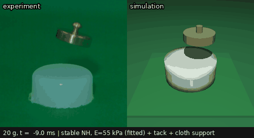
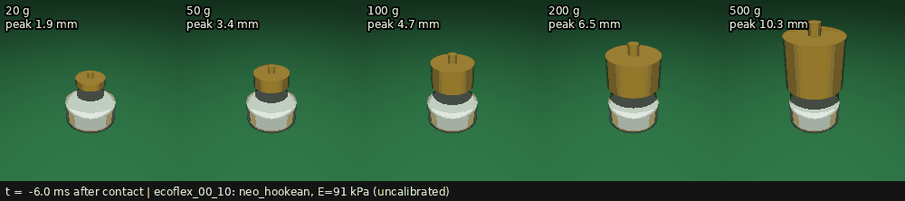

# softsim

Data-driven simulation of soft materials and soft robots, with pluggable physics
backends and validation against real experiments. The core is a pure Python
package; ROS 2 integration is a thin layer on top (milestone M2).

**Status: M1 (core + MuJoCo drop test).** ROS 2 layer, video tracking and
calibration, and the SOFA backend are planned; see [docs/roadmap.md](docs/roadmap.md).



*20 g weight dropped from 38 cm onto an Ecoflex 00-10 cylinder (D 40 × H 17 mm),
about 100× slow motion, aligned at first contact. Left: high-speed camera
recording from [Czopek et al., doi:10.5281/zenodo.23185808](https://doi.org/10.5281/zenodo.23185808)
(CC-BY-4.0, cropped and denoised). Right: softsim + MuJoCo flex with the
**uncalibrated** datasheet material. It is visibly too stiff (about 2 mm vs
about 4 mm peak indentation), which is what M3 calibration will fix. The real
weight also lands slightly tilted; the simulated one drops straight.*



*The five weights of the dataset (20–500 g) from the same YAML scenario,
switching one preset each. Regenerate both GIFs with
`python tools/make_readme_media.py` (needs `020gram.zip` in `data/raw/czopek2026/`
for the left panel).*

## Why

Gazebo has no deformable bodies, SOFA is powerful but hard to use from ROS,
and MuJoCo's new volumetric flex is fast but low-level. softsim adds:

- **Everything as data.** Materials, bodies, scenarios and sweeps are YAML with
  units (`"17 mm"`, `"55 kPa"`), strictly validated, so typos are errors.
  Backend models (MJCF) are generated, never hand-written.
- **Honest backends.** Each backend declares what it can simulate. A scene that
  needs, e.g., Mooney-Rivlin on MuJoCo is refused with the full list of gaps
  instead of silently running different physics.
- **Physics checks before every run**: contact compliance vs. impact speed,
  mesh resolution, volumetric locking, StVK under large compression, explicit
  stability limits, and density/mass consistency.
- **Validation first.** Every scenario produces metrics that are meant to be
  compared with experimental data (tracking and calibration in M3).

## Install

Python ≥ 3.10. On ROS 2 Humble, use a venv that can see the ROS packages:

```bash
python3 -m venv --system-site-packages .venv
.venv/bin/pip install -e ".[dev]"      # mujoco 3.17, gmsh, scipy, pytest
.venv/bin/python -m pytest              # ~20 s; add -m "not slow" to skip the slow ones
```

`numpy<2` is pinned so ROS 2 Humble's compiled Python modules keep working.

## Quick start

```bash
softsim materials                                   # list material presets
softsim check scenarios/drop_test/cases/w020.yaml   # mesh stats, physics findings, backend support
softsim run   scenarios/drop_test/cases/w020.yaml   # results in runs/<name>_<timestamp>/
softsim run   scenarios/drop_test/cases/w020.yaml \
    --set specimen.material.elastic.youngs_modulus="45 kPa" --set drop.tilt="[5 deg, 0]"
softsim view  scenarios/drop_test/cases/w050.yaml   # interactive MuJoCo viewer (slowed 200x)
softsim sweep scenarios/drop_test/sweeps/all_weights.yaml --jobs 5
softsim export scenarios/drop_test/cases/w020.yaml --out model.xml
```

From Python:

```python
from softsim import Simulation

sim = Simulation("scenarios/drop_test/cases/w020.yaml")
result = sim.run()
print(result.summary["peak_indentation"])
sim.set_material("specimen", {"preset": "ecoflex_00_10", "elastic": {"youngs_modulus": "40 kPa"}})
sim.action("drop", preset="czopek2026_w100", height=0.2)
state = sim.state()            # rigid poses/twists, soft vertices, contact wrenches
```

A run directory contains `config.yaml` (fully resolved and re-runnable),
`timeseries.parquet`, `summary.yaml` (summary, findings, versions, wall time)
and `model.xml`.

## Layout

```text
softsim/            core library (no ROS)
  config/           YAML loading (extends, --set overrides), units, strict schemas
  materials/        constitutive models + presets/*.yaml
  geometry/         soft and rigid primitives + rigid body presets
  meshing/          tetrahedral meshing (structured built-in, gmsh optional)
  scene.py          backend-neutral scene description
  backends/         Backend interface, MuJoCo flex backend, SOFA stub
  scenarios/        Scenario base class + drop_test
  checks/           pre-run physics checks
  runner.py         Simulation / run_config
  sweep.py, cli.py
scenarios/          scenario configs, cases and sweeps (data, not code)
data/               raw/ (not versioned) and processed/ experimental data
tools/              helper scripts (README media generation)
docs/               architecture, how-to guides, backend notes, media/
tests/
```

## Documentation

- [Architecture](docs/architecture.md)
- How to add a [material](docs/adding_a_material.md), [body](docs/adding_a_body.md),
  [scenario](docs/adding_a_scenario.md), [backend](docs/adding_a_backend.md)
- [MuJoCo backend: physics notes and limits](docs/backends/mujoco.md)
- [Drop test scenario and dataset](docs/scenarios/drop_test.md)

## Data and citation

The first validation scenario uses:

> Czopek P., Superczynska P., Marcinkowska A., Gajewski P., Bernat J.
> *Records of falling mass on Ecoflex 00-10 cylinder.* Zenodo.
> doi:[10.5281/zenodo.23185808](https://doi.org/10.5281/zenodo.23185808). CC-BY-4.0.

The dataset is not redistributed here. Download it into `data/raw/czopek2026/`.
To cite softsim itself, see [CITATION.cff](CITATION.cff).

## License

Apache License 2.0; see [LICENSE](LICENSE).
