# softsim

Data-driven simulation of soft materials and soft robots, with pluggable physics
backends and validation against real experiments. The core is a pure Python
package; ROS 2 integration is a thin layer on top (milestone M2).

**Status:** M1 (core + MuJoCo drop test), M2 (ROS 2 layer), M3 (video
tracking + calibration) and M4 (SOFA backend) are done. **M5, soft-material
fidelity, is in progress**; soft-robot actuation (pressure, cables, moving
mounts, rods) is working and verified against analytic solutions
([gallery below](#soft-robots)).

Backends:

- **MuJoCo flex:** the default, fast.
- **SOFA:** more material laws; optional install.
- **`fem`:** a locking-free 3D reference. Slow, but exact where the others
  are not, and it is the referee for them.
- **`rod`:** slender bodies reduced to beams on SOFA BeamAdapter. Runs the same
  YAML as the others, in seconds, with finite rotations.

See [docs/roadmap.md](docs/roadmap.md) for what's next.

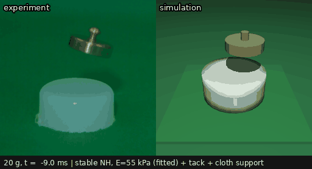

*20 g weight dropped from 38 cm onto an Ecoflex 00-10 cylinder (D 40 × H 17 mm),
aligned at the tracked contact: ~100× slow motion through the impact, then
2 ms per frame. Left: high-speed camera recording from
[Czopek et al., doi:10.5281/zenodo.23185808](https://doi.org/10.5281/zenodo.23185808)
(CC-BY-4.0, cropped and denoised). Right: softsim + MuJoCo flex with the
**calibrated** material and the measured impact speed, offset and spin. The
weight sticks to the tacky silicone and the specimen hops, dragging the cloth
under it (green plate), as in the recording. The fit reproduces the whole first
100 ms of the 20 g and 50 g drops (12–25% error); without the tack the weight
flies 7 cm high. The 500 g impact is not reproduced; see
[docs/experiments.md](docs/experiments.md) for what fits, what doesn't, and why.*

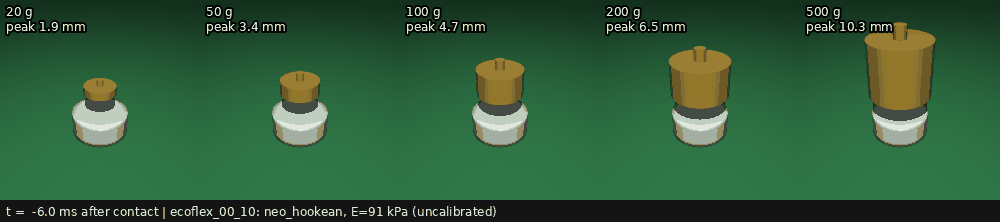

*The five weights of the dataset (20–500 g) from the same YAML scenario,
switching one preset each (nominal centred impacts; fitted tack and cloth
support). Regenerate both GIFs with
`python tools/make_readme_media.py` (needs `020gram.zip` in `data/raw/czopek2026/`
for the left panel).*

## Soft robots

The same YAML runs on every backend, and `softsim transfer` fits a cheap
backend's material to the reference so they agree. Each figure below is
regenerated by the command under it.

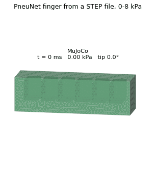

*A pneumatic finger imported from a STEP file, inflated 0-8 kPa (MuJoCo), then the camera
circles the final pose. Pressure acts on the cavity wall; the strain-limiting layer makes it curl.
`python tools/make_actuation_media.py --only pneunet`*

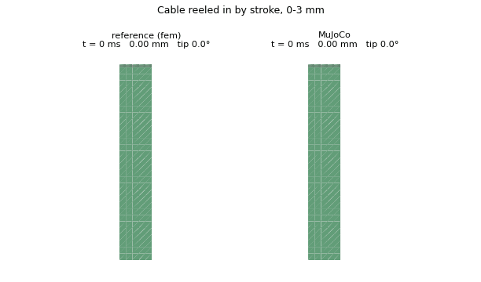

*A cable driven by stroke (reeled in 0-3 mm) rather than tension: the reference
and MuJoCo bend the same way.
`python tools/make_actuation_media.py --only stroke`*

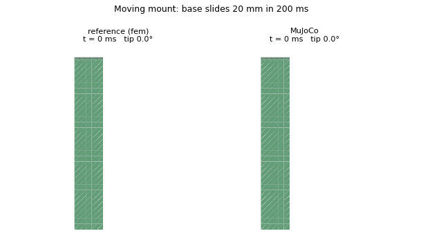

*A prescribed-motion mount: the base slides 20 mm in 200 ms and the soft body lags behind it,
on the reference and on MuJoCo.
`python tools/make_actuation_media.py --only mount`*

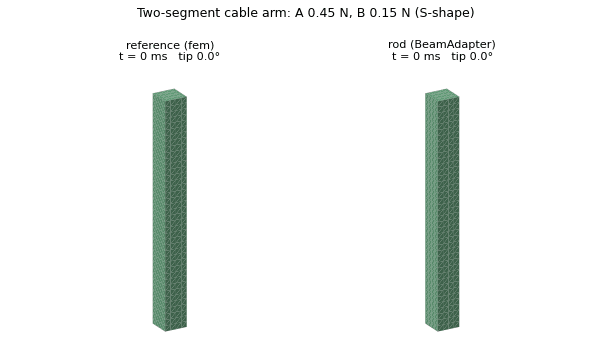

*Two cables ending in different stiff disks bend a soft column into an S; the camera then circles the final pose. The `rod`
backend (right) reduces the 3D mesh to beam frames and follows the 3D reference
(left): final tip tilt 13.6° against 13.3° (3 mm mesh, 500 ms).
`python tools/make_actuation_media.py --only arm`*

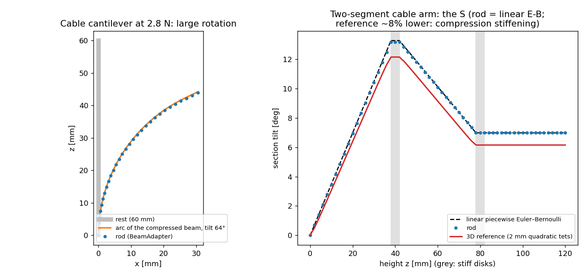

*A cable with an offset applies a pure moment, so the beam curls to a circle of known
angle, which a linear beam cannot reproduce. The rod follows the exact arc
(allowing for axial shortening) and the cable arm's tilt profile matches the
reference. `python tools/plot_rod.py`; details in [docs/backends/rod.md](docs/backends/rod.md).*

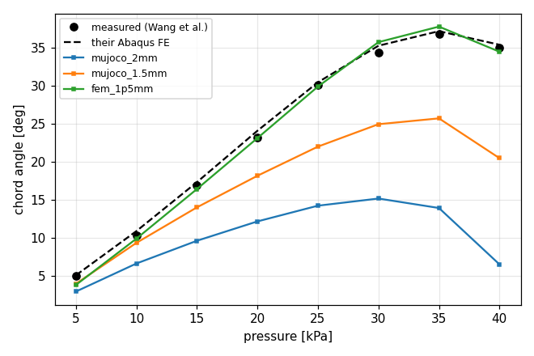

*A cast silicone finger (seven chambers, toothed constraint layer; geometry and Yeoh material from Wang et al.,
Actuators 2026, CC BY 4.0) against the angles the authors measured and their Abaqus result. The reference solver
is within 0.76° RMS of the measurements (paper's FE: 0.56°), including the peak near 35 kPa; a 1 mm mesh gives 0.95°, so
read it as agreement within about 1° of discretisation error. MuJoCo and SOFA do not reproduce this finger at 1–2 mm (8–16° RMS).
Slider viewers for the finger, PneuNet and arm: `docs/viewer/*.html`.
`softsim run scenarios/actuation/ribbed_finger.yaml --backend fem`, then `python tools/compare_wang_finger.py`;
details in [docs/actuation.md](docs/actuation.md).*

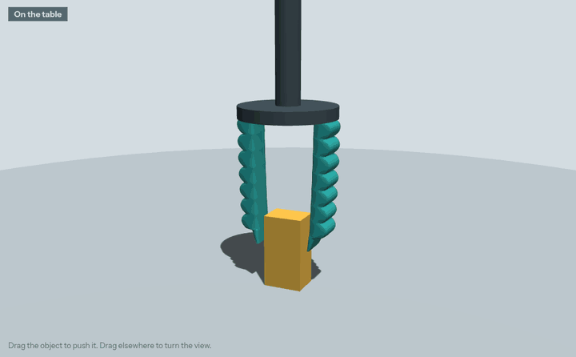

*Play with it: `xdg-open docs/viewer/gripper.html`, or double-click the file. It needs no server. A gripper built from
that finger runs live in your browser: pressure, mass and friction sliders, and a map of what it can hold. The live
finger is a chain of links fitted to the reference, within 5–7% on a tip load left out of the fit (9–27% on a load
spread along the pads).*

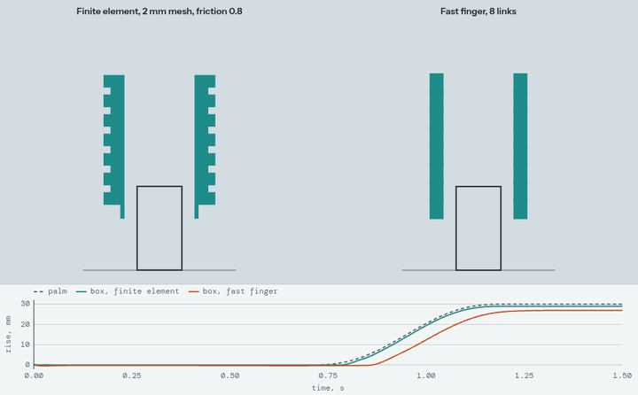

*The page's Truth tab replays a finite-element grasp beside the live model, both with friction 0.8. Both lift the 10 g box
almost at once and carry it, with grips within 8% while holding. A second finite-element run drops a 30 g box, as the fast
model does. Both runs are a coarse 2 mm finger, so every other held and dropped limit is the fast model's alone. Details and
commands in [docs/gripper.md](docs/gripper.md).*

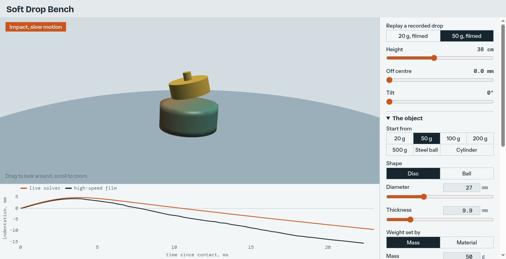

*Drop things in slow motion: `xdg-open docs/viewer/drop.html`. A live solver with the reference's Ecoflex card, nothing
fitted, beside the film's trace: filmed peaks within 12%, rebound too slow. Details in [docs/drop.md](docs/drop.md).*

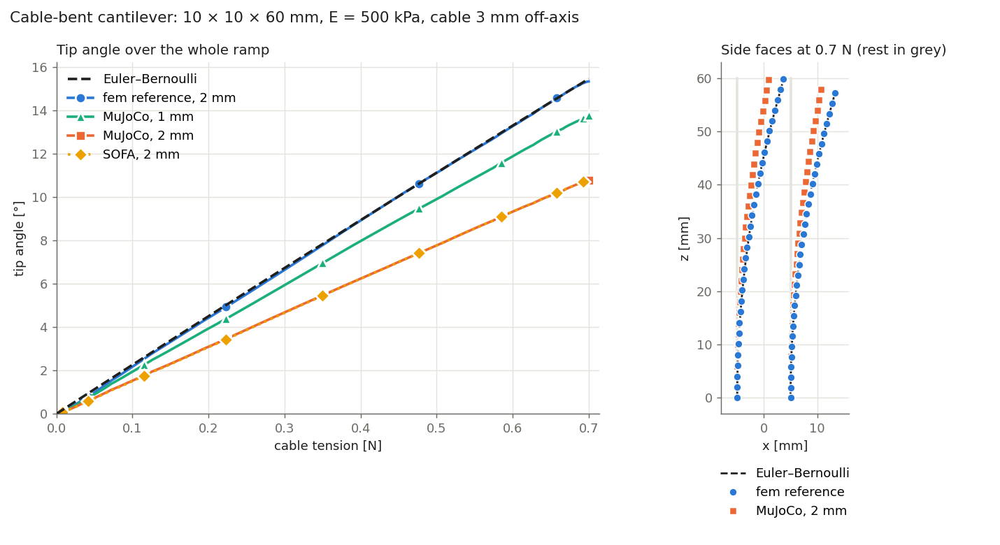

*A cable-bent cantilever against the Euler-Bernoulli solution: tip angle over the tension ramp, and the deformed beam.
See [docs/actuation.md](docs/actuation.md).*

## Why

Gazebo has no deformable bodies, SOFA is powerful but hard to use from ROS,
and MuJoCo's new volumetric flex is fast but low-level. softsim adds:

- **Everything as data.** Materials, bodies, scenarios and sweeps are YAML with
  units (`"17 mm"`, `"55 kPa"`), strictly validated, so typos are errors.
  Backend models (MJCF) are generated, never hand-written.
- **Honest backends.** Each backend declares what it can simulate. A scene that
  needs, e.g., Mooney-Rivlin on MuJoCo is refused with the full list of gaps
  instead of silently running different physics.
- **Physics checks before every run**: contact compliance vs. impact speed,
  mesh resolution, volumetric locking, StVK under large compression, explicit
  stability limits, and density/mass consistency.
- **Validation first.** Every scenario produces metrics that are meant to be
  compared with experimental data (see [docs/experiments.md](docs/experiments.md)).
- **Material cards, not magic numbers.** A card states whether it is
  *physical* (fitted to material tests) or *effective* (valid on one backend
  and mesh), its strain range, uncertainty and references. The library holds
  25 silicone cards fitted to public tension, compression and relaxation data.
  Fit your own with `softsim fit-material`. Carry a physical card to MuJoCo or
  SOFA by transfer, with the error bar stated
  ([docs/materials.md](docs/materials.md)).

## Install

Python ≥ 3.10. On ROS 2 Humble, use a venv that can see the ROS packages:

```bash
python3 -m venv --system-site-packages .venv
.venv/bin/pip install -e ".[dev]"      # mujoco 3.17, gmsh, scipy, pytest
.venv/bin/python -m pytest              # ~20 s; add -m "not slow" to skip the slow ones
```

`numpy<2` is pinned so ROS 2 Humble's compiled Python modules keep working.

**Reference FEM (optional).** `pip install -e ".[fem,fast]"` adds JAX (CPU,
float64) and MKL PARDISO for `softsim.fem`
([docs/reference_fem.md](docs/reference_fem.md)). This provides:

- the locking-free reference solvers (axisymmetric and 3D);
- the **`fem` backend** (`--backend fem`): slow but exact, for checking the
  other backends and fitting physical material cards;
- the material homogeneous tests and fitting ([docs/materials.md](docs/materials.md));
- Prony viscoelasticity on MuJoCo and SOFA.

**SOFA backend (optional).** Unzip the SOFA v26.06 Linux release (Python 3.10)
and point `SOFA_ROOT` at it; then add `--backend sofa` to any command. Without
it, the SOFA tests skip. See [docs/backends/sofa.md](docs/backends/sofa.md).

## Quick start

```bash
softsim materials                                   # list material presets
softsim material show ecoflex_00_10                 # one card: moduli, wave speeds, time steps, stresses
softsim material plot ecoflex_00_10 dragon_skin_10 --tests uniaxial,simple_shear   # needs the fem extra
softsim params scenarios/drop_test/cases/w020.yaml  # every changeable value: key, value, unit, range
softsim check scenarios/drop_test/cases/w020.yaml   # mesh stats, physics findings, backend support
softsim run   scenarios/drop_test/cases/w020.yaml   # results in runs/<name>_<timestamp>/
softsim run   scenarios/drop_test/cases/w020.yaml \
    --set specimen.material.elastic.youngs_modulus="45 kPa" --set drop.tilt="[5 deg, 0]"
softsim view  scenarios/drop_test/cases/w050.yaml   # interactive MuJoCo viewer (slowed 200x)
softsim sweep scenarios/drop_test/sweeps/all_weights.yaml --jobs 5
softsim sensitivity scenarios/drop_test/cases/w050.yaml --metric peak_indentation --jobs 8 \
    --param "specimen.material.elastic.youngs_modulus=30 kPa:150 kPa" --param "drop.height=0.2:0.4"
softsim export scenarios/drop_test/cases/w020.yaml --out model.xml
softsim track datasets/czopek2026_ecoflex_drop.yaml --jobs 5       # video tracking (needs the dataset zips)
softsim calibrate calibrations/ecoflex_00_10_drop.yaml --jobs 3    # fit E and damping to the recordings
softsim fetch datasets/roels2025_elastomers.yaml                   # public material-test data (checksummed)
softsim fit-material datasets/roels2025_elastomers.yaml ecoflex_00_30 --strain-min=-0.25 --strain-max 1.5
softsim material project ecoflex_00_30_roels2025 --to neo_hookean --out eco30_nh.yaml   # for MuJoCo
softsim run   scenarios/drop_test/cases/w050.yaml --backend fem \
    --set specimen.material=ecoflex_00_30_roels2025 --set simulation.duration=12ms      # 3D reference
softsim run   scenarios/drop_test/cases/w020.yaml --backend sofa \
    --set specimen.material=ecoflex_00_10_drop_fit_sofa_ogden --set specimen.mesh.size=5mm --set simulation.timestep=5e-5
```

From Python:

```python
from softsim import Simulation

sim = Simulation("scenarios/drop_test/cases/w020.yaml")
result = sim.run()
print(result.summary["peak_indentation"])
sim.set_material("specimen", {"preset": "ecoflex_00_10", "elastic": {"youngs_modulus": "40 kPa"}})
sim.set_material("specimen", None, ["elastic.model=yeoh", "elastic.c10=12 kPa"])  # change single values
sim.action("drop", preset="czopek2026_w100", height=0.2)
state = sim.state()            # rigid poses/twists, soft vertices, contact wrenches
```

### ROS 2

```bash
source /opt/ros/humble/setup.bash && source .venv/bin/activate
python -m colcon build --base-paths ros2 && source install/setup.bash
ros2 launch softsim_bringup softsim.launch.py config:=drop_test/cases/w050.yaml   # RViz
ros2 service call /softsim/action softsim_interfaces/srv/RunAction "{action: drop, arguments: '{mass: 0.1}'}"
```

The node publishes `/clock`, TF, poses and twists, soft-body point clouds and
meshes, contact wrenches, ground reaction and scenario metrics. Its services
cover reset, pause, save, material changes and scenario actions. See
[docs/ros2.md](docs/ros2.md).

A run directory contains `config.yaml` (fully resolved and re-runnable),
`timeseries.parquet`, `summary.yaml` (summary, findings, versions, wall time)
and `model.xml`.

## Layout

```text
softsim/            core library (no ROS)
  config/           YAML loading (extends, --set overrides), units, strict schemas
  materials/        material cards (laws, Prony, tack, validity, uncertainty) + presets/*.yaml,
                    homogeneous tests, fitting to test data, Prony overstress for backends
  geometry/         soft and rigid primitives + rigid body presets
  meshing/          tetrahedral meshing (structured built-in, gmsh optional)
  scene.py          backend-neutral scene description
  backends/         Backend interface, MuJoCo flex, SOFA, fem (3D reference solver)
  fem/              locking-free reference solvers: axisymmetric and 3D quadratic tetrahedra (JAX)
  reduced/          fast fingers: a chain of links with tables taken from the reference, as a MuJoCo model
  scenarios/        Scenario base class + drop_test
  checks/           pre-run physics checks
  experiments/      datasets (drop recordings, material tests), video tracking (incl. tilt),
                    sim-vs-experiment comparison, calibration, plots
  runner.py         Simulation / run_config
  sweep.py, cli.py
ros2/               softsim_interfaces, softsim_ros (generic node), softsim_bringup (launch, RViz)
scenarios/          scenario configs, cases and sweeps (data, not code)
datasets/           experimental dataset descriptions (DOI, camera, cases)
calibrations/       calibration configs
data/               raw/ (not versioned) and processed/ experimental data
tools/              helper scripts (README media generation)
docs/               architecture, how-to guides, backend notes, media/
tests/
```

## Documentation

- [Architecture](docs/architecture.md)
- [Materials: cards, changing any value, homogeneous test curves, fitting](docs/materials.md)
- [Material library: 25 silicone cards fitted to public tension, compression and relaxation data](docs/material_library.md)
- How to add a [material](docs/adding_a_material.md), [body](docs/adding_a_body.md),
  [scenario](docs/adding_a_scenario.md), [backend](docs/adding_a_backend.md)
- [MuJoCo backend: physics notes and limits](docs/backends/mujoco.md)
- [SOFA backend: setup, physics notes and limits](docs/backends/sofa.md)
- [Rod backend: slender bodies as beams (BeamAdapter)](docs/backends/rod.md)
- [Reference FEM (axisymmetric and 3D, locking-free; backend `fem`), performance and cross-checks](docs/reference_fem.md)
- [Drop test scenario and dataset](docs/scenarios/drop_test.md)
- [ROS 2 integration](docs/ros2.md)
- [Experiments: video tracking and calibration](docs/experiments.md)
- [Validation: predictions on data the model never saw](docs/validation.md)
- [Actuation: pressure and cable actuators, verified against the exact thick sphere and a cable-bent cantilever](docs/actuation.md)
- [Soft gripper: the live demo, the fast finger and what it can hold](docs/gripper.md)
- [Soft drop bench: drop things on the Ecoflex cylinder, beside the film](docs/drop.md)
- [Moving to a faster machine: setup, data to copy, long jobs](docs/new_machine.md)

## Data and citation

The first validation scenario uses:

> Czopek P., Superczynska P., Marcinkowska A., Gajewski P., Bernat J.
> *Records of falling mass on Ecoflex 00-10 cylinder.* Zenodo.
> doi:[10.5281/zenodo.23185808](https://doi.org/10.5281/zenodo.23185808). CC-BY-4.0.

The dataset is not redistributed here. Download it into `data/raw/czopek2026/`.
To cite softsim itself, see [CITATION.cff](CITATION.cff).

## License

Apache License 2.0; see [LICENSE](LICENSE).
