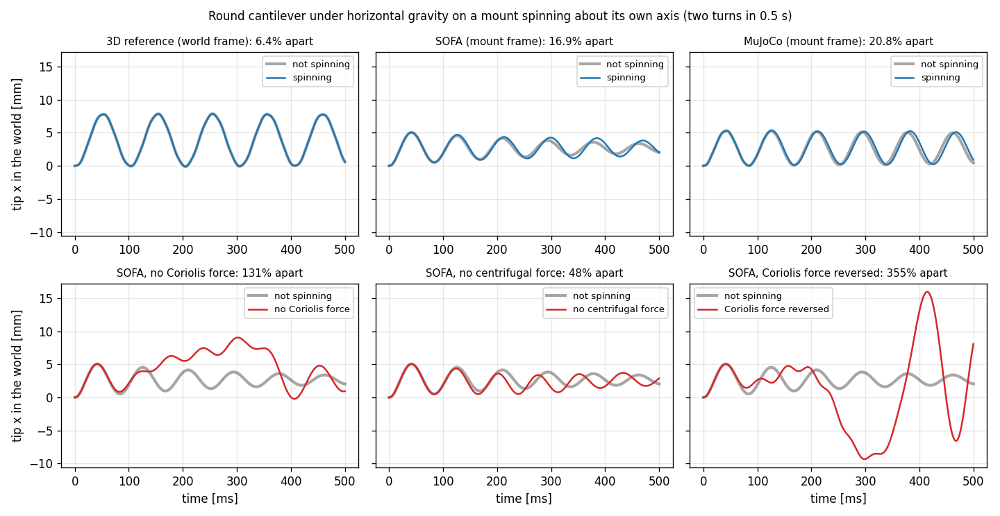
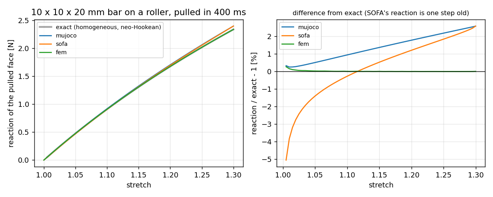

# Actuation (M6, in progress)

Three actuators so far: pressure on a surface region, cables routed through
the body (by tension or by stroke), and forces on a surface region. The fixed
regions can also follow a prescribed translation (a moving mount), and any
region can follow a prescribed path with its reaction reported (displacement
control). See
[roadmap.md](roadmap.md), M6. The scenario is `actuation` (`inflation`
is the same scenario under its first name).

## Regions

Every soft shape names its surface regions: sets of boundary triangles with
outward normals, found on the mesh from the shape's own geometry
(`softsim/geometry/soft.py`).

| Shape (`geometry.type`) | Regions |
| --- | --- |
| `cylinder`, `box` | `base`, `top`, `side` |
| `hollow_sphere` (`outer_diameter`, `inner_diameter`) | `cavity`, `outer` |
| `closed_tube` (`outer_diameter`, `inner_diameter`, `height`, `cap`) | `cavity`, `base`, `top`, `side` |
| `pneunet` (see [below](#a-pneunet-finger)) | `cavity`, `base`, `tip`, `bottom`, `top`, `side` |
| `cable_finger` (see [below](#a-cable-finger)) | `base`, `top`, `side`, `cable_side` |
| `mesh_file` (STEP, STL, OBJ, `.msh`, VTK; [adding_a_body.md](adding_a_body.md#soft-body-from-a-file-no-code)) | the file's named groups, `surface`, `cavity` (found by itself), boxes you name |

The hollow shapes are meshed with gmsh (`pip install softsim[mesh]`). Regions
fix vertices (`body.fixed: [base]` pins every vertex of the base) and carry
loads.

## Pressure actuators

```yaml
scenario: inflation
body:
  geometry: {type: closed_tube, outer_diameter: 20 mm, inner_diameter: 12 mm, height: 50 mm, cap: 4 mm}
  material: ecoflex_00_30
  fixed: [base]
actuators:
  - name: cavity
    region: cavity
    schedule: [[0 ms, 0 kPa], [100 ms, 3 kPa], [200 ms, 3 kPa]]   # linear in between, held after
```

A pressure actuator loads its region with gauge pressure `p`: the traction
`-p n` on the deforming surface (a follower load). Its value comes from the
schedule, or from a controller:

```python
sim = Simulation("scenarios/inflation/scenario.yaml")
sim.backend.set_control("cavity", 5e3)     # Pa, from the next step on
sim.backend.release_control("cavity")      # back to the schedule
sim.state().controls                       # {"cavity": ...}, the values in effect
```

From the CLI, any value can be changed as usual:
`--set actuators[0].schedule="[[0, 0], [0.1, 4000]]"`.

On ROS 2, `~/actuators/<name>/command` (std_msgs/Float64, Pa) sets the
pressure, NaN releases it, and `~/actuators/<name>/state` publishes the value in
effect ([ros2.md](ros2.md)).

The `inflation` scenario writes each actuator's pressure and cavity volume
(`<name>_pressure`, `<name>_volume`) and the body's extent at every sample, so a
run gives the actuator's pressure–volume curve directly.

### How each backend applies it

- **fem (reference):** the potential `-p V`, with `V` the volume the region
  encloses, integrated exactly on the quadratic faces. It is the consistent
  follower load with a symmetric tangent, so Newton stays quadratic. The
  pressure is the value at the end of the step (implicit). The region must be
  closed; an open region is refused, because `-p V` is then not the follower
  load.
- **MuJoCo, SOFA:** nodal forces `-p A n / 3` on the linear surface triangles,
  recomputed from the current positions before every step (explicit, through
  `xfrc_applied` and a `ConstantForceField`, like adhesion).

## Verification: thick hollow sphere

The exact solution for an incompressible Neo-Hookean sphere (radii `a < b`,
shear modulus `mu`) under internal pressure, at inner hoop stretch `la`, is
(`softsim.analytic.hollow_sphere_pressure`):

```text
p = 2 mu [(1/lb + 1/(4 lb^4)) - (1/la + 1/(4 la^4))],   lb^3 = 1 + (a/b)^3 (la^3 - 1)
```

It has a maximum, the limit pressure: 0.816 mu at `la` = 1.83 for `b = 2a`.
Above it, no inflated static state exists and a real balloon snaps through.

**Reference (one octant, symmetry planes, nu = 0.4995, 4 mm mesh):** the
inner stretch matches the exact solution within **0.1%** up to `la` = 1.62
(p = 0.8 mu), and the quasi-static solve fails above the limit pressure, as it
must (`tests/test_actuation.py`). The symmetry planes pass through the centre,
where `x . n = 0`, so `-p V` stays exact on the open octant.

**Thick tube with closed ends (Lamé, free axial extension).** The sphere is
the finite-strain case; this one checks the same load on a different geometry,
and the axial part of the closed cavity (its end walls carry the pressure
into the tube). For a tube of radii `a < b` at pressure `p`, `A = p a² / (b² − a²)`,
`B = A b²`: `σ_r = A − B/r²`, `σ_θ = A + B/r²`, `σ_z = A`, so

```text
u_r = [(1 − 2ν) A r + (1 + ν) B / r] / E,    ε_z = (1 − 2ν) A / E
```

(plane strain would have `ε_z = 0`, and a `(1 + ν)` larger `A` term). A
100 mm long tube of 10/20 mm (E = 100 kPa, ν = 0.3, 10 mm caps) at 200 Pa,
reference on the closed `closed_tube` body, measured over its middle (±12 mm
for the radial displacement, ±30 mm for the axial slope):

| Mesh | u_r(a) | u_r(b) | ε_z |
| --- | --- | --- | --- |
| 4 mm | −10.2% | −10.1% | −6.4% |
| 2.5 mm | −3.5% | −3.2% | |
| 1.8 mm | −1.5% | −1.4% | +0.3% |
| 1.3 mm | −0.5% | −0.4% | |

Second-order convergence to the exact values (`tests/test_actuation.py::
test_reference_matches_lame_closed_end_tube`, which runs 4 and 1.8 mm). The test
is sensitive: loading only the tube's cylindrical wall (no end-wall pressure)
gives an axial strain 79% too low and the outer wall 4.3% off. The four
mid-height nodes pinned against rigid-body motion are where the symmetric solution is
zero, so they do not disturb it. This replaces the open-lid plane-strain idea, which
the `−pV` load cannot close.

**Backends at the same card** (`python tools/compare_inflation.py`; 40/20 mm
sphere, Neo-Hookean E = 30 kPa, nu = 0.45, 3 kPa held):

| Model | Cavity V/V0 | Volume change vs reference |
| --- | --- | --- |
| **fem reference** (quadratic, 3 mm) | 1.3336 | – |
| MuJoCo, 3 mm | 1.2426 | **−27%** |
| MuJoCo, 2 mm | 1.2890 | **−13%** |
| SOFA, 3 mm | 1.2427 | **−27%** |
| Linear Lamé, ν = 0.45 | 1.2748 | −18% |
| Exact incompressible solution, μ = 10.3 kPa | 1.3354 | +0.5% |

- **The reference agrees with the exact finite-strain solution within 0.5%.**
  That solution is incompressible and the card has ν = 0.45, so this is a
  consistency check, not an exact comparison. Linear Lamé misses 18% of the
  volume change at this 33% inflation: at actuator pressures, finite strain
  matters.
- **MuJoCo and SOFA agree with each other to 0.01%, and both are 27% too
  stiff at 3 mm.** Two independent implementations agreeing shows the pressure
  load is right. The gap is volumetric locking of linear tetrahedra at
  ν = 0.45, as in the drop test ([reference_fem.md](reference_fem.md)).
- **Locking shrinks with the mesh** (−27% → −13% from 3 to 2 mm, about h^1.8),
  but slowly and at a high cost: 2 mm is 3.4× the elements. For a pneumatic
  actuator, either use a fine mesh, or fit an effective modulus for the fast
  backend at its mesh against the reference (as the drop transfers do,
  `calibrations/transfer_*.yaml`; for inflation this is still to be wired up).
  On a coarse linear-tet mesh, a physical card makes the actuator too stiff.

## Transfer: making a fast backend inflate like the reference

`softsim transfer` fits a fast backend's effective card at its mesh, so that
it reproduces the reference on chosen outputs. It then checks the fit on load
cases it never saw (`softsim/transfer.py`;
`calibrations/transfer_inflation_mujoco.yaml`, 9 evaluations, 11 min):

| Backend, 3 mm | E | Fitted: 3 kPa | Check: 1.5 kPa | Check: 4.5 kPa |
| --- | --- | --- | --- | --- |
| MuJoCo: physical card | 30 kPa | 20% | 19% | 22% |
| **MuJoCo: transferred** | **23.7 kPa** | **0.5%** | **1.2%** | **2.2%** |
| SOFA, 3 mm: physical card | 30 kPa | 20% | 19% | 22% |
| **SOFA, 3 mm: transferred** (`transfer_inflation_sofa.yaml`) | **23.6 kPa** | **0.9%** | **1.4%** | **2.4%** |

The error is the NRMSE of the cavity-volume history against the reference.

Re-run on 2026-11-03 after the MuJoCo step-timing fix: E 23.66 kPa, 0.5% / 1.2% / 2.2%, identical to the table.

- **One effective modulus is enough over a 3× range of pressure:** fitted at
  33% inflation, it holds at 15% and 52% inflation within 2.2%.
- **The softening is 21%,** close to the locking measured above (27% too
  little volume change). MuJoCo and SOFA need the same correction (23.7 and
  23.6 kPa), as expected for the same linear tetrahedra on the same mesh.
- **The result is an `effective` card** (`kind: effective`, with backend,
  mesh, element and check errors in its provenance). Use it only with that
  backend and mesh.

The identity test (`tests/test_actuation.py`) transfers MuJoCo to itself and
recovers the generating modulus within 1%.

## A bending actuator

`scenarios/inflation/bending.yaml` is a single-material bending actuator:
- an Ecoflex 00-30 tube, 16 mm wide and 40 mm tall, bonded at its base;
- an 8 mm cavity moved 2 mm off-axis (`cavity_offset`), so one wall is 2 mm
  thick and the other 6 mm.

The thin wall stretches more, so the tube curls towards the thick side. The
scenario reports the top face's tilt (`bend_angle`) and position (`tip_x`,
`tip_y`, `tip_z`).

| At 8 kPa, 2 mm mesh, same card | Bend angle | Tip shift | Cavity V/V0 |
| --- | --- | --- | --- |
| fem reference | 3.45° | −1.28 mm | 1.407 |
| MuJoCo | 2.16° (−37%) | −0.77 mm | 1.258 |

- **The bending is strongly nonlinear:** the reference bends 1.0° at 4 kPa and
  3.4° at 8 kPa.
- **Thin walls make locking worse:** MuJoCo is 37% too stiff even at 2 mm,
  because the 2 mm wall is a single element thick.
- **This shape needs `simulation.iterations: 300` on MuJoCo.** With the
  default of 100, the stiff flex's M+K solve stops at a residual of about 1e-7,
  and MuJoCo warns. The result doesn't change, but the config sets 300 so the
  run is clean.

**Transfer** (`calibrations/transfer_bending_mujoco.yaml`; fitted on the bend
angle and cavity volume from 0 to 8 kPa):

| MuJoCo, 2 mm | E | Fitted: 0–8 kPa | Check: 0–4 kPa |
| --- | --- | --- | --- |
| Physical card | 114 kPa | 23% | 18% |
| **Transferred** | **86.5 kPa** | **4.1%** (bend 3.1%, volume 5.1%) | **8.4%** |

The transfer helps, but less than on the sphere. One effective modulus can't
fully match a thin wall that locks differently as it stretches, so the error
at half pressure is twice the fitted one. For bending actuators on linear
tetrahedra, plan for an error bar of about 10% after transfer. Without the
transfer, it is about 20%.

## Cable actuators

```yaml
scenario: actuation
body:
  geometry: {type: box, size: [10 mm, 10 mm, 60 mm]}
  fixed: [base]
  ...
actuators:
  - name: cable
    type: cable
    path: [[3 mm, 0, 0], [3 mm, 0, 55 mm]]     # body frame: from the exit to the motor, to the anchor
    schedule: [[0 ms, 0 N], [400 ms, 0.7 N]]    # tension; or `tension: 0.5 N`
    # spacing: 2 mm                             # via points at most this far apart (default: mesh size)
    # anchor: top                               # spread the last point's load over this face (see below)
```

A cable is a tendon of tension `T` through via points along `path`. The via
points are embedded in the body's elements, so they act as frictionless guides
that move with the material. The motor sits on the body at the first point,
so the cable is internal: its net force and moment on the body are zero.
`set_control("cable", 0.3)` and ROS `~/actuators/cable/command` set the tension
in N. A cable can only pull, so a negative tension is refused.

The load is the potential `T L(x)`, where `L` is the cable's length through the
via points:
- **fem (reference):** in the implicit solve. Via points use the elements'
  quadratic shape functions. The tangent is `T w w^T (I - u u^T) / l` per
  segment, symmetric and PSD, so Newton stays robust.
- **MuJoCo, SOFA:** the same forces `-T dL/dx` on the linear elements'
  vertices, recomputed before every step (`softsim.actuation.cable_forces`).
  They are explicit, so `softsim check` compares the cable's string stiffness
  `T (1/l1 + 1/l2)` with the vertex masses at the timestep. It warns or refuses,
  as for adhesion: tight via-point spacing at high tension needs a smaller
  timestep, or a larger `spacing`.

The scenario reports `<name>_tension` and `<name>_length` (the current length
through the via points), and in the summary the cable's stroke (how far it was
pulled in).

### Verification: cable-bent cantilever

`scenarios/actuation/cable_cantilever.yaml`:
- a 10 × 10 × 60 mm beam, Neo-Hookean E = 500 kPa, ν = 0.45, clamped at its
  base, no gravity;
- a cable 3 mm off-axis, anchored at L = 55 mm.

Below the anchor the cable puts a pure moment `T d` on the beam. Euler–Bernoulli
then gives a circular arc whose tip angle is exact at any rotation:

```text
theta = T d L / (E_t I),   E_t = E (1 + 2 T / (E A))
```

`E_t` is the Neo-Hookean tangent under the axial pre-compression `T / (E A)`
that the cable also applies: 2.8% stiffer at 0.7 N.

**The reference matches it within 0.3%** at 0.1 and 0.7 N (0.04 and 0.27 rad,
quasi-static, 2.5 mm; `tests/test_cable.py`). Two things the check taught:
- **Without `E_t`, the error grows with the load** (−2.4% → −5.2% over the same
  range). It halves on a beam twice as long at the same tip angle, so it scales
  with strain, not rotation: material nonlinearity, as the formula says.
- **Anchor the cable inside the body, not at a point on the face where you
  measure.** A point anchor on the top face dents it, and the face's tilt then
  reads 4–6% low. Anchored 5 mm below, the top face rotates rigidly with the
  beam; or spread the anchor over the face, next.

### Anchor spread over a face

`anchor: <region>` makes the last path point (it must lie on that boundary
region, e.g. `top`) not a point load but a traction over the region: the linear
traction with the same resultant and moment, i.e. nodal weights `w_j` with
`sum w_j = 1` and `sum w_j x_j = ` the anchor point (`softsim.actuation.anchor_weights`).
A cable pulling the end by `F` loads the face with `w_j F`, so the end section
carries a force `F` and a moment about the point just as the point load would,
without the singularity. On a quadratic mesh the weights are the consistent
nodal loads (mid-edge nodes included); on the linear meshes of MuJoCo and SOFA
they are the corner nodes' shares. The cable length under stroke control then
ends at the weighted point `sum w_j x_j`, which moves with the face.
A cable 3 mm off the axis of a 10 mm section is outside the section's core
(1.7 mm), so some weights are negative: tension on the far side, as beam theory
has it.

**Verification** (reference, 2.5 mm quadratic, cable to the top face at
L = 60 mm, `scenarios/actuation/cable_cantilever_anchored.yaml`;
`tests/test_cable.py`, run `python -m pytest tests/test_cable.py -k anchor`):

| Case | Tip angle vs Euler–Bernoulli | Stroke 0.3 mm: tension / angle | Stroke 3 mm: tension / angle |
| --- | --- | --- | --- |
| **anchor: top** (0.7 N) | +0.27% (2.5 mm), −0.44% (1.25 mm) | +0.3% / +0.4% | +0.5% / +0.7% |
| point anchor on the face | −2.6% (2.5 mm); Newton fails at 1.25 mm | −19% / −21% | −18% / −20% |

On the linear-tet backends (2 mm, 0.7 N) the angle is far under Euler–Bernoulli
because of locking, as in the tension table above (MuJoCo 0.205 rad, SOFA
0.205 rad, 70% of 0.294), but the spread anchor raises it by the same 2.6%
over a point anchor (0.200 rad) as on the reference (+2.9% at 2.5 mm):
`scenarios/actuation/cable_cantilever_anchored.yaml --backend mujoco|sofa`.

The stroke columns need no stiff cap now. Corner-node-only weights on the
quadratic mesh (not the consistent load) read +2.7% in the first column.


*Left: tip angle over the whole ramp. Right: the side faces at 0.7 N, the
reference and MuJoCo (2 mm) against the theoretical arc (`python
tools/plot_cable.py`).*

**Backends at the same card** (`python tools/compare_cable.py`; tip angle,
error against Euler–Bernoulli with `E_t`):

| Model | 0.35 N | 0.7 N | vs reference |
| --- | --- | --- | --- |
| Euler–Bernoulli | 7.83° | 15.45° | |
| **fem reference**, 2 mm, dynamic | 7.78° (−0.7%) | 15.34° (−0.7%) | – |
| MuJoCo, 2 mm | 5.46° (−30%) | 10.79° (−30%) | −30% |
| SOFA, 2 mm | 5.45° (−30%) | 10.79° (−30%) | −30% |
| MuJoCo, 1 mm (via points 3 mm apart) | 6.96° (−11%) | 13.74° (−11%) | −10% |

- **The reference is right in dynamics too:** a 400 ms ramp against the beam's
  10 Hz mode is quasi-static, and the dynamic run agrees with the quasi-static
  solve.
- **MuJoCo and SOFA agree with each other to 0.1% and bend 30% too little at
  2 mm.** Linear tetrahedra lock in bending: 5 elements across a 10 mm beam,
  ν = 0.45. The error is the same at both tensions, so one effective modulus
  fixes it (`softsim transfer`, as for pressure). At 1 mm it is 10%.
- **On MuJoCo and SOFA, choose the via-point spacing from the check, not the
  mesh.** On the 1 mm mesh at 1 mm spacing (ω·dt ≈ 1.4), MuJoCo tracks the ramp
  up to 0.6 N, then rings between 14° and 18° instead of settling. Halving the
  timestep only takes ω·dt to 1.15, because the implicit elastic stiffness
  already dominates the step. Spacing the via points 3 mm apart (ω·dt ≈ 0.8)
  runs clean. The cable path is straight, so it follows the beam just as well.

### Stroke control: a servo reeling the cable in

```yaml
actuators:
  - name: cable
    type: cable
    control: stroke                              # the value is a length, not a tension
    stiffness: 300 N/m                           # the tendon's (or servo's) axial stiffness
    path: [[3 mm, 0, 0], [3 mm, 0, 58 mm]]
    schedule: [[0 ms, 0 mm], [400 ms, 3 mm]]     # stroke; or `stroke: 2 mm`
```

A stroke-controlled cable is a tendon of stiffness `k` and free length
`L0 - s`: `L0` is its length at rest, `s` the stroke the motor has reeled in.
It pulls with `T = k max(L - L0 + s, 0)` and is slack when shorter. With a stiff
tendon the stroke sets the cable's shortening (1e5 N/m: 1 mm of stroke shortens
it by 0.996 mm), and the tension follows from the body. `set_control` and ROS
take the stroke in m. A negative stroke pays the cable out.
- **fem (reference):** `k/2 (L - L0 + s)^2` while taut, in the implicit solve.
  The tangent adds `k dL dL^T`, which couples the whole cable, so the stiff
  limit stays robust.
- **MuJoCo, SOFA:** `T` from the current length before every step, then the
  usual cable forces. The check adds the tendon's axial term
  `k sum |dL/dx|^2 / m` to the string stiffness. At 0.1 ms on the 2 mm beam,
  300 N/m runs clean and 3000 N/m is refused (ω·dt = 1.45). A stiff tendon
  needs the reference, or a compliant one standing in for the servo.

The scenario reports `<name>_command` (the stroke) and `<name>_tension`, which
follows from the current length.

**Anchor a stroke-controlled cable in something stiff, or spread over a face
(`anchor:`, above).** A cable ending at a
point inside the soft body pulls that point into the material. A point load is
singular, so how far it moves depends on the mesh, and under stroke control
that local give counts as cable shortening: 10% less tension and tip angle
here. `scenarios/actuation/cable_cantilever_stroke.yaml` anchors the cable
3 mm into a 5 mm tip cap (a 50 MPa zone), as a real finger anchors its tendon
in a rigid tip.

**Verification:** Euler–Bernoulli puts the beam's compliance along the cable in
series with the tendon (`softsim.analytic.cable_beam_stroke`):
`s = T/k + L (a^2 T / (E_t I) + T / (E A))`. The axial term is as large as the
bending term on this beam.

| Model, 2 mm | 0.3 mm: tension | 0.3 mm: tip angle | 3 mm: tension | 3 mm: tip angle |
| --- | --- | --- | --- | --- |
| Euler–Bernoulli | 0.0534 N | 1.209° | 0.536 N | 11.91° |
| **fem reference** (2.5 mm, quasi-static) | 0.0537 N (+0.5%) | 1.204° (−0.4%) | 0.540 N (+0.8%) | 11.90° (−0.1%) |
| fem, point anchor, no cap | 0.0480 N (−10%) | 1.084° (−10%) | 0.483 N (−10%) | 10.71° (−10%) |
| MuJoCo | | | 0.584 N (+9%) | 8.79° (−26%) |
| SOFA (1 ms) | | | 0.584 N (+9%) | 8.79° (−26%) |

MuJoCo and SOFA agree to 0.01%. Their beam is too stiff (the locking of the
tension-controlled table), so the same stroke takes more tension and bends it
less. The stroke run's equilibrium is the tension run's at the tension it
found (`tests/test_cable.py`).

## A cable finger

`geometry: {type: cable_finger, ...}` is a tendon-driven finger: a block
(`width` × `depth` × `length`, base at z = 0, centred on the z axis) cut into
`segments` links by `segments − 1` transverse slots (`slot_width` along z,
`slot_depth` into the +x face). The tendon runs along z at `tendon_offset` from the +x
face, through the web the slots leave (`tendon_offset > slot_depth` is checked), and
pulls that side shut: the finger curls towards +x. `path: geometry` on the cable
takes this path from the shape, and `anchor: top` spreads its end over the tip face
(above). With `segments: 1` the finger is a plain beam. The shape writes CAD like the
others (`softsim export ... --cad`). `scenarios/actuation/cable_finger.yaml`:

```yaml
body:
  geometry: {type: cable_finger, length: 60 mm, width: 12 mm, depth: 10 mm, segments: 4,
             slot_width: 3 mm, slot_depth: 3 mm, tendon_offset: 4.5 mm}
  material: {preset: ecoflex_00_30, damping: null}   # E = 114 kPa
  mesh: {size: 1.5 mm, method: gmsh}
  fixed: [base]
actuators:
  - {name: cable, type: cable, path: geometry, anchor: top, schedule: [[0 ms, 0 N], [400 ms, 0.2 N]]}
```

**Verification** (reference, quasi-static, 0.2 N, tip-face rotation;
`tests/test_cable_finger.py`):
- **The mesh is the geometry:** the tetrahedra's volume is the block minus the slots, to
  rounding (relative 1e-9); the slots sit at the segment boundaries; base, top, side
  and cable-side regions are where they should be; the tendon runs through solid
  along its whole length.
- **One segment is Euler–Bernoulli:** `theta = T d L / (E_t I)` (`softsim.analytic.cable_beam_tip_angle`,
  d = 1.5 mm) is 0.1065 rad; the reference gives 0.1055 (2.5 mm, −0.9%) and 0.1051 (1.5 mm, −1.4%).
- **The slots add compliance, and the 1-D model understates it:** the four-link finger
  rotates 0.2677 rad (2.5 mm) and 0.2664 rad (1.5 mm; the mesh changes it by 0.5%), 2.54 times the plain
  beam. A beam with plane sections through each slot (the web's own centroid and
  moment of inertia) predicts 1.55 times: the slots are short for their depth, and
  the material beside them takes part. Treat that estimate as a lower bound, not a prediction.
- **Direction and ordering:** a deeper slot (3.5 mm) rotates more; MuJoCo bends towards the tendon.

Reproduce: `python -m pytest tests/test_cable_finger.py`, or
`softsim run scenarios/actuation/cable_finger.yaml --backend fem --set simulation.timestep=2ms`.

## A two-segment cable arm

`scenarios/actuation/cable_arm.yaml` is a continuum arm made from features
already described: a 12 × 12 × 120 mm Ecoflex 00-30 column with two stiff
disks (50 MPa zones, 4 mm, at z = 38–42 and 78–82 mm) and two cables on opposite
sides (x = ±4 mm). Cable A ends in the lower disk, cable B passes through it
and ends in the upper one, as in a tendon-driven arm with spacer disks.

The lower segment carries both moments, `(T_A − T_B) d`, under the axial force
`T_A + T_B`; the upper one only B's, `−T_B d`; the disks are rigid and the tail
above the second disk is unloaded. Euler–Bernoulli per soft length,
`θ = Σ M L / (E_t I)` with `E_t = E (1 + 2N / (E A))`, predicts 0.2157 rad
after the first segment and 0.1080 rad at the tip (T_A = 0.45 N, T_B = 0.15 N). The
reference (2 mm quadratic, quasi-static) gives 0.2119 rad (−1.8%) and 0.1074 rad
(−0.6%): the arm bends one way below the first disk and back above it (an S),
the disks turn rigidly, and the tail stays straight. With cable B ending in the
first disk instead, nothing bends the upper segment and the whole arm above the
disk is straight (`tests/test_cable_arm.py`).

MuJoCo (2 mm, 0.1 ms, 20 min for 0.5 s because the stiff disks make the flex
ill-conditioned) ends at a tip rotation of 0.161 rad and a tip displacement of 17.9 mm,
against the reference's 0.107 rad and 14.9 mm. This is an observation, not a
comparison: the beam is undamped and still swinging at 500 ms (the tension
ramp ends at 400 ms), and the tip rotation is the difference of two segment
rotations, each affected by linear-tet locking, so a quasi-static run with the
transferred modulus would be needed to say anything. Not done.

The **rod backend** ([backends/rod.md](backends/rod.md)) runs this arm in seconds and gives the linear
piecewise Euler–Bernoulli S (0.2298, 0.1221 rad); the reference sits 8% lower from the compression stiffening.

## Region forces

```yaml
actuators:
  - name: tip_force
    type: force
    region: top                 # any surface region
    direction: [1, 0, 0]        # world frame, normalised
    schedule: [[0 ms, 0 mN], [400 ms, 5 mN]]     # total force [N]; or `force: 5 mN`
```

A total force along a fixed direction, spread over a surface region by area:
a dead load, such as a payload or a probe pressing on a fingertip. A negative
force pushes the other way.
- **fem (reference):** the consistent load of a uniform traction on the
  quadratic faces. It is all on the mid-edge nodes, a third of each face's
  area each.
- **MuJoCo, SOFA:** a third of each triangle's share to each of its vertices.

It doesn't depend on positions, so it needs no stability check. Outputs:
`<name>_force` and `<name>_displacement`, the region's area-weighted centre
moving along the force. Force against displacement is the body's stiffness
there.

**Verification:** `scenarios/actuation/tip_load_cantilever.yaml`, the beam
above with 5 mN on its top face. Euler–Bernoulli gives 0.864 mm. Timoshenko
adds 2.4% of shear (0.884 mm,
`softsim.analytic.cantilever_tip_deflection`). The reference converges to
0.870, 0.867, then 0.864 mm at 2.5, 2 and 1.25 mm (`tests/test_region_force.py`),
between the two. On this short beam (L/h = 6), the fully clamped root (no
warping, no Poisson contraction) offsets the shear. On MuJoCo and SOFA, the
vertex forces sum to the commanded force exactly. Both deflect 0.602 mm at
2 mm, 30% stiff: the locking of the cable tables, now under a known force.

## Moving mount

```yaml
body:
  fixed: [base]
  mount_path: [[0 ms, [0, 0, 0]], [200 ms, [20 mm, 0, 0]], [400 ms, [20 mm, 0, 10 mm]]]
```

The fixed regions follow a prescribed translation, such as a finger on a robot
arm. Waypoints are displacements from rest (the first is zero). Between
waypoints the mount moves point to point with minimum jerk: at rest at every
waypoint, continuous acceleration, no overshoot. After the last one it holds.

Every backend simulates in the mount's frame. For a translation that is exact:
the pinned vertices stay put, and every element feels the inertial force
`-rho a(t)`, so gravity becomes `g - a(t)` (`Backend.mount_gravity`, set before
every step). Positions and velocities are reported in the world, with the
mount's added back (`Backend._to_world`). A rotating mount would also need
centrifugal and Coriolis terms, and the ground and rigid bodies would have to
move with the frame, so those are refused.

**Verification:** the reference run two ways on
`scenarios/actuation/moving_mount.yaml` (the beam, its base sliding 20 mm in
200 ms):
- in the mount's frame;
- in the world, with the base nodes driven along the path
  (`Solid3DSolver.fixed_motion`, Newmark-consistent).

With the trapezoidal rule the tip trajectories agree to 0.10% of the tip's lag
at 2 ms and 0.026% at 1 ms. That is second order: the two formulations converge
to one solution (`tests/test_moving_mount.py`). With the default numerically
damped Newmark (first order) the gap is 2.2% at 2 ms and halves with the step.
On MuJoCo and SOFA the base vertices follow the path exactly, and the tip lags
while the mount accelerates.

| Model, 2 mm | Tip's peak lag | Swing after the mount stops |
| --- | --- | --- |
| **fem reference** (2 ms) | 2.15 mm at 64 ms | 0.51 mm |
| MuJoCo | 1.47 mm (−32%) at 56 ms | 0.94 mm |
| SOFA (1 ms) | 1.40 mm (−35%) at 56 ms | 0.75 mm |

The locked beams of MuJoCo and SOFA are stiffer, so they lag about a third
less and ring at a higher frequency. The swing left after the stop depends on
where in its cycle the beam is when the mount stops, so it differs more.
SOFA's implicit Euler also damps it.

**Closed-loop control from Python:** `Simulation.run(controller=f)` calls
`f(sim)` before every output interval. `f` reads `sim.time`, `sim.metrics()`
and `sim.state()`, and returns the actuator values to hold, `{name: value}`;
NaN hands an actuator back to its schedule (`Simulation.apply_controls`). In
`tests/test_cable.py`, a PI loop on the cable tension holds the lightly damped
beam at a 0.1 rad tip angle on MuJoCo, within 3%.

## Rotating mount

```yaml
body:
  fixed: [base]
  mount_rotation:                      # composes with mount_path
    axis: [0, 1, 0]                    # normalised
    center: [0, 0, 0]                  # a point of the axis (rest frame)
    path: [[0 ms, 0 deg], [300 ms, 90 deg], [800 ms, 0 deg]]   # angle from rest, minimum jerk
```

The fixed regions turn about an axis, such as a finger on a spinning arm or a
gripper wrist. In the mount's frame every point feels, per unit mass, gravity
`R^T (g - p'')` and the fictitious accelerations `-alpha x r - omega x (omega x
r) - 2 omega x v` (Euler, centrifugal, Coriolis), with `r` measured from the
centre (`softsim.scene.MountFrame`; `MountFrame.fictitious` and `.gravity` are
used by every backend). Positions and velocities are reported in the world.

| Backend | Frame | How |
| --- | --- | --- |
| MuJoCo | the mount's | gravity rotated each step, the three forces `m a` as explicit vertex forces at the step's middle |
| SOFA | the mount's | the same, in a `ConstantForceField`, at the step's end like gravity |
| fem (reference) | the **world** | the pinned nodes follow `R (X - c) + c + p` exactly: no fictitious forces to get wrong. Trapezoidal rule |

Only waypoint paths are available (the rate is zero at every waypoint), so no
constant-rpm spin yet. Region forces and prescribed regions are refused with a
rotating mount: their directions are world directions and would have to turn
with the frame.

**Verification**, five independent checks (`tests/test_rotating_mount.py`,
figure `docs/media/rotating_mount.png`, `python tools/plot_spin.py`):

1. **The terms.** A free particle moves on a known world trajectory. The same
   path in the mount's frame, differentiated numerically twice, gives the
   acceleration `MountFrame` says it has. Any wrong sign or factor of Euler,
   centrifugal, Coriolis or the rotated gravity fails it (5 mutants).
2. **The plumbing.** From the state a backend reports, with a tilted axis through
   an off-centre point, the force it applied to each vertex equals `m` times that
   acceleration to 2e-4, on MuJoCo and SOFA (mutants: the skin offset, the
   frame's time, the mass). A velocity left unrotated is an equivalent mutant:
   an unrotated body's vertex axes are the world's.
3. **Centrifugal stretch.** A beam spinning about an axis across it, at 60 rad/s
   without angular acceleration, stretches by `rho w^2 L^3 / (3 E)` = 0.555 mm:

   | Model | Stretch against that | Lateral deflection |
   | --- | --- | --- |
   | reference, 5 ms / 2.5 ms | +3.35% / +2.83% (+2.7% extrapolated, the 3D rod against the 1D formula) | 0.39 / 0.12 mm |
   | MuJoCo | -1.6% | 0.01 mm |
   | SOFA | -2.3% | 0.01 mm |
   | reference, default Newmark (damping 0.25), 5 ms | **-32%** | **4.6 mm** |

   The default scheme's numerical damping dissipates the rotation's centripetal
   balance, so a rotating mount uses the trapezoidal rule (second order: the
   lateral deflection falls 3.2x when the step is halved).
4. **The Euler force.** From rest, the beam's tip is left behind: when a rigidly
   turning tip would have moved 1 mm (3.3 ms, before the elastic signal from the
   clamp arrives), it has moved 0.0% of that on the reference, 4.2% on MuJoCo
   and 21.7% on SOFA (the cause is not investigated). Without the force it
   moves 100%.
5. **Spinning is invisible to a round beam.** A round beam bends alike in every
   direction, so in the world its tip moves as without the spinning clamp, whatever
   its stiffness: the rotated gravity, centrifugal and Coriolis forces must all be
   right. The beam of `scenarios/actuation/spinning_cantilever.yaml` spins
   twice in 0.5 s under horizontal gravity:

   

   Largest tip difference from the not spinning run, as a fraction of the sag:

   | Model | Difference |
   | --- | --- |
   | reference (world frame, 2.5 ms) | 6.4% |
   | MuJoCo, 3 mm elements | 20.8% |
   | SOFA, 3 mm elements | 16.9% |
   | SOFA without the Coriolis force | 131% |
   | SOFA without the centrifugal force | 48% |
   | SOFA, Coriolis force reversed | 355% |
   | SOFA, centrifugal force reversed | 70% |

   The 17-21% of MuJoCo and SOFA is not the forces (check 2) but their
   linear tetrahedra, in two parts. (a) At 3 mm the mesh is anisotropic: the
   beam sags 4.2% differently along different directions (0.3% at 1.5 mm), and
   a spinning beam at 0.7 of its bending frequency amplifies that. (b) Implicit
   Euler damps a mode by an amount that depends on its frequency in the
   integrated frame; the two whirl components have other frequencies in the
   mount's frame than the still beam's, so they decay differently. On the 2 mm
   mesh, SOFA's difference is 9.6, 7.3 and 6.3% at steps of 1, 0.5 and 0.25 ms.
   Across meshes at 1 ms: 23.9% (4 mm), 16.9% (3 mm), 9.6% (2 mm), 11.1%
   (1.5 mm).

**The reference's step.** The undamped trapezoidal rule is only reliable for a
small rotation per step. On this beam, at 2.5 ms (0.11 rad per step at the peak
rate) the reference agrees with the still run (6.4%, the same bending frequency
to four digits). At 5 ms (0.23 rad per step) a whirl grows: 6 mm lateral
deflection, and the run-to-run scatter of the GPU's rounding gives anything from
31% to 198% apart (three identical runs). The stability check warns above 0.15 rad per step
(`spin-step`) and when the centrifugal strain `rho w^2 r^2 / 3E` of the
farthest point exceeds 20% (`spin-centrifugal`: a soft beam spun fast enough has
no equilibrium).

## Prescribed region motion (displacement control)

```yaml
body:
  prescribed:                    # any surface region, along its own path
    - {region: base, path: [[0 ms, [null, null, 0]], [300 ms, [null, null, 0]]]}   # a roller: held in z only
    - {region: top,  path: [[0 ms, [null, null, 0]], [200 ms, [null, null, 2 mm]]]}
```

Every vertex of a region moves along `path` (waypoints from rest, minimum
jerk, held after the last; with a moving mount it is relative to the mount).
`null` leaves an axis free in every waypoint. This is the grip of a tension
test, a probe pressing in, or a servo-driven clamp. The reaction is what the
motion needs, which a force actuator can't tell you. Outputs, per held axis:
`<region>_reaction_<axis>` [N], the force the support exerts on the body, and
`<region>_displacement_<axis>` [m], the region's centroid motion.

| Backend | How | Reaction |
| --- | --- | --- |
| fem (reference) | the region's dofs (vertices and the mid-edge nodes between them) are fixed to the path at each step's end | the converged residual at those dofs: `sum(M a) - weight` for a free body, exact to Newton's tolerance |
| MuJoCo | a joint equality per held axis of each vertex, `timeconst` 2 steps, the path's velocity fed forward | the sum of their constraint forces |
| SOFA | `PartialLinearMovementProjectiveConstraint` with a key per step | `sum m dv/dt - f` over the region, **one step back**: approximate in fast motion |

Details that were measured, not assumed:
- A MuJoCo soft constraint trails a moving target by `2 timeconst v`
  (0.75 um on a 200 um pull in 0.2 s, measured on a bar with direct joint
  equalities). Feeding the velocity forward cancels it: 0.006 um. The tracking
  test allows 0.04 um and fails without the feed-forward.
- SOFA's constraint takes the key of the step's *start* time, so each key holds
  the path at the step's end. Without the shift the region trails by a step
  (9.4 um at 94 mm/s and 0.1 ms).
- On a rotated body MuJoCo's vertices slide along the body's axes, so holding
  only some world axes is refused.

**Verification:** `scenarios/actuation/tension_test.yaml`, a 10 x 10 x 20 mm
bar on a roller pulled 10% in 200 ms. The state is homogeneous uniaxial stress,
which every element type represents exactly, so the reaction per area is the
material's nominal stress at stretch 1.1
(`softsim.materials.homogeneous.curve`, `tests/test_prescribed.py`):

| Model | Pull at 10% | Against the exact 0.908919 N |
| --- | --- | --- |
| **fem reference** (neo-Hookean) | 0.908919 N | 1e-7; at 30% stretch 1e-5, with the sideways contraction 0.9582 on every vertex to 1e-8 m |
| MuJoCo (stable neo-Hookean) | 0.917325 N | +0.92% |
| SOFA (stable neo-Hookean) | 0.917381 N | +0.93% |

MuJoCo and SOFA agree to 6e-5. Their stable neo-Hookean law is 0.9% stiffer
than the split neo-Hookean of the reference at 10%, a difference in the law,
not locking (a uniform stretch cannot lock). On every backend, a force
actuator on the top face with the force the displacement run reported
stretches the bar by the prescribed 2 mm to 0.2%: the reaction is the force
the motion needs.



`tools/plot_tension.py` pulls the bar to 30% in 400 ms on each backend. The
reference follows the exact curve to 1e-5 (the table's last row: 2.335002 against
2.335007 N). MuJoCo and SOFA are 2.6% above it at 30%, the stable neo-Hookean
law. SOFA's curve also sits below the others early in the pull (-5% at 0.5%
stretch, -0.3% at 10%): its reaction is one step (1 ms) old, and against the
current stretch that is stiffness x speed x 1 ms, a constant offset that is large
only where the force is small. It is gone at the hold (the first table).

A fast pull (1 mm in 20 ms, about 2.5 axial periods, under gravity, with a heavy
top layer of 20 000 kg/m^3 so that the held face's own inertia is a third of
the reaction) checks that the reaction carries the inertia: reaction + weight =
rate of change of the body's momentum. Reference: 1.4e-6 of the peak reaction.
MuJoCo: 1.6e-4. SOFA: 0.9%, one step back, because SofaPython3 does not expose
implicit Euler's end-of-step forces. The quasi-static reactions are exact on all
three. Without the held region's inertia SOFA's reaction is off by 41% here (a
mutation test); on a uniform light bar the region is 2% of the mass, which
SOFA's own error hides.

## Multi-material bodies

```yaml
body:
  geometry: {type: box, size: [10 mm, 10 mm, 60 mm]}
  material: {density: 1070 kg/m^3, elastic: {model: stable_neo_hookean, youngs_modulus: 500 kPa, poisson_ratio: 0.45}}
  zones:
    - name: layer                     # e.g. a strain-limiting layer
      material: {density: 1070 kg/m^3, elastic: {model: stable_neo_hookean, youngs_modulus: 5 MPa, poisson_ratio: 0.45}}
      box: [[-5 mm, -5 mm, 0], [-3 mm, 5 mm, 60 mm]]   # elements whose centroid is inside (body frame)
```

A zone gives some elements their own material. Make the mesh resolve the
zone: a zone smaller than the elements catches only the elements whose centroid
falls inside it. A zone selects elements by `box` or by a shape's volume
region (`region: layer` on a `pneunet`, a named 3D group of a mesh file).

A zone may have its own density: every element carries its material's
density, and the vertex masses are lumped from them (a `body.mass` override
scales all densities alike). All three backends use these masses (MuJoCo per
vertex body, SOFA a per-element `massDensity`, the reference in its consistent
mass matrix). Under gravity, a cantilever whose outer half is four times as
dense sags 3.56 times as much as a uniform one. That is Euler–Bernoulli's ratio
(3.562). The reference is within 0.15% of the theory's tip deflection
(`tests/test_zones.py`).

**A zone may have its own damping, in the reference only.** Each zone then
carries its own Prony series (or none: a stiff cap that does not relax) with its
own viscous memory; a zone without a `damping:` entry of its own is undamped,
not the body's. Rayleigh and Kelvin–Voigt damping are not in the reference at
all, MuJoCo has one damping coefficient per flex, and SOFA's Rayleigh damping
belongs to the solver (a force field's own `rayleighStiffness` is not used by
its elastic force fields; measured: no effect on the decay), so a zone whose
damping differs from the body's is refused there, naming the zone.
`Scene` knows them as `SoftBodySpec.zone_damping_differs()`.

**Verification** (`tests/test_fem_3d.py::test_zone_prony_follows_its_own_series`,
quasi-static ramp and hold, 5 mm): a quarter of a box's cross-section is a zone
with series B (g 0.3, τ 5 ms) in a body with series A (g 0.6, τ 20 ms), compressed
uniformly. The elastic cards are equal and the material is near-incompressible,
so the strain state stays homogeneous and the plate force must be the
area-weighted sum of what each series gives alone (`softsim.materials.homogeneous.history`):
0.75 F_A + 0.25 F_B. At 0.1 s the reference gives 1.457 N (F_A = 1.232 N,
F_B = 2.135 N; the sum is 1.457 N); a global series would give 1.232 N. The
same test with an undamped zone passes too. With the zone given the body's own
series, or the whole body B, the reference reproduces the homogeneous history
to 6e-5.

| Backend | Zones |
| --- | --- |
| fem (reference) | any law per zone; each zone has its own Prony series (or none) |
| SOFA | one force field per material, each in a child node on that material's elements |
| MuJoCo | the body's elastic model (Stable Neo-Hookean or StVK, one per flex), any modulus and Poisson's ratio. MuJoCo precomputes 24 values per element: the material constants times the element's geometry, plus geometry alone. A zone's rows are copied from a model compiled with the zone's material, so they match it exactly (`tests/test_zones.py`). Scaling the rows is wrong, because it also scales the geometry-only value. |

**Verification: a two-material cable beam**
(`scenarios/actuation/cable_cantilever_layered.yaml`,
`python tools/compare_cable.py --layered`). This is the cable cantilever with
a 2 mm layer, ten times stiffer, on the face away from the cable. In composite
Euler–Bernoulli (`softsim.analytic.cable_beam_tip_angle`):
- the neutral axis moves to x = −2.57 mm;
- EI grows 2.3×;
- the cable's moment arm grows to 5.57 mm.

The tip angle at 0.7 N falls from 15.4° to 12.7°.

| Model | 0.35 N | 0.7 N | Layered ÷ homogeneous, 0.7 N |
| --- | --- | --- | --- |
| Composite Euler–Bernoulli | 6.36° | 12.66° | 0.820 |
| **fem reference**, 2 mm | 6.28° (−1.4%) | 12.35° (−2.4%) | 0.805 |
| SOFA, 2 mm | 4.18° (−34%) | 8.35° (−34%) | 0.774 |
| MuJoCo, 2 mm | 4.20° (−34%) | 8.35° (−34%) | 0.774 |
| MuJoCo StVK, 2 mm | 3.48° (−45%) | 7.07° (−44%) | 0.745 |
| MuJoCo StVK, 1 mm | 5.16° (−19%) | 10.51° (−17%) | 0.772 |

- **The reference matches composite beam theory** within 0.55% at 0.1 N
  (`tests/test_zones.py`). Its gap at 0.7 N is Neo-Hookean nonlinearity, not a
  zone error: the stiff layer works in compression and the soft part in
  tension, so the two no longer cancel as in one material. The gap halves on a
  beam twice as long at the same angle.
- **MuJoCo and SOFA agree on the layered beam to 0.1%** (8.35° both), with
  two independent zone implementations.
- **A zone with the body's own material reproduces the plain body exactly**
  (to 1e-9 on MuJoCo, 1e-6 on SOFA, and on the reference). SOFA needs a child
  node per material: a force field's `topology` link is ignored, and two force
  fields in one node both act on every element. The identity test caught that.
- **On MuJoCo and SOFA the layer stiffens the beam more than theory says**
  (ratio 0.75–0.77, against 0.82). With linear tetrahedra, a stiff layer one
  element thick locks even more than the soft body does. At 1 mm the MuJoCo
  ratio moves from 0.745 to 0.772, towards theory, so this is discretisation.
  Resolve a stiff layer with two or more elements, or transfer the card
  (`softsim transfer`).
- **MuJoCo's StVK flex locks more than its Stable Neo-Hookean flex** in bending
  (−39% against −30% at 2 mm), so prefer Stable Neo-Hookean.

## A PneuNet finger

`geometry: {type: pneunet, ...}` is a parametric PneuNet bending actuator:
- a block along +x, its base face at x = 0;
- `chambers` closed chambers in its upper part, joined by a channel just above
  a solid base slab, so they form one cavity;
- an optional strain-limiting `layer` at the bottom of the slab. The mesh
  conforms to it, and a zone takes it by name (`region: layer`).

Regions: `cavity`, `base`, `tip`, `bottom`, `top`, `side`. The tip angle is
the `tip` face's rotation from its rest orientation.

`scenarios/actuation/pneunet.yaml`:
- six 6 mm chambers in Ecoflex 00-30 (datasheet card), 54 × 16 × 16 mm;
- 2 mm walls, a 5 mm slab whose bottom 1.5 mm is a 1 MPa silicone layer;
- base bonded, no gravity, a smooth ramp to 8 kPa
  (`python tools/compare_pneunet.py`; 1.5 mm mesh, 17.9k tetrahedra).

| Model | 4 kPa: tip angle | 4 kPa: V/V0 | 8 kPa: tip angle | 8 kPa: V/V0 | Wall time |
| --- | --- | --- | --- | --- | --- |
| **fem reference** | 5.29° | 1.232 | 13.51° | 1.562 | 7 min |
| MuJoCo | 4.29° (−19%) | 1.169 (−27%) | 10.25° (−24%) | 1.404 (−28%) | 6.4 min |
| SOFA | 4.22° (−20%) | 1.168 (−28%) | 10.25° (−24%) | 1.404 (−28%) | 17 min |

(Volume errors are relative to the reference's volume change.)

- **MuJoCo and SOFA agree with each other** to 0.1% at 8 kPa, and both bend
  24% less than the reference, as on the beams. Locking is the same story with
  2 mm walls only one or two elements thick.
- **`softsim transfer` fixes it, with both moduli fitted together**
  (`calibrations/transfer_pneunet_mujoco.yaml`, 13 MuJoCo runs, 1.8 h). It
  fits the body and the layer on the 0–8 kPa bend-angle and cavity-volume
  histories. MuJoCo at 1.5 mm needs body E 114 → 91.0 kPa and layer
  E 1 → 1.76 MPa. The error (NRMSE against the reference) falls from 17.7% to
  2.9% (bend angle 4.6%, volume 1.2%). It holds on cases the fit never saw:

  | Check | Raw card | Transferred cards |
  | --- | --- | --- |
  | 11 kPa (larger strain) | 21.5% | 3.2% |
  | 4 chambers (a shorter finger) | 17.1% | 4.3% |

  The fit softens the body, where the thin walls lock, and stiffens the layer:
  its bending resistance is the other half of the curl. The transfer writes
  one effective card per fitted material
  (`ecoflex_00_30_mujoco_transfer.yaml`, `ecoflex_00_30_layer_mujoco_transfer.yaml`).
  They are valid for MuJoCo, linear tetrahedra and 1.5 mm.
  Re-run after the MuJoCo timing fix (2026-11-03): body E 91.0 kPa, layer 1.76 MPa, 2.9%, checks 3.2% and 4.3%, unchanged.
- **Above about 15 kPa the walls balloon.** On MuJoCo the volume runs away:
  V/V0 2.85 and 39° at 16 kPa, then the run diverges. These thin Ecoflex
  chambers approach their limit pressure, like the sphere. The reference,
  which is softer, gets there sooner, so this scenario stops at 8 kPa.
- **How converged is the reference itself?** Quasi-static runs on the GPU,
  same finger, 1.5 mm down to 0.7 mm (152k tetrahedra, 709k dofs; the largest
  needed the element kernels chunked, below):

  | Mesh | Tetrahedra | 4 kPa: tip angle | 8 kPa: tip angle | 8 kPa: V/V0 | Wall time (4 loads) |
  | --- | --- | --- | --- | --- | --- |
  | 1.5 mm | 17.9k | 5.316° | 13.496° | 1.5616 | 40 s |
  | 1.2 mm | 34.1k | 5.377° | 13.628° | 1.5688 | 104 s |
  | 1.0 mm | 52.1k | 5.511° | 13.921° | 1.5766 | 200 s |
  | 0.8 mm | 101.7k | 5.519° | 13.943° | 1.5809 | 804 s |
  | 0.7 mm | 152.7k | 5.544° | 13.997° | 1.5827 | 1506 s |

  The tip angle rises monotonically and the steps shrink (0.4% from 0.8 to
  0.7 mm at 8 kPa), but it is not yet flat: **the 1.5 mm reference used for
  the transfers is 3.6% under-bent (volume change −3.6%) against 0.7 mm**, and
  0.7 mm itself is probably still a fraction of a percent low. The earlier
  steps are not a clean power law (0.13°, 0.29°, 0.02°, 0.05°), so I do not
  extrapolate; the mesh sequence from the gmsh generator is not
  uniformly refined. Consequence for the transfers: they reproduce the
  1.5 mm reference, and carry its few-percent bias.
- **Real data is a different finger.** These PneuNet numbers check the backends against each other and the
  reference, not against reality. The reference is compared with measured angles on the cast finger of the next
  section ("A cast finger against measured angles"), not on this PneuNet.


## A cast finger against measured angles

`scenarios/actuation/ribbed_finger.yaml` is the finger of Wang et al., *Actuators* 15(9), 488 (2026),
doi:10.3390/act15090488 (CC BY 4.0): 103 x 24 x 16 mm, seven 5 mm chambers on one manifold, a 2 mm floor with 19
teeth (shape `ribbed_finger`; solid 19,568 mm^3 and cavity 12,400 mm^3 equal the paper's mesh, tests/test_ribbed_finger.py),
Posilicone Shore A20 as the paper's own third-order Yeoh fit (`posilicone_a20_wang2026`), base clamped, 0-40 kPa.
The measured angle is the **chord angle** (change in direction of the root-to-tip line, metric `chord_angle`), which
is not the tip face's rotation (tested). Data: `datasets/wang2026_finger.yaml` (measured and the paper's FE).

Two details decide the result (found by elimination, docs/decisions.md decision 3):

| model | chord at 5 / 10 / 40 kPa [deg] |
|---|---|
| free width, no teeth | 10 / 37 / (limit point at 16 kPa) |
| width held (`plane_strain: y`), no teeth | 5.0 / 10.1 / 4.5 (stalls at 21.7 deg) |
| width held, teeth (the committed scenario) | 5.0 / 10.7 / 34.4 |
| measured | 5.0 / 10.3 / 35.0 |

The paper's Abaqus model holds `U3 = 0` on every node (`AllNodesPlanar`): `body.plane_strain: y` does that (reference
only; a plane-strain beam deflects 1/(1-nu^2) less, tests/test_plane_strain.py). The teeth thicken the floor, the strain-limiting
layer, to an effective 2.6 mm.

Result of the committed scenario on the reference (1.5 mm mesh, dynamic 1 s ramp): RMS error against the measurements
0.76 deg, the paper's FE 0.56 deg; worst point 1.3 deg (30 kPa); the 5 kPa point is 1.15 deg low (ramp lag, static
5.04). Reproduce:

    softsim run scenarios/actuation/ribbed_finger.yaml --backend fem --set simulation.timestep=10ms --out runs/wang/fem_1p5mm
    python tools/compare_wang_finger.py runs/wang/fem_1p5mm --plot      # table and docs/media/wang_finger.png

Not done: a mesh-convergence run at 1 mm; MuJoCo and SOFA (they refuse Yeoh: `softsim material project`, then
`softsim transfer`). The interactive slider viewer of recorded runs is `tools/make_viewer.py` (docs/viewer/*.html).
