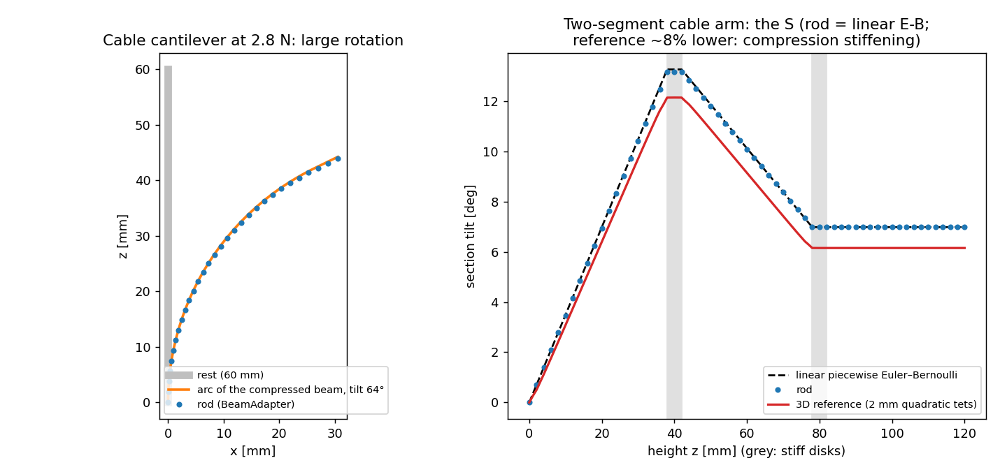

# Rod backend: slender bodies as beams

`--backend rod` runs a scenario's slender soft body as a chain of beams on SOFA's
BeamAdapter (`softsim/backends/rod/`). Needs the SOFA install of
[sofa.md](sofa.md); no GPU. The same YAML that runs on `fem`, `mujoco` and
`sofa` runs on `rod`, and `softsim transfer` can compare them:

    softsim run scenarios/actuation/cable_arm.yaml --backend rod

## Model

- **Reduction** (`reduce.py`, pure numpy). The body must be a column along its z
  axis, clamped on its z-min face (`fixed: [base]`) and at least 4 times longer than
  wide. Frames sit on planes z = const, one per mesh layer. Per beam the
  tetrahedra of the slab give, **with each element's own modulus** (so material zones, layers and
  stiff disks enter exactly), the extensional stiffness `EA`, the bending stiffnesses
  `EI_x`, `EI_y` about the stiffness-weighted centroid (the neutral axis moves off the geometric
  centre in a layered section; the exact quadratic tetrahedron integrals are used) and the mass
  per length.
- **To BeamAdapter.** Three stiffnesses meet three unknowns: a rectangle `lY = sqrt(12 EI_x / EA)`,
  `lZ = sqrt(12 EI_y / EA)` and a modulus `E = EA / (lY lZ)` per beam, plus a mass density that
  reproduces the mass per length. The beam axis is BeamAdapter's x, so the model runs in the
  cyclic frame `(X, Y, Z) = (z, x, y)` of the scene and maps back.
- **Mesh from frames.** Every mesh vertex keeps its axial position and in-plane offset; its position
  is the interpolated frame (lerp the position, slerp the rotation) plus the rotated offset, so
  *every region metric of the scenario works unchanged* (bend angle, tip position, cable length).
- **Loads.** Cables and region forces call the same functions as the 3D backends
  (`cable_forces`, `cable_length`, `region_force_weights`) on the deformed vertices; the vertex
  forces reach the frames through the transpose of the vertex map (virtual work: frame `k` gets
  `(1 - t) f` and the moment `(1 - t) arm x f`), explicitly once per step, as on SOFA's tets. Tension
  and stroke control both work.

## What it is, and is not

Geometrically nonlinear (finite rotations of the frames), **materially linear**: each element
counts with its small-strain modulus. Two consequences, both measured below:

1. A beam bent to 64° follows the exact elastica-like arc (the cable's pure moment gives a circular
   arc), with the beam shortened by its axial compression, `L / (1 + N / EA)`.
2. The 3D reference's Neo-Hookean tangent modulus *rises* under the cable's axial compression,
   `E_t = E (1 + 2N / EA)` (the factor in `tests/test_cable_arm.py`), which a linear rod cannot
   have: on the cable arm the rod bends about 8% more than the reference, and that is this factor (7.3%
   plus the reference's own 1.8% below Euler–Bernoulli), not an error of the rod.

Refused with a message: pressure actuators, ground and contact, rigid bodies, moving and rotating mounts,
prescribed motion, Prony, zones with their own damping, more than one soft body, rotated bodies, bodies
shorter than 4 widths, a free body (no clamped end).

**Damping: Rayleigh beta only.** The solver's mass-proportional alpha does nothing on BeamAdapter's mass
(measured: the late amplitude of a free vibration with alpha = 20 /s is that without damping, with
beta = 0.01 s it falls by 5x), so a card with alpha is refused. For a quasi-static run use beta
(`damping: {model: rayleigh, beta: 0.3}` on the body and on every zone).

**Cable timestep.** The explicit cable force is limited like on the 3D backends: the arm at 2 ms is refused by
the `cable-unstable` check; 1 ms runs, the arm's 0.1 ms default is 100 times slower.

## Evidence (`tests/test_rod_reduce.py`, `tests/test_rod_backend.py`, 16 tests)

| Case | Rod | Reference value | Where |
| --- | --- | --- | --- |
| Tip load 5 mN, 10 x 10 x 60 mm | 0.8641 mm | Euler–Bernoulli 0.864 mm (3D reference 0.866 mm) | `tip_load_cantilever.yaml` |
| Cable cantilever, 0.7 N | 0.2777 rad | `T d L / EI` = 0.2772 rad | `cable_cantilever.yaml` |
| Same at 2.8 N (64°) | tilt 1.116 rad; tip (30.6, 44.0) mm | arc of the compressed beam (30.7, 44.2) mm | figure, left |
| Layered section (neutral axis −2.57 mm) | 0.2233 rad | composite `T (d - x_c) L / EI` within 1% | `cable_cantilever_layered.yaml` |
| Two-segment arm | 0.2298, 0.1221 rad | linear piecewise E–B 0.2315, 0.1219 rad (3D reference 0.2119, 0.1074: lower by `1 + 2N/EA` and 1.8%) | `cable_arm.yaml`, figure, right |

Reproduce the figure with `python tools/plot_rod.py` (about 2 min).

**Mutation tests.** Each of these deliberate bugs fails the tests (4, 5, 5, 5, 2 and 6 failures): zone
stiffness ignored, the moment sign flipped, the moments dropped, nearest-frame instead of
interpolation in the vertex map, EI_x and EI_y swapped, and the cable load dropped.

**Speed.** The rod runs the arm (1.5 s at 1 ms) in 5.8 s and each 10 mm cantilever in under 2 s on the CPU
(500 ms at 2 ms); the MuJoCo arm run took 20 minutes ([../actuation.md](../actuation.md)).
