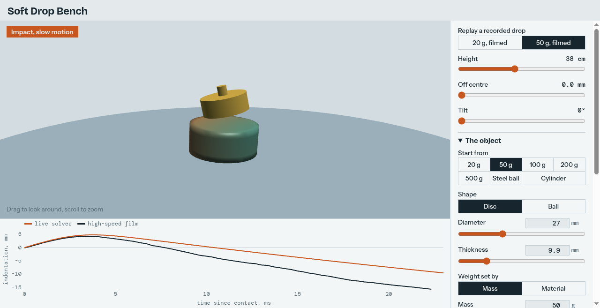

# Soft drop bench

Drop things on the Ecoflex cylinder and watch the impact in slow motion, with the high-speed film's trace beside the live
one. It runs on your own machine.

```bash
xdg-open docs/viewer/drop.html      # or double-click it: no server, the solver is inside the file
```



Set height, offset and tilt, then declare the object and the soft body. The fall plays in real time and the impact at
about 1/300 of real time, close to the 3000 fps film played at 10 frames per second. **Replay a recorded drop** uses the
film's measured impact speed, offset and spin, restores the filmed settings and overlays its track.

## What you can declare

| | Setting | Ways to give it |
| --- | --- | --- |
| Object | Shape | disc or ball, or the bare cylinder falling on the table |
| | Size | diameter, and thickness for a disc |
| | Weight | mass, or a material (its density times the volume; a disc's knob adds no mass this way) |
| Soft body | Stiffness | a library material, Young's E, shear G, or a datasheet's 100% modulus |
| | Other | Poisson's ratio, density, relaxing share g and relaxation time τ |
| | Size | diameter and height |

Every value can be typed or dragged. Switching between E, G and 100% modulus keeps the same solid and only changes how it
is written: G = E / 2(1 + ν), and 100% modulus = 1.75 G, the engineering stress of an incompressible Neo-Hookean solid at
twice its length. The panel shows the resulting E, G, K and masses, and the readout shows the time step, which shrinks
as the body stiffens, so stiffer bodies play slower.

Library materials use their initial shear modulus, from slow tests, as a Neo-Hookean solid with no relaxation, and the
page's ν rather than the card's. Those cards are softer than the same silicone under impact: Ecoflex 00-10's slow card has
G = 12.9 kPa, close to the filmed card's relaxed 47.8 × (1 − 0.691) = 14.8 kPa. Add relaxation by hand for an impact.

A new body size stretches the 40 × 17 mm mesh, so very flat or very tall bodies have elongated elements. There is no
Shore hardness input: nothing here checks a Shore-to-modulus conversion.

## The solver

`tools/drop_solver.js` is an explicit solver written for this page: linear tetrahedra with nodal averaged pressure, a
3.5 mm mesh (762 nodes, 3240 tetrahedra), penalty contact and a rigid object with six degrees of freedom. It uses the 3D
reference's physical card unchanged (Neo-Hookean, E0 = 143.3 kPa, ν = 0.4995, g = 0.691, τ = 2 ms). Nothing is fitted.
The page and the checks run the same file.

Two findings shaped it:

- **ν cannot be relaxed.** At ν = 0.47 the 50 g impact compresses the core by a quarter and collapses it. The true
  ν = 0.4995 costs 2-3 µs steps, which slow motion absorbs.
- **Fitting did not help.** A grid over E0 and g improved 50 g only by making 20 g worse, so the card stayed as it is.

## Checks

```bash
python tools/check_drop_solver.py
python tools/make_drop_page.py
python tools/check_drop_page.py docs/viewer/drop.html --shots runs/page
pytest tests/test_drop_solver.py
```

| Drop | Film peak | 3D reference track | Page solver | RMS gap to film, first contact |
| --- | --- | --- | --- | --- |
| 20 g | 3.74 mm at 3.33 ms | 3.85 mm at 3.00 ms | 3.37 mm at 2.86 ms | 9.2% |
| 50 g | 4.31 mm at 3.67 ms | 4.31 mm at 3.40 ms | 4.83 mm at 3.76 ms | 25.1% |

- `tests/test_drop_solver.py`: stress against the closed-form law, relaxation against the Prony curve, free flight
  against the parabola, the filmed peaks within 15%, and the heaviest objects survive the filmed height. Mutations of
  the relaxation, the pressure, the object's gravity and the contact reaction each fail a test.
- The same file: a declared 100% modulus comes back as the solver's engineering stress at twice the length. Twice the
  size at the same speed gives twice the indentation and time, and four times the stiffness at twice the speed gives the
  same indentation in half the time, both within 0.2%. Mutations of each conversion, the mesh axes, the ball's volume
  and the size and wave speed in the bulk viscosity each fail a test.
- `tools/check_drop_page.py` opens the page from disk in headless Chrome, fails on any script error, and compares the
  filmed drops with the same solver under Node: the peaks agree to 0.001 mm. Two declared drops run through the page's
  fields and match jobs written by hand from the same numbers to 0.001 mm. Real clicks confirm that changing the
  declaration keeps E, a typed modulus reaches the solver, and a filmed replay restores the card.

## Limits

- **The rebound is too slow.** At 20 ms the film's 50 g weight is about 15 mm above the rest surface and the solver's
  about 8 mm, so bounce height is not a prediction. The page's trace shows the gap.
- Only the 20 and 50 g drops at the filmed height and on the filmed body are checked against film. Every other object,
  body, material, height or tilt is unchecked, and the page says so. The similarity tests show the sizes and stiffness
  reach the solver correctly, not that those drops match reality.
- The 500 g film is not a passive impact ([experiments.md](experiments.md)): the solver peaks at 9.0 mm against 4.52 mm.
- 500 g from 80 cm breaks the solver. The page says so and stops.
- Peak force is filtered over 0.2 ms, because a node landing on the object is a one-step spike. It is 66 N for the 50 g
  drop, where the film implies 65 N at peak indentation; the two are not the same moment in general.
