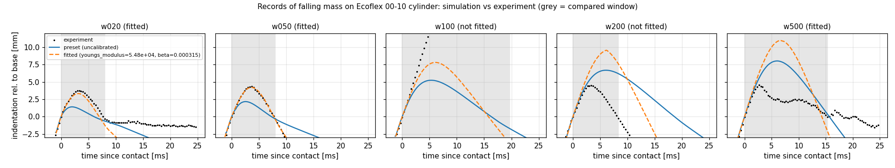
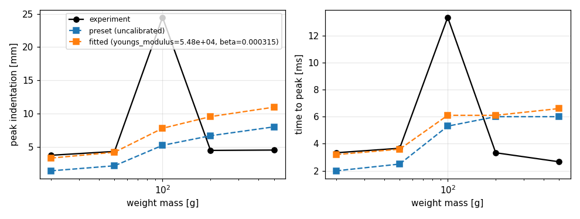
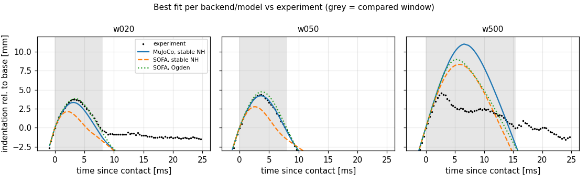
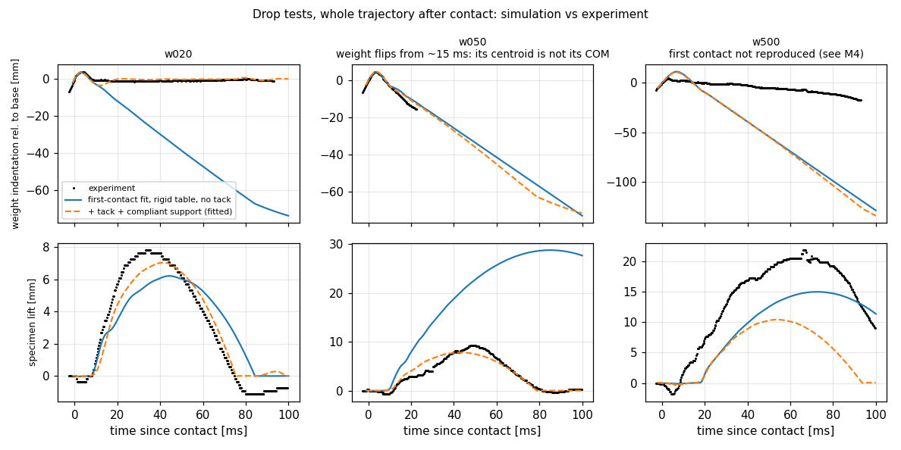
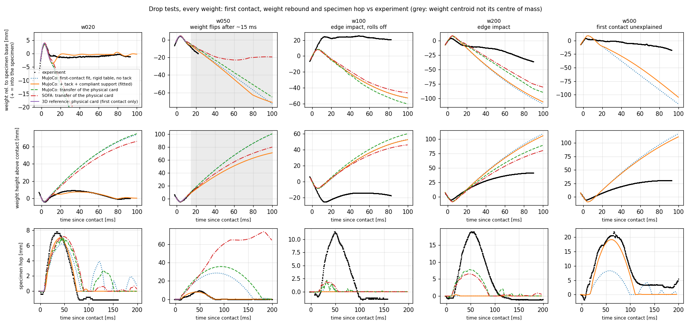

# Experiments: tracking and calibration

```bash
softsim track datasets/czopek2026_ecoflex_drop.yaml --jobs 5        # about 3 min; data/processed/<dataset>/
softsim calibrate calibrations/ecoflex_00_10_drop.yaml --jobs 3      # about 4 min; runs/calibration/...
```

## Dataset description

`datasets/czopek2026_ecoflex_drop.yaml` records the DOI, licence, camera,
specimen and, per case, the zip archive, the scenario config and how the
weight looks. Frames are read directly from the zips (`FrameSource`); nothing
is extracted or redistributed.

## Tracking (`softsim/experiments/video/`)

**Segmentation.** The backdrop is saturated green with no red, and shadows on
it stay red-free. A per-pixel reference background (the median of the first
frames) separates three classes:

- the translucent specimen: red present, bluish;
- brass weights: red present, neutral;
- black weights: much darker than the background behind them.

**Scale and camera.** The specimen's resting silhouette width equals its
diameter, giving about 5.5 px/mm. Its silhouette height, H·cos e + D·sin e,
gives a camera elevation of e ≈ 17–20°. Vertical motion therefore scales by
cos e.

**Weight motion.** The weight is followed as a rigid body (x, y and in-plane
rotation) by incremental ECC alignment of its upper part, frame to frame. The
upper part keeps the specimen and the weight's shadow out of the mask. The
weights rotate strongly during impact (the 20 g seats with about 10° of
rocking, the 100 g rolls about 100°), and a translation-only template loses
them. The tracked point is the silhouette centroid, which is close to the
centre of mass.

**Contact.** Contact is the first frame where the centre of mass departs from
a local free-fall parabola by more than 0.5 px (about 0.1 mm). The same rule is
applied to simulations (`compare.simulated_indentation`).

**Compared quantity.** `indentation_rel` is the centre-of-mass displacement
since contact, relative to the specimen base.

### Findings about the recordings

| Case | Impact speed | Offset | Spin | Usable? |
| --- | --- | --- | --- | --- |
| 20 g (brass) | 2.67 m/s | +6 mm | 317 °/s | yes; lands slightly tilted and rocks while seating |
| 50 g (brass) | 2.47 m/s | 0 mm | 48 °/s | yes for the first contact; tumbles off afterwards |
| 100 g (black, no knob) | 2.47 m/s | +14 mm | 27 °/s | **no**: hits the specimen edge and rolls off |
| 200 g (black) | 2.62 m/s | −13 mm | −59 °/s | **no**: tilted edge impact |
| 500 g (black) | 2.65 m/s | −6 mm | ~0 | first contact only; see below |

- **Frame rate is 2999.3 fps** (overlay timestamps). Impact speeds are 2–10%
  below the nominal 2.73 m/s, so simulations use the measured value per case.
- **Local free-fall fit.** Just before contact the tracker fits a free quadratic
  to the weight's height. Its apparent acceleration comes out at only
  3–4 m/s², but over the 8 ms fit window that is a difference of about 1 px
  from free fall. M3 blamed perspective; that is not established (the
  specimen's hop, below, decelerates *faster* than g). It doesn't matter for
  contact detection, and the fitted impact speeds agree with the nominal drop
  speed.
- **The specimen hops; the table does not move.** After impact the specimen
  rises 8–20 mm and lands again 70–110 ms later. The green cloth it sits on
  rises next to it (most near the specimen, less 55 mm away, with ripples
  spreading out), while the backdrop lighting band stays within ±1 px, so the
  camera is still. The 200 g specimen visibly tilts and slides in mid-air.
  The tacky specimen sticks to the cloth and drags it up, which is also why
  its hop decelerates at 13–20 m/s², faster than g. *Correction:* M3 read this
  as the table moving and discarded everything after the first contact; see
  [After the first contact](#after-the-first-contact-tack-and-the-hopping-specimen).
- **Out-of-plane tilt can't be measured** from a single side view. Simulations
  get the measured horizontal offset and in-plane spin; tilt stays zero.
- **Rotation is the less precise output.** On synthetic sequences the tracker
  recovers position to about 2% of the motion and rotation to about 20%.
- **Correction to Step 0:** the 4 mm preview estimate for 20 g happens to match
  (3.7 mm). The method was unreliable, though: it used the weight's bottom
  edge, which the specimen rim hides.

## Calibration (`softsim/experiments/calibrate.py`)

`calibrations/ecoflex_00_10_drop.yaml` fits stable Neo-Hookean E and Rayleigh
β (in log space) on MuJoCo to the 20, 50 and 500 g cases at once:

- **Optimizer:** a coarse 4×4 grid, then Nelder-Mead, 50 evaluations.
- **Simulations:** each case uses its measured impact conditions and a 5 mm
  mesh.
- **Cost:** the mean of RMSE divided by the experimental peak over the first
  contact phase.
- **Outputs:** the fitted preset (with provenance), the evaluation history,
  `report.yaml` and plots.
- **Failures and resuming:** an unstable parameter set, or one that crashes its
  worker process outright, gets the maximum per-case cost (10) instead of
  stopping the run. Each evaluation is appended to `<output>/evaluations.jsonl`.
  Re-running the calibration replays those evaluations, so an interrupted
  multi-hour run resumes where it stopped. Changing `max_evaluations`, `grid`,
  bounds or initial values keeps them. The log does not know about code
  changes: delete it after changing simulation code. The history also records
  each case's maximum ground penetration, which flags contact artefacts.

**Result:** E = 54.8 kPa and β = 0.31 ms. This is preset
[`ecoflex_00_10_drop_fit`](../softsim/materials/presets/ecoflex_00_10_drop_fit.yaml).
E is lower than the 91 kPa datasheet-derived starting estimate, and very close
to the datasheet's 100% modulus (55 kPa).



| Case | Peak exp | Peak, preset (91 kPa) | Peak, fitted | t_peak exp / fitted | NRMSE fitted |
| --- | --- | --- | --- | --- | --- |
| 20 g | 3.74 mm | 1.40 mm | 3.32 mm | 3.3 / 3.2 ms | 15% |
| 50 g | 4.31 mm | 2.16 mm | 4.20 mm | 3.7 / 3.6 ms | 3% |
| 500 g | 4.52 mm | 8.01 mm | 10.97 mm | 2.7 / 6.6 ms | 113% |
| 100 g, 200 g | edge impacts, not fitted | | | | |



### What this does and does not show

- **For light weights the model works.** For 20 g and 50 g (local indentation
  by a weight smaller than the specimen), a Neo-Hookean solid with one Rayleigh
  damping coefficient reproduces the whole first contact (loading, peak and
  unloading) within 3–15%.
- **For the 500 g weight it fails.** That weight is wider than the specimen and
  compresses its whole face. In the recording it stops within 4.5 mm in 2.7 ms,
  while the model needs about 11 mm and 6.6 ms. No single (E, β) fits both
  regimes. The measured peak indentation is almost independent of mass (3.7 →
  4.5 mm for 25× the energy). Candidate explanations, none verified:
  - rate-dependent stiffening of the silicone, which Rayleigh damping can't
    represent;
  - stronger large-strain stiffening than Neo-Hookean;
  - near-incompressibility under full-face confinement (the model uses ν = 0.45);
  - energy absorbed by the compliant table, which is measurable here but not
    modelled.

  M4 tested the material-law and compressibility candidates on SOFA; see
  [below](#backends-and-material-models-m4).
- **The fit depends on the mesh.** With the fitted values, the 20 g peak goes
  3.32 → 3.55 → 3.79 mm as the mesh refines from 5 to 3.5 to 2.5 mm. Use the
  preset with `specimen.mesh.size=5mm`, or refit at the target resolution.
- **50 g after first contact isn't modelled.** In reality the weight tumbles
  off after the first contact, so later times shouldn't be compared.

## Fitting any scenario to a measured table (`softsim fit`)

`softsim calibrate` is built around the drop test's tracked videos. `softsim fit`
is the scenario-neutral version: any observable column of any scenario against
a measured table, registered with its source. A fit file is a transfer file
(`config`, `backend`, `overrides`, `parameters`, `checks`, `max_evaluations`,
`output`, see `softsim/transfer.py`) whose `reference:` is replaced by `data:`
(`softsim/experiments/fit.py` has the full description):

```yaml
data:
  source: {name: ..., doi: 10.xxxx/..., licence: CC-BY-4.0, file: ../data/processed/x/table.csv}
  kind: curve                      # y against a simulated x (a quasi-static ramp), or series: y(t)
  filter: {tilt: 0}                # rows with these column values
  x: {column: p_kPa, scale: 1000, sim: cavity_pressure}
  y: {column: theta_deg, scale: 0.0174533, sim: bend_angle}
  relative_to: first               # compare changes from the first sample (zero offsets in the data)
```

`source` must give `name`, `doi`, `licence` and `file`, so a number in a
report can be traced. The error is the NRMSE of the transfer (RMS difference
over the largest measured change); the report adds the data's own noise floor
(the scatter at repeated x over the same range), because a fit cannot be
better than that. The fitted card is `kind: physical` on the reference
(`--backend fem`), `effective` on the linear-tet backends, and it names the
measurement in its provenance.

**Check (a twin experiment, `tests/test_fit.py`):** the "measurement" is the
sphere's pressure-volume curve at a hidden E = 45 kPa. Fitting from 25 kPa
gives back 45.18 kPa from the clean curve (0.4%), and 46.6 kPa from the same curve with 1% noise (3.5%, a cost of
0.018, about the noise). A wrong modulus costs more than 10 times the right
one on a time series, and four mutants of the code (dropped unit scale, dropped
baseline, whole run instead of the loading branch, ignored filter) are caught.
This tests the machinery against a known answer; it says nothing about a real
actuator. That needs a measurement with a known geometry and material.

## Backends and material models (M4)

Same cases, cost and procedure on the SOFA backend, which offers more material
laws. The question: can a different material law reproduce 500 g together with
20 and 50 g? Both SOFA fits use a 5 mm mesh and dt = 0.05 ms (0.1 ms diverges
for 500 g) and took about 1 h and 2.7 h on 8 cores.

| Fit | Parameters | Cost | 20 g | 50 g | 500 g peak / t_peak (exp 4.52 mm / 2.7 ms) |
| --- | --- | --- | --- | --- | --- |
| MuJoCo, stable NH ([`ecoflex_00_10_drop_fit`](../softsim/materials/presets/ecoflex_00_10_drop_fit.yaml)) | E 54.8 kPa, ν 0.45, β 0.31 ms | 0.44 | 15% | 3% | 11.0 mm / 6.6 ms |
| SOFA, stable NH ([calibration](../calibrations/ecoflex_00_10_drop_sofa_stable_nh.yaml)) | E 105 kPa, ν 0.45, β 0.89 ms | 0.54 | 49% | 37% | 8.3 mm / 5.7 ms |
| SOFA, one-term Ogden ([`ecoflex_00_10_drop_fit_sofa_ogden`](../softsim/materials/presets/ecoflex_00_10_drop_fit_sofa_ogden.yaml)) | μ 22.9 kPa, α 1.20, K 200 kPa, β 0.28 ms | 0.24 | 3% | 11% | 9.0 mm / 5.3 ms |

(Percentages are NRMSE over the first contact phase. Reproduce the figures
with `python tools/make_model_comparison.py`.)



**What M4 shows:**

- **No material law fits 500 g.** Each fit leaves 500 g about twice too deep
  and twice too slow. The SOFA stable-NH fit is a compromise that fits nothing:
  it stiffens to help 500 g and then misses 20 and 50 g by 37–49%.
- **Large-strain stiffening isn't the explanation.** The Ogden fit chooses
  α ≈ 1.2, *less* stiffening than Neo-Hookean (α = 2), and fits 20 and 50 g
  within 3–11%, the best of the three. The M3 candidate "stronger large-strain
  stiffening" is ruled out for this data.
- **Same model, different backend, different parameters.** Stable NH on
  MuJoCo and SOFA ends at E = 55 vs 105 kPa (compliant vs hard contact,
  integrator damping; see [sofa.md](backends/sofa.md)). Fitted values are
  effective parameters of a backend + mesh + model combination.
- **Compressibility matters for the full-face impact.** At peak, the SOFA fits
  lose 27% (Ogden) and 36% (stable NH) of the specimen's volume. Silicone is
  practically incompressible, so ν = 0.45–0.47 is wrong here; under local
  indentation the material can flow aside and ν matters much less. Single runs
  of the Ogden fit with a higher bulk modulus (not refitted):

  | Bulk modulus (ν) | 20 g peak (exp 3.74) | 500 g peak (exp 4.52) | 500 g t_peak (exp 2.7) |
  | --- | --- | --- | --- |
  | 200 kPa (0.466), fitted | 3.82 mm | 8.96 mm | 5.3 ms |
  | 1 MPa (0.493) | 3.54 mm | 7.65 mm | 5.2 ms |
  | 5 MPa (0.499) | 3.31 mm | 6.54 mm | 4.6 ms |

  Near-incompressibility closes about 45% of the 500 g peak gap while 20 g
  stiffens 12%, partly linear-tetrahedron locking. A joint refit with the bulk
  modulus free is prepared but **not run yet**
  ([`ecoflex_00_10_drop_sofa_ogden_bulk.yaml`](../calibrations/ecoflex_00_10_drop_sofa_ogden_bulk.yaml),
  about 3–4 h; repeat at a 3.5 mm mesh to separate locking from material).
- **The remaining gap** (500 g still about 45% too deep and 70% too slow at
  ν ≈ 0.5) points to what no tested model has: rate-dependent stiffening
  (Prony viscoelasticity; Rayleigh β can't represent it) and/or the compliant
  table.
- **SOFA contact failed at extreme rim flaring (fixed).** In the Ogden 500 g run the
  specimen's rim spreads to 45 mm radius and, from 7.6 ms (after the peak at
  5.3 ms), rim vertices passed up to 8.5 mm through the ground. No element
  inverts. The cause was the intersection's alarm distance (0.4 mm) against the
  rim's 0.6 mm per step when it snaps back onto the ground; the backend now
  widens it to the fastest vertex's travel
  ([backends/sofa.md](backends/sofa.md#known-limits): 2.83 mm to 0.006 mm at 8.8 ms, peak unchanged). The
  500 g peak and timing were before this and are reproduced (9.0 mm / 5.3 ms); the fit's stored 500 g NRMSE
  (58%) included the artefact, and re-simulated without it the 500 g NRMSE is 79% (2026-11-12). The Ogden fit's
  cost of 0.24 above was minimised with the artefact in its 500 g term.
- **Re-simulating these fits needs their own setup.** They were made (28-29 Oct) before the measured 11° in-plane
  landing tilt of the 500 g drop was applied to every re-simulation (31 Oct); with the tilt, both SOFA fits blow up
  at 5 mm / 0.05 ms (8.3-8.4 ms, a real instability, not the speed guard) and the figures were left without 500 g.
  Their calibration files now say `tilt: false`, and `tools/make_model_comparison.py` re-simulates each fit as it
  was fitted. Whether SOFA survives the tilted impact at a finer mesh or step is open.

## After the first contact: tack and the hopping specimen

M3 and M4 compared only the first ~8 ms, because M3 had read the later motion
as the table moving. That was wrong (see the findings above): the specimen
itself hops. The whole first 100 ms is usable data, and it shows that the
simulations got the physics after the first contact wrong. Without any
adhesion, the simulated 20 g weight flies off at 1.2 m/s and rises 70 mm. The
real one never leaves the specimen.

**What the recordings show:**

- **20 g: the weight sticks.** It comes off the compressed material at
  1.0–1.2 m/s relative to the base, as fast as in the simulation, and then
  stops within about 1 mm and stays there for 90 ms while rocking. Momentum
  says why: 20 g × 1.0 m/s ≈ 42 g × 0.45 m/s, and weight plus specimen then
  hop together at about 0.45 m/s (7.6 mm apex). The weight is stuck to the
  tacky Ecoflex and pulls the whole specimen off the cloth.
- **50 g: the weight peels off.** With 2.5× the momentum, the bond can't hold
  the weight. It separates while rotating (a peel from one edge) at about
  1 m/s relative to the specimen, the same as the simulation up to 22 ms.
  After that it tumbles away from the camera and lands on the table *behind*
  the specimen (it lies still there from ~210 ms). Its image height then mixes
  height with depth, so the side view can't measure its rebound. The specimen
  still hops 8 mm.
- **500 g: the weight lifts the specimen with it** by 20 mm, and separates
  only around 70–100 ms.
- **The cloth comes along.** The green cloth next to the specimen rises with
  it and ripples, and the hop decelerates at 13–20 m/s², faster than g: the
  specimen sticks to the cloth too.

**Model.** Two scene elements, both general features of softsim:

- **Adhesion** (`material.adhesion: {strength, range}`), an exponential
  cohesive law for the normal traction between the soft surface and what it
  touches (t = σ (g/δ) e^(1 − g/δ); work of separation e·σ·δ). Bonds form on
  contact and break beyond 6δ. Verified against analytic equilibria on MuJoCo
  and SOFA (`tests/test_adhesion.py`).
- **A compliant support** (`support:` in the drop test): a carrier plate under
  the specimen that can lift off the table against a spring and damper. It is
  a lumped stand-in for the cloth, and its parameters are effective ones.

**Fit** (`calibrations/ecoflex_00_10_drop_adhesion_support.yaml`, MuJoCo,
5 mm mesh). Compared quantities:

- 20 g: weight position relative to the specimen base and specimen lift over
  0–100 ms;
- 50 g: relative position over 0–15 ms (later, the flipping weight's centroid
  is not its centre of mass) and specimen lift over 0–100 ms.

500 g is not used (below).

Only the tack and support are fitted; the bulk material stays at its M3
first-contact values (preset
[`ecoflex_00_10_drop_fit_tacky`](../softsim/materials/presets/ecoflex_00_10_drop_fit_tacky.yaml);
`softsim sweep scenarios/drop_test/sweeps/fitted_tack_support.yaml` runs all five weights with it):

| | Fitted value |
| --- | --- |
| tack strength σ | 14.6 kPa |
| tack range δ | 0.29 mm (work of separation e·σ·δ ≈ 11.6 J/m²) |
| support stiffness, damping, mass | 33 N/m, 0.35 N·s/m, 45 g |

| Case | Observable | Without tack (rigid table) | With tack + support |
| --- | --- | --- | --- |
| 20 g | weight rel. to base, 0–100 ms | flies off (−75 mm at 100 ms) | stays seated; NRMSE 25% |
| 20 g | specimen hop | 6.2 mm, too slow | 7.0 mm (exp. 7.8), lands at ~80 ms; NRMSE 12% |
| 50 g | weight rel. to base, 0–15 ms | | NRMSE 6% (first contact and separation) |
| 50 g | specimen hop | 29 mm | 8 mm (exp. 9); NRMSE 11% |

Total cost 0.133 (90 evaluations, flat from about the 55th), against 0.48 at
the first initial guess.

**What to make of it:**

- **Tack, not dissipation, is why the simulations flew too high.** In the
  MuJoCo model the weight already leaves the compressed specimen at the
  measured speed. What was missing is that it stays stuck.
- **The parameters are effective, and tied to the mesh.** The tack is a
  cohesive law whose process zone (~4 mm) the 5 mm mesh doesn't resolve. On a
  3.5 mm mesh the same values let the 20 g weight peel off. The support is a
  lumped stand-in for a cloth that sticks, stretches and ripples, so 45 g and
  33 N/m are not the cloth's mass and stiffness.
- **Checked:** halving the timestep changes the errors by less than 0.01.
- **The cloth pulls back harder than gravity** (13–20 m/s² in the
  recordings). The fit captures that through the spring, which is why the
  simulated hop is about 10% too low but lands on time.
- **500 g is outside this model** (below). With its first contact 2.4× too
  deep, the weight rebounds too fast for any bond and tears off.



### Every weight, whole bounce (validation)

`python tools/validate_drop_bounces.py` (about 1 min on 8 cores) runs all five
weights with each recording's measured impact for 200 ms. It compares the
first contact, the weight's rebound (its height above its contact height) and
the specimen's hop (`runs/bounce_validation/metrics.csv`, figure
`docs/media/bounce_validation.png`). It covers the two MuJoCo models above
and, since 2026-10-31, the MuJoCo and SOFA transfers of the physical card,
plus the 3D reference's first contacts.

- The transfers reproduce the first contact best: 6–8% at 20 g, 8–14% at
  50 g.
- They have no tack, so the weight then flies 38 mm high instead of staying
  seated.
- They diverge where their strong relaxation lets heavy weights crush the
  specimen: MuJoCo from 100 g, SOFA at 500 g.

(Those numbers are for the transfers of the earlier physical card, 143 kPa /
0.69 / 2 ms, run on 2026-10-31. With the joint card below (2026-11-02), the
table's first-contact NRMSE against the recordings is 13% (MuJoCo) and 4% (SOFA)
at 20 g and 6% and 5% at 50 g; the 3D reference itself gives 14% and 3%. The
weight now rises 72 (MuJoCo) and 64 mm (SOFA) at 20 g, still with no tack. MuJoCo
diverges only at 500 g, like SOFA: its 200 g run completes. The run was done
with the MuJoCo timing fix of that day, see below.)

`python tools/make_comparison_media.py` writes `docs/media/compare_wXXX.gif`:
for each weight, the recording next to the MuJoCo tack-and-support model,
with the same scale and view angle.

| Case | | First peak mm (t ms) | Weight max rise mm | Specimen hop mm (t ms) | Specimen landed ms |
| --- | --- | --- | --- | --- | --- |
| 20 g | experiment | 3.7 (3.3) | 9.1 | 7.8 (33) | 73 |
| | rigid, no tack | 3.3 (3.0) | **71** | 6.2 (44) | 83 |
| | tack + support | 3.5 (3.2) | 7.5 | 7.0 (41) | 74 |
| 50 g | experiment | 4.3 (3.7) | 10.1 (to 15 ms) | 9.2 (48) | 79 |
| | rigid, no tack | 4.3 (3.6) | 10.8 | **29** (85) | 161 |
| | tack + support | 4.5 (3.8) | 9.2 | 7.8 (44) | 78 |
| 100 g (edge) | experiment | rolls off the rim | falls 25 mm beside it | 11.4 (48) | 94 |
| | tack + support | 8.1 (6.1) | 48 (bounces up) | 0.1 | |
| 200 g (edge) | experiment | 4.5 (3.3) | 42 | 18.9 (50) | 108 |
| | tack + support | 8.7 (4.6) | 96 | 0.3 | |
| 500 g | experiment | 4.5 (2.7) | 31 | 21.8 (66) | after 200 |
| | tack + support | 9.0 (5.0) | 105 | **20.1 (62)** | 111 |
| | (same, dropped flat) | 10.7 (6.7) | 126 | 10.4 (54) | 93 |

The 100, 200 and 500 g simulations get each recording's measured in-plane tilt
at contact (−7.6°, −8.7° and −11.0°; `tools/measure_tilts.py`,
`softsim.experiments.video.tilt`). It is measured from the straight side edges
of the dark weights' silhouettes 15 frames before contact, with 0.5–1.6 px
residuals and less than 1.3° of spread. The brass weights' reflections and
knobs make their edges unusable, so 20 and 50 g stay untilted. The rigid model
gives the same as tack + support for 100–500 g within a few mm. All weight
numbers after 15 ms are unusable for 50 g: the weight flips.



- **20 g and 50 g are reproduced over the whole bounce:** hop height within
  10–15%, landing time within 2 ms, and the 20 g weight stays seated. That is
  what the tack and the support were fitted to.
- **100, 200 and 500 g all fail.** In every simulation the weight
  rebounds 45–130 mm and leaves the specimen behind. The real heavy weights
  rise only 30–40 mm (or roll off) and carry the specimen up 11–22 mm with
  them. Two of the three are not comparable impacts, though: the simulations
  drop every weight flat, and the heavy weights don't land flat.
  - **200 g** comes down strongly tilted: its bottom face is visible from
    the camera above. It digs in with its edge and keeps rotating, so its
    shallow 4.5 mm "first contact" is an edge impact, not evidence of a
    stiffer material.
  - **100 g** lands 14 mm off centre and tilted. It rolls off the rim,
    falls 25 mm beside the specimen and still drags the specimen up 11 mm.
  - **500 g** lands least tilted: 11° in the image plane, rotating only 2°
    in the first 20 ms, with an unknown out-of-plane tilt.
    - Applying the measured tilt brings the specimen's hop from 10 to 20 mm
      (measured 21.8 mm) and its first contact from 10.7 to 9.0 mm.
    - It still stops at 4.5 mm in 2.7 ms in the recording.
    - Its rise height means an upward speed of about 0.8 m/s (restitution
      about 0.3), against about 1.4 m/s simulated, so the real impact is
      still stiffer and more lossy than the model.
    - The tack doesn't change it.
- **Next:** compare the heavy weights only with the measured attitude. The
  in-plane tilt can be measured. The out-of-plane tilt needs either a second
  view or a 3D fit in which it is a free parameter. Until then, the material
  question rests on the flat impacts (20 and 50 g) and on 500 g (below).

### The 500 g first contact

The 500 g weight stops within 4.5 mm in 2.7 ms. No simulation so far gets
close: every material law, both backends and a near-incompressible bulk
modulus leave it at 6.5–11 mm and 4.6–6.6 ms (M4). Three checks so far:

- **The tracking is right.** Tracking the top edge of the weight's knob
  against the plain backdrop, independently of the tracker, gives the same
  motion within 0.5–1 mm. The weight travels almost freely for the first
  ~1 ms, then decelerates at ~1750 m/s² (~900 N), and comes back up at
  ~0.85 m/s.
- **It lands tilted, which explains part of it.** Before impact the weight
  is tilted by 11° in the image plane (side-edge fits, see the bounce
  validation). The simulation with that tilt peaks at 9.0 mm at 5.0 ms
  instead of 10.7 mm at 6.7 ms: closer, but not close.
- **No elastomer explanation fits.** As a linear spring, the stop needs
  ~170 kN/m, an effective modulus above 1 MPa, against ~55 kPa from the light
  weights. That is 19× the 50 g case's stiffness, with a shorter time to peak
  than 20 g despite 25× the mass. No string or guide is visible above the
  weight.
- **It is not a modelling artefact of the tetrahedral backends.** The
  locking-free axisymmetric reference ([reference_fem.md](reference_fem.md))
  is nearly incompressible (ν = 0.4995) with sticking contact on both faces,
  so it has none of the suspects: locking, volume loss, friction slip. It
  still peaks at 8.1 mm (E = 100 kPa) and 6.4 mm (E = 200 kPa), against the
  measured 4.5 mm. Statically, sticking faces stiffen 26% compression only
  1.7× over frictionless.

- **Rate dependence does not explain it either.** This was tested with Prony
  viscoelasticity on MuJoCo: 48 combinations of instantaneous modulus
  E0 = 100–800 kPa, relaxing fraction g = 0.5–0.95 and τ = 0.3–3 ms, each case
  with its measured impact. Every material that stops 500 g near the
  measured depth stops 50 g at a quarter of its measured depth. For example,
  E0 = 800 kPa, g = 0.5, τ = 1 ms gives 3.85 mm at 2.9 ms for 500 g (measured
  4.52 mm at 2.7 ms) but 1.10 mm at 1.1 ms for 50 g (measured 4.31 mm at
  3.7 ms). Both weights hit at the same speed, so their strain rates are
  similar, and no linear viscoelastic spectrum can stiffen one and not the
  other. (Materials with a soft long-term modulus made MuJoCo diverge under
  500 g; the trend is clear without them.)
- **It does not land flat.** The frame montages show the weight squashing
  the specimen into a wedge, and it rotates only 2° in the first 20 ms. Its
  side edges give an 11° in-plane tilt (the earlier 7° estimate is
  superseded). With that tilt, MuJoCo's first contact goes from 10.7 to
  9.0 mm and the specimen's hop from 10 to 20 mm (measured 21.8 mm).
- **Out-of-plane tilt does not explain it.** That tilt can't be seen from one
  view, so it was swept on MuJoCo (`python tools/sweep_out_of_plane_tilt.py`,
  first-contact fit card, measured impact and in-plane tilt):

  | Out-of-plane tilt | 0° | 5° | 10° | 15° | 20° | measured |
  | --- | --- | --- | --- | --- | --- | --- |
  | First contact [mm] | 9.08 | 8.69 | 8.42 | 8.04 | 7.53 | **4.52** |
  | Time of peak [ms] | 4.8 | 4.6 | 4.4 | 4.2 | 4.0 | **2.67** |

  Even 20°, more than the side view could hide, takes off only 17% of a 2×
  gap. The MuJoCo transfer of the physical card (Prony g = 0.94) inverts
  elements under 500 g and can't be used for this case.

- **The force the film implies.** The force on the
  weight at its peak indentation is m·(a + g), with the deceleration a taken
  from a parabola through the tracked indentation (±0.8 ms around the peak):

  | Weight | Peak indentation | Time of peak | Deceleration at peak | Force at peak |
  | --- | --- | --- | --- | --- |
  | 20 g | 3.74 mm | 3.33 ms | 750 m/s² | 15 N |
  | 50 g | 4.31 mm | 3.67 ms | 1285 m/s² | 65 N |
  | 200 g (tilted) | 4.47 mm | 3.33 ms | 615 m/s² | 125 N |
  | 500 g | 4.52 mm | 2.67 ms | 1572 m/s² | 791 N |

  The tracked decelerations hardly depend on the mass, which spans 25×. 50 and
  500 g hit at the same speed and reach nearly the same indentation: 4.3
  against 4.5 mm, in 3.7 against 2.7 ms. The 500 g recording needs 12× the
  force. **This is not model-free, and it does not rule the specimen out.** The
  two weights do not deform the specimen the same way: the 50 g weight is 27 mm
  wide and indents a 40 mm face, the 500 g weight is 43 mm wide and compresses
  all of it, so the same depth need not mean the same force. What stands is the
  simulations above: full-face runs on the reference still stop at 6.4-8.1 mm.

The cause is still unknown. The candidates left are the material under
full-face confinement, the setup and the measurement:

- what is under the specimen (cloth and table compliance, a stiffer support
  under heavy loads);
- the side view's projection of depth motion: the camera looks down at 18.6°,
  so a weight moving away from it appears to rise by 0.32× that motion.

500 g is kept out of the fits because no model matches it and the cause is open.

## What the fitted modulus means

All fits on this page are *effective* models of a backend, mesh and contact
model, not the silicone's material constants. The axisymmetric reference
solver ([reference_fem.md](reference_fem.md)) cross-checks this:

- it agrees with MuJoCo's 3.5 mm mesh within 2–5% for static indentation;
- in the drop, MuJoCo's impact loses energy to friction slip and contact
  mechanics that the reference doesn't have;
- on the reference, the first contacts need **E ≈ 100–130 kPa** plus some
  damping, consistent with the datasheet (≈ 94 kPa). MuJoCo's 55 kPa
  compensates for MuJoCo's own losses.

Use the MuJoCo presets with MuJoCo at their mesh size. Take the material's
actual modulus from the reference.

## A physical card on the 3D reference (fem backend)

The 3D locking-free reference ([reference_fem.md](reference_fem.md)) runs the
drop test with each recording's measured offset, spin and tilt. It answers
the material question without the axisymmetric solver's limits: the 20 g
weight lands 6 mm off centre and spinning. The card:

- Neo-Hookean, E0 = 143 kPa, ν = 0.4995;
- one Prony term, g = 0.69 at τ = 2 ms;
- sticking contact.

These are the axisymmetric fit's values. Nothing was refitted for 3D.

| Case | Measured first contact | 3D reference, physical card | NRMSE (first contact) |
| --- | --- | --- | --- |
| 20 g (6 mm off centre, 317°/s) | 3.74 mm at 3.33 ms | 3.94 mm at 3.00 ms | **6.6%** |
| 50 g | 4.31 mm at 3.67 ms | 4.41 mm at 3.40 ms | **9.9%** |
| 500 g (11° in-plane tilt) | 4.52 mm at 2.67 ms | 7.41 mm at 4.20 ms | 60% (over 0–6 ms) |

(Each run takes 4–9 minutes on a laptop with a 5 mm quadratic mesh.)

- **One physical, locking-free material reproduces both light weights within
  10%.** The axisymmetric joint fit's 20 g/50 g conflict (15–20%) was the
  centred approximation of the off-centre 20 g, not the material.
- **The card describes the silicone at impact rates.** Its instantaneous
  modulus is 143 kPa, relaxing about 70% within a few milliseconds, so the
  long-term modulus is about 45 kPa. The Marechal et al. tension data give
  31 kPa (Neo-Hookean over 0–200%) at 0.23/s. Those data probably understate
  the modulus, since their strain was measured at the crosshead. So the
  slow tension test and the relaxed drop card are consistent within that
  uncertainty, while impacts see a 3× stiffer material.
- **500 g is not reproduced** here either, now without any backend artefact:
  no locking, no contact losses, the measured tilt, a material that fits the
  light weights. It stops 1.6× deeper and 1.6× later than recorded. The
  out-of-plane tilt and the model-free force check above show it isn't the
  material.
- **Transfer to MuJoCo.** The reference runs are saved as tracks
  (`tools/make_reference_tracks.py`), and MuJoCo is calibrated against them
  (`calibrations/transfer_ecoflex_00_10_mujoco.yaml`, 3 min). At a 5 mm
  mesh and ν = 0.45, MuJoCo reproduces the physical card with E0 = 66 kPa,
  g = 0.94, τ = 5.5 ms, within **3.4% (50 g) and 9.7% (20 g)** of the
  reference. Those are MuJoCo's effective values for this card, and its
  error bar.
- **Transfer to SOFA** (`calibrations/transfer_ecoflex_00_10_sofa.yaml`,
  43 min): E0 = 79.6 kPa, g = 0.77, τ = 2.7 ms, within **2.6% (50 g) and
  6.8% (20 g)**. SOFA needs much less extra relaxation than MuJoCo (g 0.77
  against 0.94), because MuJoCo loses impact energy on its own through
  friction slip and numerical damping
  ([backends/mujoco.md](backends/mujoco.md#energy-and-contact-fidelity)).

  | Card | E0 | g | τ | Error vs reference (20 / 50 g) |
  | --- | --- | --- | --- | --- |
  | Physical (3D reference) | 143 kPa | 0.69 | 2.0 ms | – |
  | SOFA, 5 mm, ν = 0.45 | 79.6 kPa | 0.77 | 2.7 ms | 6.8% / 2.6% |
  | MuJoCo, 5 mm, ν = 0.45 | 66 kPa | 0.94 | 5.5 ms | 9.7% / 3.4% |
- **Refined in 3D** (E0, g, τ free, both cases;
  `calibrations/ecoflex_00_10_drop_fem_prony.yaml`, 40 evaluations, 5.4 h):
  E0 = 147 kPa, g = 0.70, τ = 2.24 ms. The cost falls only from 0.084 to
  0.080 (first contact NRMSE 9.5% for 20 g and 6.4% for 50 g; peak indentation
  3.86 vs 3.74 mm and 4.31 vs 4.31 mm). The 3D fit confirms the card: E0 and
  g move by 3% or less, τ by 12%, all within the spread between the two
  weights. The card and its transfers keep the values above.

### Joint fit: the drop and the datasheet (GPU box, 2026-11-02)

The drop-only card relaxes to E∞ = E0 (1 − g) = 44 kPa, about half the ~94 kPa
that the datasheet's 100% modulus (55 kPa) implies: impacts alone cannot say how
much of the stiffness relaxes within milliseconds. `calibrations/ecoflex_00_10_drop_fem_joint.yaml`
fits the 20 and 50 g drops and that datasheet point together (weight 0.5; the
datasheet moduli are approximate: Roels et al. measured 93 kPa against a
datasheet 69 kPa for Ecoflex 00-30). The first 40 evaluations ran on the
laptop; the next 40 resumed from their log here.

| Card | E0 | g | τ | E∞ | 20 g / 50 g NRMSE | Datasheet term | Cost |
| --- | --- | --- | --- | --- | --- | --- | --- |
| Drop only (40 evaluations) | 147 kPa | 0.70 | 2.24 ms | 44 kPa | 9.5% / 6.4% | 40–60% off | 0.080 |
| Joint, after 40 evaluations | 143 kPa | 0.53 | 1.23 ms | 68 kPa | 13.3% / 5.2% | 28% | 0.130 |
| **Joint, after 80 evaluations** | **190 kPa** | **0.60** | **0.58 ms** | **76 kPa** | 14.3% / 2.9% | 20% | **0.108** |

- **The datasheet pulls the relaxed modulus up from 44 to 76 kPa** (94 kPa
  implied) at the price of the 20 g first contact (9.5% to 14.3%); the 50 g one
  improves (peak 4.310 vs 4.314 mm recorded). The card turns stiffer and relaxes
  faster: 190 kPa for 0.6 ms.
- **Forty evaluations were not enough.** At 40 the best point was still the last
  one and τ was drifting down; the cost fell from 0.130 to 0.108 over the next
  40. It is nearly flat at the end (0.1099 at evaluation 70, 0.1080 at 80), but
  not proven converged.
- **Speed.** A 20 g or 50 g evaluation takes 58–69 s on the GPU and 73–83 s on the CPU of
  this box (the laptop's was ~8 min). Replaying the first logged evaluation
  reproduces the laptop's numbers to 5e-8 (20 g) and 7e-13 (50 g).

The reference runs of this card (`tools/make_reference_tracks.py`) are the
target of the backend transfers (5 mm mesh, 2 min on MuJoCo, 20 min on SOFA):

| Card | E0 | g | τ | Error vs reference (20 / 50 g) |
| --- | --- | --- | --- | --- |
| Joint physical card (3D reference) | 190 kPa | 0.60 | 0.58 ms | – |
| SOFA, 5 mm, ν = 0.45 | 86.1 kPa | 0.70 | 2.47 ms | 8.5% / 1.6% |
| MuJoCo, 5 mm, ν = 0.45 | 64.9 kPa | 0.68 | 7.82 ms | 8.6% / 3.3% |

The transfers again soften the material by 55–66% (linear tetrahedra lock) and
change the relaxation. Their peaks: 3.40 and 3.37 mm at 20 g against the
reference's 3.85, and 4.34 and 4.50 mm at 50 g against 4.31.

**Two things that bit on this run, both fixed.**
- **Stale replays.** A calibration's log was keyed by the *path* of its tracks,
  not their contents. After the reference tracks were regenerated from the new
  card, both transfers replayed every evaluation fitted to the old tracks and
  finished in minutes with a result for the wrong reference. Log entries now
  record a digest of the track files and are ignored when it differs
  (`tests/test_experiments.py`). Logs from before the digest are still trusted.
- **Calibration on a GPU.** `--jobs 2` forked its workers after the parent had
  used CUDA, so every 3D case crashed its worker; JAX also reserved 75% of the
  GPU per process. Workers are now spawned and memory is allocated on demand.

The MuJoCo numbers above were made after a timing fix in the MuJoCo backend:
`mj_step` computes positions before it integrates, so softsim reported
positions one step late and evaluated its explicit forces from them. On the
adhesion fit's best point, the fix moves the first-contact NRMSE by 1.5–3%
(20 g 0.1822 to 0.1795, 50 g 0.0835 to 0.0808) and the 50 g time of the peak by
one step (3.78 to 3.57 ms). The MuJoCo rows of the earlier tables (tack and
support, rigid) were fitted with the old timing.
