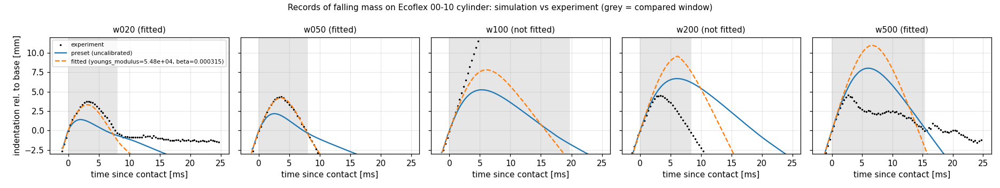
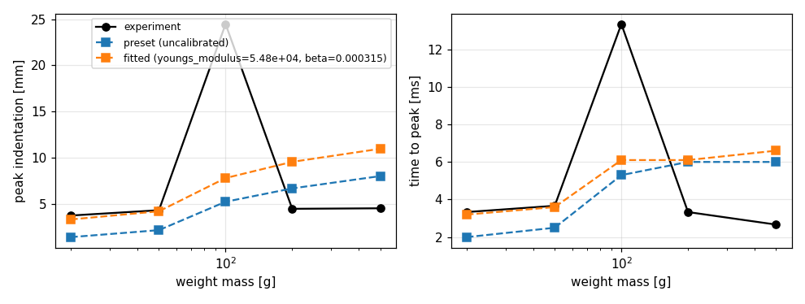
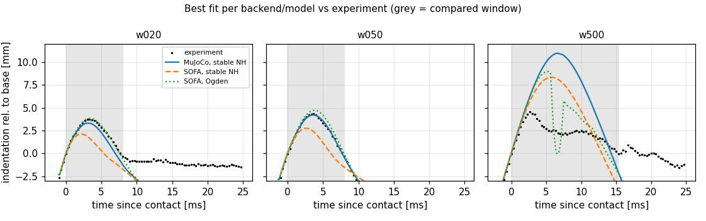
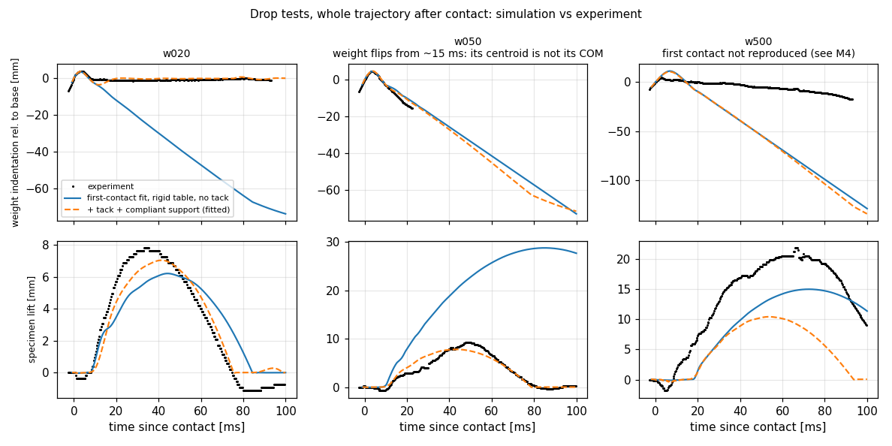

# Experiments: tracking and calibration

```bash
softsim track datasets/czopek2026_ecoflex_drop.yaml --jobs 5        # about 3 min; data/processed/<dataset>/
softsim calibrate calibrations/ecoflex_00_10_drop.yaml --jobs 3      # about 4 min; runs/calibration/...
```

## Dataset description

`datasets/czopek2026_ecoflex_drop.yaml` records the DOI, licence, camera,
specimen and, per case, the zip archive, the scenario config and how the
weight looks. Frames are read directly from the zips (`FrameSource`); nothing
is extracted or redistributed.

## Tracking (`softsim/experiments/video/`)

**Segmentation.** The backdrop is saturated green with no red, and shadows on
it stay red-free. A per-pixel reference background (the median of the first
frames) separates three classes:

- the translucent specimen: red present, bluish;
- brass weights: red present, neutral;
- black weights: much darker than the background behind them.

**Scale and camera.** The specimen's resting silhouette width equals its
diameter, giving about 5.5 px/mm. Its silhouette height, H·cos e + D·sin e,
gives a camera elevation of e ≈ 17–20°. Vertical motion therefore scales by
cos e.

**Weight motion.** The weight is followed as a rigid body (x, y and in-plane
rotation) by incremental ECC alignment of its upper part, frame to frame. The
upper part keeps the specimen and the weight's shadow out of the mask. The
weights rotate strongly during impact (the 20 g seats with about 10° of
rocking, the 100 g rolls about 100°), and a translation-only template loses
them. The tracked point is the silhouette centroid, which is close to the
centre of mass.

**Contact.** Contact is the first frame where the centre of mass departs from
a local free-fall parabola by more than 0.5 px (about 0.1 mm). The same rule is
applied to simulations (`compare.simulated_indentation`).

**Compared quantity.** `indentation_rel` is the centre-of-mass displacement
since contact, relative to the specimen base.

### Findings about the recordings

| Case | Impact speed | Offset | Spin | Usable? |
| --- | --- | --- | --- | --- |
| 20 g (brass) | 2.67 m/s | +6 mm | 317 °/s | yes; lands slightly tilted and rocks while seating |
| 50 g (brass) | 2.47 m/s | 0 mm | 48 °/s | yes for the first contact; tumbles off afterwards |
| 100 g (black, no knob) | 2.47 m/s | +14 mm | 27 °/s | **no**: hits the specimen edge and rolls off |
| 200 g (black) | 2.62 m/s | −13 mm | −59 °/s | **no**: tilted edge impact |
| 500 g (black) | 2.65 m/s | −6 mm | ~0 | first contact only; see below |

- **Frame rate is 2999.3 fps** (overlay timestamps). Impact speeds are 2–10%
  below the nominal 2.73 m/s, so simulations use the measured value per case.
- **Local free-fall fit.** Just before contact the tracker fits a free quadratic
  to the weight's height. Its apparent acceleration comes out at only
  3–4 m/s², but over the 8 ms fit window that is a difference of about 1 px
  from free fall. M3 blamed perspective; that is not established (the
  specimen's hop, below, decelerates *faster* than g). It doesn't matter for
  contact detection, and the fitted impact speeds agree with the nominal drop
  speed.
- **The specimen hops; the table does not move.** After impact the specimen
  rises 8–20 mm and lands again 70–110 ms later. The green cloth it sits on
  rises next to it (most near the specimen, less 55 mm away, with ripples
  spreading out), while the backdrop lighting band stays within ±1 px, so the
  camera is still. The 200 g specimen visibly tilts and slides in mid-air.
  The tacky specimen sticks to the cloth and drags it up, which is also why
  its hop decelerates at 13–20 m/s², faster than g. *Correction:* M3 read this
  as the table moving and discarded everything after the first contact; see
  [After the first contact](#after-the-first-contact-tack-and-the-hopping-specimen).
- **Out-of-plane tilt can't be measured** from a single side view. Simulations
  get the measured horizontal offset and in-plane spin; tilt stays zero.
- **Rotation is the less precise output.** On synthetic sequences the tracker
  recovers position to about 2% of the motion and rotation to about 20%.
- **Correction to Step 0:** the 4 mm preview estimate for 20 g happens to match
  (3.7 mm). The method was unreliable, though: it used the weight's bottom
  edge, which the specimen rim hides.

## Calibration (`softsim/experiments/calibrate.py`)

`calibrations/ecoflex_00_10_drop.yaml` fits stable Neo-Hookean E and Rayleigh
β (in log space) on MuJoCo to the 20, 50 and 500 g cases at once:

- **Optimizer:** a coarse 4×4 grid, then Nelder-Mead, 50 evaluations.
- **Simulations:** each case uses its measured impact conditions and a 5 mm
  mesh.
- **Cost:** the mean of RMSE divided by the experimental peak over the first
  contact phase.
- **Outputs:** the fitted preset (with provenance), the evaluation history,
  `report.yaml` and plots.
- **Failures and resuming:** an unstable parameter set, or one that crashes its
  worker process outright, gets the maximum per-case cost (10) instead of
  stopping the run. Each evaluation is appended to `<output>/evaluations.jsonl`.
  Re-running the calibration replays those evaluations, so an interrupted
  multi-hour run resumes where it stopped. Changing `max_evaluations`, `grid`,
  bounds or initial values keeps them. The log does not know about code
  changes: delete it after changing simulation code. The history also records
  each case's maximum ground penetration, which flags contact artefacts.

**Result:** E = 54.8 kPa and β = 0.31 ms. This is preset
[`ecoflex_00_10_drop_fit`](../softsim/materials/presets/ecoflex_00_10_drop_fit.yaml).
E is lower than the 91 kPa datasheet-derived starting estimate, and very close
to the datasheet's 100% modulus (55 kPa).



| Case | Peak exp | Peak, preset (91 kPa) | Peak, fitted | t_peak exp / fitted | NRMSE fitted |
| --- | --- | --- | --- | --- | --- |
| 20 g | 3.74 mm | 1.40 mm | 3.32 mm | 3.3 / 3.2 ms | 15% |
| 50 g | 4.31 mm | 2.16 mm | 4.20 mm | 3.7 / 3.6 ms | 3% |
| 500 g | 4.52 mm | 8.01 mm | 10.97 mm | 2.7 / 6.6 ms | 113% |
| 100 g, 200 g | edge impacts, not fitted | | | | |



### What this does and does not show

- **For light weights the model works.** For 20 g and 50 g (local indentation
  by a weight smaller than the specimen), a Neo-Hookean solid with one Rayleigh
  damping coefficient reproduces the whole first contact (loading, peak and
  unloading) within 3–15%.
- **For the 500 g weight it fails.** That weight is wider than the specimen and
  compresses its whole face. In the recording it stops within 4.5 mm in 2.7 ms,
  while the model needs about 11 mm and 6.6 ms. No single (E, β) fits both
  regimes. The measured peak indentation is almost independent of mass (3.7 →
  4.5 mm for 25× the energy). Candidate explanations, none verified:
  - rate-dependent stiffening of the silicone, which Rayleigh damping can't
    represent;
  - stronger large-strain stiffening than Neo-Hookean;
  - near-incompressibility under full-face confinement (the model uses ν = 0.45);
  - energy absorbed by the compliant table, which is measurable here but not
    modelled.

  M4 tested the material-law and compressibility candidates on SOFA; see
  [below](#backends-and-material-models-m4).
- **The fit depends on the mesh.** With the fitted values, the 20 g peak goes
  3.32 → 3.55 → 3.79 mm as the mesh refines from 5 to 3.5 to 2.5 mm. Use the
  preset with `specimen.mesh.size=5mm`, or refit at the target resolution.
- **50 g after first contact isn't modelled.** In reality the weight tumbles
  off after the first contact, so later times shouldn't be compared.

## Backends and material models (M4)

Same cases, cost and procedure on the SOFA backend, which offers more material
laws. The question: can a different material law reproduce 500 g together with
20 and 50 g? Both SOFA fits use a 5 mm mesh and dt = 0.05 ms (0.1 ms diverges
for 500 g) and took about 1 h and 2.7 h on 8 cores.

| Fit | Parameters | Cost | 20 g | 50 g | 500 g peak / t_peak (exp 4.52 mm / 2.7 ms) |
| --- | --- | --- | --- | --- | --- |
| MuJoCo, stable NH ([`ecoflex_00_10_drop_fit`](../softsim/materials/presets/ecoflex_00_10_drop_fit.yaml)) | E 54.8 kPa, ν 0.45, β 0.31 ms | 0.44 | 15% | 3% | 11.0 mm / 6.6 ms |
| SOFA, stable NH ([calibration](../calibrations/ecoflex_00_10_drop_sofa_stable_nh.yaml)) | E 105 kPa, ν 0.45, β 0.89 ms | 0.54 | 49% | 37% | 8.3 mm / 5.7 ms |
| SOFA, one-term Ogden ([`ecoflex_00_10_drop_fit_sofa_ogden`](../softsim/materials/presets/ecoflex_00_10_drop_fit_sofa_ogden.yaml)) | μ 22.9 kPa, α 1.20, K 200 kPa, β 0.28 ms | 0.24 | 3% | 11% | 9.0 mm / 5.3 ms |

(Percentages are NRMSE over the first contact phase. Reproduce the figures
with `python tools/make_model_comparison.py`.)



**What M4 shows:**

- **No material law fits 500 g.** Each fit leaves 500 g about twice too deep
  and twice too slow. The SOFA stable-NH fit is a compromise that fits nothing:
  it stiffens to help 500 g and then misses 20 and 50 g by 37–49%.
- **Large-strain stiffening isn't the explanation.** The Ogden fit chooses
  α ≈ 1.2, *less* stiffening than Neo-Hookean (α = 2), and fits 20 and 50 g
  within 3–11%, the best of the three. The M3 candidate "stronger large-strain
  stiffening" is ruled out for this data.
- **Same model, different backend, different parameters.** Stable NH on
  MuJoCo and SOFA ends at E = 55 vs 105 kPa (compliant vs hard contact,
  integrator damping; see [sofa.md](backends/sofa.md)). Fitted values are
  effective parameters of a backend + mesh + model combination.
- **Compressibility matters for the full-face impact.** At peak, the SOFA fits
  lose 27% (Ogden) and 36% (stable NH) of the specimen's volume. Silicone is
  practically incompressible, so ν = 0.45–0.47 is wrong here; under local
  indentation the material can flow aside and ν matters much less. Single runs
  of the Ogden fit with a higher bulk modulus (not refitted):

  | Bulk modulus (ν) | 20 g peak (exp 3.74) | 500 g peak (exp 4.52) | 500 g t_peak (exp 2.7) |
  | --- | --- | --- | --- |
  | 200 kPa (0.466), fitted | 3.82 mm | 8.96 mm | 5.3 ms |
  | 1 MPa (0.493) | 3.54 mm | 7.65 mm | 5.2 ms |
  | 5 MPa (0.499) | 3.31 mm | 6.54 mm | 4.6 ms |

  Near-incompressibility closes about 45% of the 500 g peak gap while 20 g
  stiffens 12%, partly linear-tetrahedron locking. A joint refit with the bulk
  modulus free is prepared but **not run yet**
  ([`ecoflex_00_10_drop_sofa_ogden_bulk.yaml`](../calibrations/ecoflex_00_10_drop_sofa_ogden_bulk.yaml),
  about 3–4 h; repeat at a 3.5 mm mesh to separate locking from material).
- **The remaining gap** (500 g still about 45% too deep and 70% too slow at
  ν ≈ 0.5) points to what no tested model has: rate-dependent stiffening
  (Prony viscoelasticity; Rayleigh β can't represent it) and/or the compliant
  table.
- **SOFA contact fails at extreme rim flaring.** In the Ogden 500 g run the
  specimen's rim spreads to 45 mm radius and, from 7.6 ms (after the peak at
  5.3 ms), rim vertices pass up to 8.5 mm through the ground. No element
  inverts. The 500 g peak and timing are before this and valid, but its 58%
  NRMSE includes the artefact and isn't meaningful.

## After the first contact: tack and the hopping specimen

M3 and M4 compared only the first ~8 ms, because M3 had read the later motion
as the table moving. That was wrong (see the findings above): the specimen
itself hops. The whole first 100 ms is usable data, and it shows that the
simulations got the physics after the first contact wrong. Without any
adhesion, the simulated 20 g weight flies off at 1.2 m/s and rises 70 mm. The
real one never leaves the specimen.

**What the recordings show:**

- **20 g: the weight sticks.** It comes off the compressed material at
  1.0–1.2 m/s relative to the base, as fast as in the simulation, and then
  stops within about 1 mm and stays there for 90 ms while rocking. Momentum
  says why: 20 g × 1.0 m/s ≈ 42 g × 0.45 m/s, and weight plus specimen then
  hop together at about 0.45 m/s (7.6 mm apex). The weight is stuck to the
  tacky Ecoflex and pulls the whole specimen off the cloth.
- **50 g: the weight peels off.** With 2.5× the momentum, the bond can't hold
  the weight. It separates while rotating (a peel from one edge) at about
  1 m/s relative to the specimen, the same as the simulation up to 22 ms.
  After that it tumbles away from the camera and lands on the table *behind*
  the specimen (it lies still there from ~210 ms). Its image height then mixes
  height with depth, so the side view can't measure its rebound. The specimen
  still hops 8 mm.
- **500 g: the weight lifts the specimen with it** by 20 mm, and separates
  only around 70–100 ms.
- **The cloth comes along.** The green cloth next to the specimen rises with
  it and ripples, and the hop decelerates at 13–20 m/s², faster than g: the
  specimen sticks to the cloth too.

**Model.** Two scene elements, both general features of softsim:

- **Adhesion** (`material.adhesion: {strength, range}`), an exponential
  cohesive law for the normal traction between the soft surface and what it
  touches (t = σ (g/δ) e^(1 − g/δ); work of separation e·σ·δ). Bonds form on
  contact and break beyond 6δ. Verified against analytic equilibria on MuJoCo
  and SOFA (`tests/test_adhesion.py`).
- **A compliant support** (`support:` in the drop test): a carrier plate under
  the specimen that can lift off the table against a spring and damper. It is
  a lumped stand-in for the cloth, and its parameters are effective ones.

**Fit** (`calibrations/ecoflex_00_10_drop_adhesion_support.yaml`, MuJoCo,
5 mm mesh). Compared quantities:
- 20 g: weight position relative to the specimen base and specimen lift over
  0–100 ms;
- 50 g: relative position over 0–15 ms (later, the flipping weight's centroid
  is not its centre of mass) and specimen lift over 0–100 ms.

500 g is not used (below).

Only the tack and support are fitted; the bulk material stays at its M3
first-contact values (preset
[`ecoflex_00_10_drop_fit_tacky`](../softsim/materials/presets/ecoflex_00_10_drop_fit_tacky.yaml);
`softsim sweep scenarios/drop_test/sweeps/fitted_tack_support.yaml` runs all five weights with it):

| | Fitted value |
| --- | --- |
| tack strength σ | 14.6 kPa |
| tack range δ | 0.29 mm (work of separation e·σ·δ ≈ 11.6 J/m²) |
| support stiffness, damping, mass | 33 N/m, 0.35 N·s/m, 45 g |

| Case | Observable | Without tack (rigid table) | With tack + support |
| --- | --- | --- | --- |
| 20 g | weight rel. to base, 0–100 ms | flies off (−75 mm at 100 ms) | stays seated; NRMSE 25% |
| 20 g | specimen hop | 6.2 mm, too slow | 7.0 mm (exp. 7.8), lands at ~80 ms; NRMSE 12% |
| 50 g | weight rel. to base, 0–15 ms | | NRMSE 6% (first contact and separation) |
| 50 g | specimen hop | 29 mm | 8 mm (exp. 9); NRMSE 11% |

Total cost 0.133 (90 evaluations, flat from about the 55th), against 0.48 at
the first initial guess.

**What to make of it:**

- **Tack, not dissipation, is why the simulations flew too high.** In the
  MuJoCo model the weight already leaves the compressed specimen at the
  measured speed. What was missing is that it stays stuck.
- **The parameters are effective, and tied to the mesh.** The tack is a
  cohesive law whose process zone (~4 mm) the 5 mm mesh doesn't resolve. On a
  3.5 mm mesh the same values let the 20 g weight peel off. The support is a
  lumped stand-in for a cloth that sticks, stretches and ripples, so 45 g and
  33 N/m are not the cloth's mass and stiffness.
- **Checked:** halving the timestep changes the errors by less than 0.01.
- **The cloth pulls back harder than gravity** (13–20 m/s² in the
  recordings). The fit captures that through the spring, which is why the
  simulated hop is about 10% too low but lands on time.
- **500 g is outside this model** (below). With its first contact 2.4× too
  deep, the weight rebounds too fast for any bond and tears off.



### The 500 g first contact

The 500 g weight stops within 4.5 mm in 2.7 ms. No simulation so far gets
close: every material law, both backends and a near-incompressible bulk
modulus leave it at 6.5–11 mm and 4.6–6.6 ms (M4). Three checks so far:

- **The tracking is right.** Tracking the top edge of the weight's knob
  against the plain backdrop, independently of the tracker, gives the same
  motion within 0.5–1 mm. The weight travels almost freely for the first
  ~1 ms, then decelerates at ~1750 m/s² (~900 N), and comes back up at
  ~0.85 m/s.
- **It lands tilted, but that is not the explanation.** Before impact the
  weight is tilted by 7° in the image plane (consistent over 4 frames). The
  simulation with that tilt peaks at 9.7 mm at 5.0 ms instead of 11.0 mm at
  6.6 ms: closer, but not close.
- **No elastomer explanation fits.** As a linear spring, the stop needs
  ~170 kN/m, an effective modulus above 1 MPa, against ~55 kPa from the light
  weights. That is 19× the 50 g case's stiffness, with a shorter time to peak
  than 20 g despite 25× the mass. No string or guide is visible above the
  weight.
- **It is not a modelling artefact of the tetrahedral backends.** The
  locking-free axisymmetric reference ([reference_fem.md](reference_fem.md))
  is nearly incompressible (ν = 0.4995) with sticking contact on both faces,
  so it has none of the suspects: locking, volume loss, friction slip. It
  still peaks at 8.1 mm (E = 100 kPa) and 6.4 mm (E = 200 kPa), against the
  measured 4.5 mm. Statically, sticking faces stiffen 26% compression only
  1.7× over frictionless.

The cause is unknown. Possibilities include something in the 500 g setup that
the recording doesn't show, or a strongly rate-dependent response under
full-face confinement. Until it is understood, 500 g is kept out of the fits.

## What the fitted modulus means

All fits on this page are *effective* models of a backend, mesh and contact
model, not the silicone's material constants. The axisymmetric reference
solver ([reference_fem.md](reference_fem.md)) cross-checks this:
- it agrees with MuJoCo's 3.5 mm mesh within 2–5% for static indentation;
- in the drop, MuJoCo's impact loses energy to friction slip and contact
  mechanics that the reference doesn't have;
- on the reference, the first contacts need **E ≈ 100–130 kPa** plus some
  damping, consistent with the datasheet (≈ 94 kPa). MuJoCo's 55 kPa
  compensates for MuJoCo's own losses.

Use the MuJoCo presets with MuJoCo at their mesh size. Take the material's
actual modulus from the reference.
