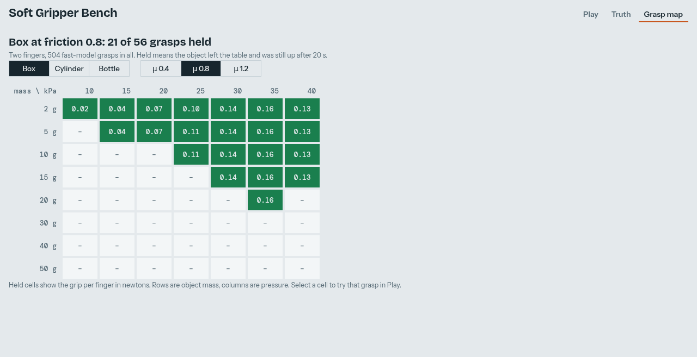
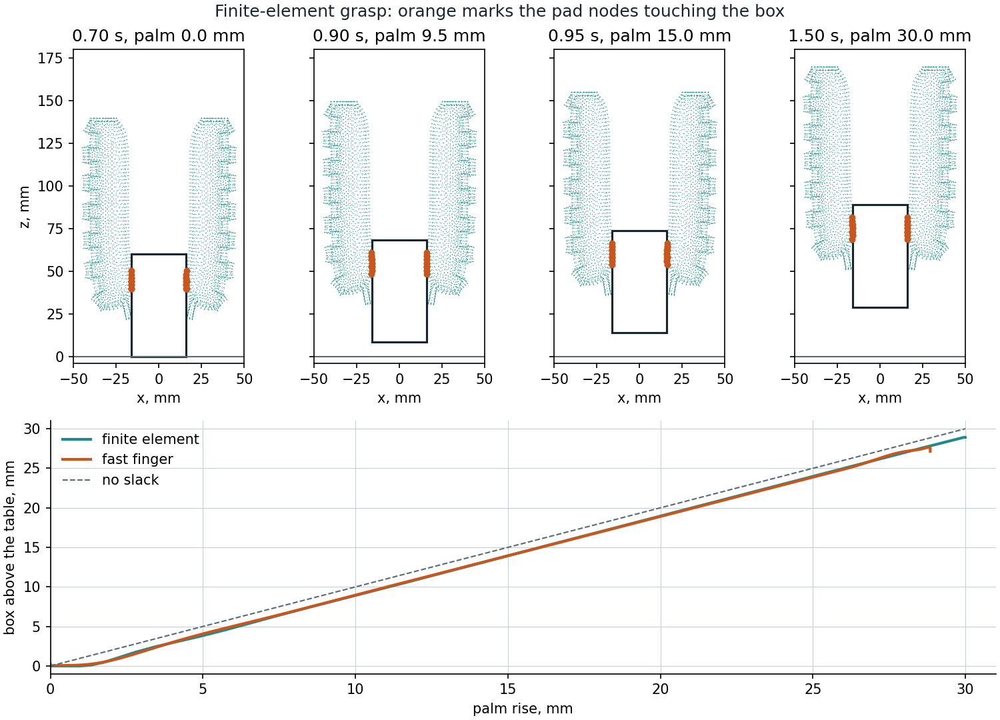

# Soft gripper

A two-finger gripper built from the validated Wang finger, and a fast model of it that runs live on your own machine.
The slow reference solver matches the measured finger to about 1°; it teaches a chain of links, and the chain runs
faster than real time.

## Play with it

```bash
xdg-open docs/viewer/gripper.html      # or double-click it: no server, the physics is inside the file
python tools/demo_gripper.py --finger softsim/reduced/wang_finger.json    # desktop version (MuJoCo viewer, sliders)
```

The page runs MuJoCo compiled to WebAssembly in your browser. **Play** has sliders for pressure, mass and friction,
three objects, two to four fingers, and a live readout of grip against weight. Drag the object to push it. **Truth**
replays a recorded finite-element grasp beside the fast finger on the same clock, with a time slider and jumps to the
moments that matter. **Grasp map** shows which grasps hold; selecting a cell loads that grasp into Play. Only the page's fonts come from the
network, and it falls back to system fonts offline.

## The fast finger

`softsim/reduced` cuts the finger into 8 links, each with a hinge and a slide. Tables in pressure give each link's rest
angle and length, read from the reference's free-bend ramp. They are tables, not laws, because the pad stretches by a
third at 40 kPa and the bend falls back after 35 kPa. One stiffness per pressure, shared by all hinges, comes from
static tip loads on the reference (`tools/probe_finger.py`). `softsim/reduced/wang_finger.json` holds the result, and
the page and Python read the same tables and the same model text.

Errors of the fitted finger against the reference:

| Check | Used in the fit | Result |
| --- | --- | --- |
| Free tip against the static shape, 5-35 kPa | no | 0.3-3.1 mm |
| Tip load, 5, 15, 25, 35 kPa | yes | 4-7% of the tip's movement |
| Tip load, 20 kPa | no | 5-7% (3.5-4.7 mm of 53-91 mm) |
| Load spread over the pads, 5-35 kPa | no | 9-27% |

The spread-load error is the model's known weakness: at 20 kPa the chain bends 17-22% too far, so one stiffness for the
whole finger is too simple. Contact on the objects here is near the tip, where the tip-load figures apply.

Reproduce (the probes take about an hour on the RTX 3060):

```bash
python tools/probe_finger.py --pressures 5 15 20 25 35 --forces 0.1 0.2 --out runs/reduced/probes_static.json
python tools/fit_reduced_finger.py --ramp runs/media/wang/fem.npz --probes runs/reduced/probes_static.json \
    --hold-out 20 --out softsim/reduced/wang_finger.json
```

`runs/media/wang/fem.npz` is the free-bend run written by `tools/make_actuation_media.py`.

## What it can hold



`tools/grasp_map.py` runs 504 grasps: three objects, three frictions, eight masses, seven pressures; 154 hold. Held means
the object ended at least 10 mm above where it started and sank less than 1 mm over the last 0.2 s
(`softsim.scenarios.grasp.is_held`, shared with the finite-element grasps). It is not a share of the lift, because soft
fingers can lose much of the lift before the object leaves the table. An earlier rule of 80% of the lift held 126: all
126 still hold, and 23 of the 28 added are the bottle. The finger is very
soft (0.2 N moves its tip about 90 mm), so this is a light gripper: the box grips at 0.16 N per finger at 35 kPa, and at
friction 0.8 two fingers can carry about 26 g. The map holds 20 g and drops 30 g, as that limit says it should.

Three things decided the layout:

- **Palm height 140 mm.** At 120 mm the lengthened fingers reach the table at 30-40 kPa and pinch objects at their base,
  so a cylinder tips over.
- **Holds are not monotonic in pressure.** The cylinder drops at 35 kPa and holds at 40 kPa. This may follow the bend
  falling back after 35 kPa; it has not been confirmed.
- **Fingers do not collide with each other** in the fast model.

```bash
python tools/grasp_map.py --finger softsim/reduced/wang_finger.json --out runs/reduced/grasp_map.json
python tools/make_gripper_page.py --finger softsim/reduced/wang_finger.json --map runs/reduced/grasp_map.json
python tools/check_gripper_page.py docs/viewer/gripper.html --finger softsim/reduced/wang_finger.json --shots runs/page
```

## Against the finite-element grasp



The same grasp on the reference: 25 kPa, a 10 g box, friction 0.8, a 30 mm lift. This run is coarse, 2 mm and toothless, so
it is not the validated finger; the 1.5 mm finger with teeth is the one to trust.

| | Finite element, 2 mm | Fast finger |
| --- | --- | --- |
| Palm rise when the box leaves the table | 13.9 mm | 0.2 mm |
| Final rise of the box | 17.2 mm | 27.1 mm |
| Grip before the lift | 0.170 N | 0.107 N |
| Grip while holding | 0.100 N | 0.092 N |
| `held` (left the table and stayed up) | 1 | 1 |

Both carry the box and hold it steady, so the two agree that this grasp works. They disagree on how it works. In the
reference the fingertips first press the box
down on the table, then peel away as the palm rises, and the box is picked up by a new contact near its top corners. A
chain of links cannot peel or re-grip like that. So the fast model's lift height and its grip before the lift are not
predictions, and its holding limit (about 26 g) rests on the grip while holding, which agrees within 8% in this one case.

The fast palm also stops 1.15 mm short of its target, sagging on its position actuator; `ReducedGripper.palm_rise` is
the real height.

```bash
python tools/run_fe_grasp.py --mass 10 --out runs/grasp/box_10g_2mm.npz --set body.mesh.size=2mm --set body.geometry.finger.tooth_height=0
python tools/plot_fe_grasp.py runs/grasp/box_10g_2mm.npz --finger softsim/reduced/wang_finger.json --out docs/media/gripper_fe_grasp.png
python tools/make_gripper_page.py --finger softsim/reduced/wang_finger.json --map runs/reduced/grasp_map.json --truth runs/grasp/box_10g_2mm.npz
python tools/check_gripper_page.py docs/viewer/gripper.html --finger softsim/reduced/wang_finger.json --truth runs/grasp/box_10g_2mm.npz --shots runs/page
```

The Truth tab draws the finger's side face. Contact is usually mid-width, where the cavity bulges the pad past that face,
so a marked node can sit in a gap between the drawn finger and the box. The fast finger there gets the same pressure
schedule and is asked for the same palm path, but its palm follows about 6 mm behind during the lift.

## Checks

- `tools/check_gripper_page.py` opens the page from disk in headless Chrome, fails on any script error, and runs four
  scripted grasps in both the page and Python. The largest gap is 0.16 mm, although the page's MuJoCo is an older
  build (WebAssembly 3.1.16). It ran at about 8x real time with software graphics and two FE runs on the machine.
- `tests/test_reduced_finger.py`: tables recover an exact arc, a small tip load matches the hinged cantilever by hand,
  the fit recovers a known stiffness, MuJoCo agrees with the static balance, and a mass under the friction limit rises
  while one over it stays. Mutations of the load direction, the spread load, the object's friction and the held metric
  each fail a test.
- `tools/check_gripper_page.py --truth` compares the tab's decoded nodes with the run file (worst 0.005 mm, the storage
  step) and its readouts with both models. `tests/test_truth_data.py` checks the packing, the chapters and the schedule.
- `tests/test_grasp.py`: two fingers are exactly two of the finger, they curl inwards, and held and slip mean what they
  say.

## Limits

- **The map is the fast model's prediction.** One coarse finite-element grasp is in, above, and no finite-element drop
  yet, so its held and dropped boundary is unchecked. The page says so.
- There is no real grasp data, so nothing here is checked against a physical gripper.
- The chain does not deform around an object.
- Two fingers are the fitted case. Three and four fingers on the page are extrapolations, and the validated finger is
  plane strain, so FE grasps can only be two fingers.
- In FE grasps the table is a one-way frictionless support under the object's centre of mass (`RigidBody3D.floor`): it
  stops the object sinking, but not tipping, and the object cannot slide against it. The reference also has no
  finger-to-finger contact or self-collision.
- SOFA is not used: 8.14° RMS on the finger at 1 mm and no browser build (`docs/decisions.md`).
