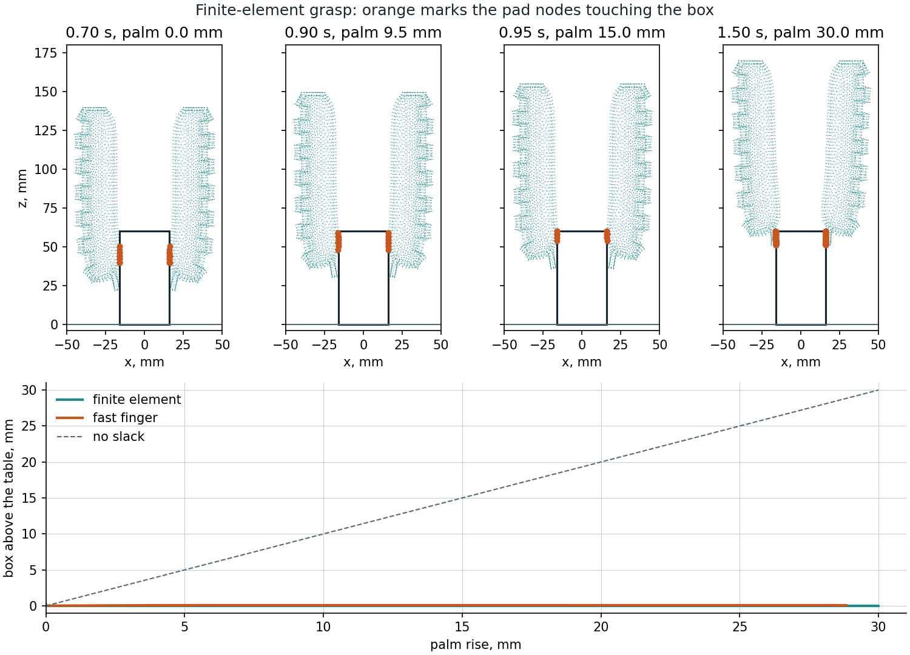

# Soft gripper

A two-finger gripper built from the validated Wang finger, and a fast model of it that runs live on your own machine.
The slow reference solver matches the measured finger to about 1°; it teaches a chain of links, and the chain runs
faster than real time.

## Play with it

```bash
xdg-open docs/viewer/gripper.html      # or double-click it: no server, the physics is inside the file
python tools/demo_gripper.py --finger softsim/reduced/wang_finger.json    # desktop version (MuJoCo viewer, sliders)
```

The page runs MuJoCo compiled to WebAssembly in your browser. **Play** has sliders for pressure, mass and friction,
three objects, two to four fingers, and a live readout of grip against weight. Drag the object to push it. **Truth**
replays a recorded finite-element grasp beside the fast finger on the same clock, with a time slider and jumps to the
moments that matter. **Grasp map** shows which grasps hold; selecting a cell loads that grasp into Play. Only the page's fonts come from the
network, and it falls back to system fonts offline.

## The fast finger

`softsim/reduced` cuts the finger into 8 links, each with a hinge and a slide. Tables in pressure give each link's rest
angle and length, read from the reference's free-bend ramp. They are tables, not laws, because the pad stretches by a
third at 40 kPa and the bend falls back after 35 kPa. One stiffness per pressure, shared by all hinges, comes from
static tip loads on the reference (`tools/probe_finger.py`). `softsim/reduced/wang_finger.json` holds the result, and
the page and Python read the same tables and the same model text.

Errors of the fitted finger against the reference:

| Check | Used in the fit | Result |
| --- | --- | --- |
| Free tip against the static shape, 5-35 kPa | no | 0.3-3.1 mm |
| Tip load, 5, 15, 25, 35 kPa | yes | 4-7% of the tip's movement |
| Tip load, 20 kPa | no | 5-7% (3.5-4.7 mm of 53-91 mm) |
| Load spread over the pads, 5-35 kPa | no | 9-27% |

The spread-load error is the model's known weakness: at 20 kPa the chain bends 17-22% too far, so one stiffness for the
whole finger is too simple. Contact on the objects here is near the tip, where the tip-load figures apply.

Reproduce (the probes take about an hour on the RTX 3060):

```bash
python tools/probe_finger.py --pressures 5 15 20 25 35 --forces 0.1 0.2 --out runs/reduced/probes_static.json
python tools/fit_reduced_finger.py --ramp runs/media/wang/fem.npz --probes runs/reduced/probes_static.json \
    --hold-out 20 --out softsim/reduced/wang_finger.json
```

`runs/media/wang/fem.npz` is the free-bend run written by `tools/make_actuation_media.py`.

## What it can hold


`tools/grasp_map.py` runs 504 grasps: three objects, three frictions, eight masses, seven pressures; 107 hold (60 box, 23
cylinder, 24 bottle). Each grasp holds to 20 s. Held means the object ended at least 10 mm above where it started and sank less
than 1 mm over the last 0.2 s (`softsim.scenarios.grasp.is_held`, shared with the finite-element grasps). It is not a share of
the lift, because soft fingers can lose much of the lift before the object leaves the table. The finger is very
soft (0.2 N moves its tip about 90 mm), so this is a light gripper: the box grips at 0.16 N per finger at 35 kPa, and at
friction 0.8 two fingers can carry about 26 g. The map holds 20 g and drops 30 g, as that limit says it should.

**Why 20 s.** Stopping 2 s after the lift called 154 grasps held. `tools/check_long_hold.py` runs those on, and only 123 are
held at 10 s and 106 at 20 s: 60 of 61 box grasps, 23 of 46 cylinders and 23 of 47 bottles. One bottle grasp the short window
rejected holds at 20 s, which makes 107. Even a good box grasp sinks, at 0.40 mm/s for 10 g at 30 kPa, so 20 s also marks
down a grasp that creeps below 10 mm: the 30 g box at friction 1.2 and 35 kPa ends at 9.2 mm. That sink is MuJoCo's soft
friction creeping rather than the grasp slipping: raising `impratio` from 10 to 100 cuts it to 0.04 mm/s. The cylinder's fall
is not only creep: at `impratio` 100 it still falls, later.

Three things decided the layout:

- **Palm height 140 mm.** At 120 mm the lengthened fingers reach the table at 30-40 kPa and pinch objects at their base,
  so a cylinder tips over.
- **More pressure is not always better.** A 10 g cylinder at friction 0.8 holds at 20 and 25 kPa, and is back on the table
  by 10 s at 30 and 40 kPa. At 25 kPa and above even a 2 g cylinder falls by 20 s, so weight is not the cause. The cause has
  not been established.
- **Fingers do not collide with each other** in the fast model.

```bash
python tools/grasp_map.py --finger softsim/reduced/wang_finger.json --out runs/reduced/grasp_map.json
python tools/make_gripper_page.py --finger softsim/reduced/wang_finger.json --map runs/reduced/grasp_map.json
python tools/check_gripper_page.py docs/viewer/gripper.html --finger softsim/reduced/wang_finger.json --shots runs/page
python tools/grasp_map.py --finger softsim/reduced/wang_finger.json --end 3.5 --out runs/reduced/grasp_map_3p5s.json
python tools/check_long_hold.py runs/reduced/grasp_map_3p5s.json --finger softsim/reduced/wang_finger.json --out runs/reduced/long_hold.json
```

## Against the finite-element grasp


The same grasp on the reference: 25 kPa, a 10 g box, a 30 mm lift, Coulomb friction 0.8 on both models. This run is coarse,
2 mm and toothless, so it is not the validated finger; the 1.5 mm finger with teeth is the one to trust.

| | Finite element, 2 mm, μ 0.8 | Fast finger | Finite element, no-slip (earlier) |
| --- | --- | --- | --- |
| Palm rise when the box leaves the table | 1.3 mm | 0.2 mm | 13.9 mm |
| Final rise of the box | 28.9 mm | 27.1 mm | 17.2 mm |
| Grip before the lift | 0.122 N | 0.107 N | 0.170 N |
| Grip while holding | 0.100 N | 0.092 N | 0.100 N |
| `held` | 1 | 1 | 1 |

**The two agree on how the grasp works, not only that it holds.** The pads stay on the box's sides, the box leaves the table
almost at once and follows the palm, and the grip is within 8% while holding and 12% before the lift. The fast finger's friction
was not tuned to this run.

**The earlier comparison was wrong, and why.** The first finite-element grasps ran with no-slip contact while the fast finger
ran at 0.8: the backend takes the larger of the silicone card's friction (1.0) and the object's, and from `STICK_MU` = 1.0 up it
sticks, so `object.friction` had no effect. In those runs the fingertips pressed the box down, peeled off and re-gripped it at its
top corners. That was the no-slip contact, not the finger: with friction it does not happen. Real friction is set with the card,
`body.material.friction.sliding`, below 1.

The fast palm also stops 1.15 mm short of its target, sagging on its position actuator; `ReducedGripper.palm_rise` is
the real height.

```bash
python tools/run_fe_grasp.py --mass 10 --out runs/grasp/coulomb_10g_2mm.npz --checkpoint runs/grasp/coulomb_10g_2mm.ckpt.npz \
    --set body.mesh.size=2mm --set body.geometry.finger.tooth_height=0 --set body.material.friction.sliding=0.8    # about an hour
python tools/plot_fe_grasp.py runs/grasp/coulomb_10g_2mm.npz --finger softsim/reduced/wang_finger.json --out docs/media/gripper_fe_grasp.png
python tools/make_gripper_page.py --finger softsim/reduced/wang_finger.json --map runs/reduced/grasp_map.json --truth runs/grasp/coulomb_10g_2mm.npz
python tools/check_gripper_page.py docs/viewer/gripper.html --finger softsim/reduced/wang_finger.json --truth runs/grasp/coulomb_10g_2mm.npz --shots runs/page
```

### The first finite-element drop



The same grasp with a 30 g box, which the map drops. The finite-element fingertips slide up the box's sides to its top
corners and the box never leaves the table; the fast finger lifts it 1.5 mm at most and puts it back. Both call it dropped.

| | Finite element, 2 mm, μ 0.8 | Fast finger |
| --- | --- | --- |
| Final rise of the box | 0.001 mm | 0.08 mm |
| Grip before the lift | 0.122 N | 0.108 N |
| Grip while holding (the tips at the corners) | 0.074 N | 0.092 N |
| `held` | 0 | 0 |

The hand check: grip is per finger, so two fingers at μ 0.8 and 0.122 N carry 2 × 0.8 × 0.122 = 0.195 N, which is 19.9 g. The
10 g box is under that and held, the 30 g box over it and dropped, on both models. This is one grasp on each side of the
limit, on a coarse mesh, so it checks the map's boundary for the box at 25 kPa, not everywhere.

```bash
python tools/run_fe_grasp.py --mass 30 --out runs/grasp/coulomb_30g_2mm.npz --checkpoint runs/grasp/coulomb_30g_2mm.ckpt.npz \
    --set body.mesh.size=2mm --set body.geometry.finger.tooth_height=0 --set body.material.friction.sliding=0.8    # about 2.7 hours
python tools/plot_fe_grasp.py runs/grasp/coulomb_30g_2mm.npz --finger softsim/reduced/wang_finger.json --mass 30 --out docs/media/gripper_fe_drop.png
```

**Mesh error.** A no-slip run on the validated 1.5 mm finger with teeth (11 hours) gripped 12% harder while holding than the
same run at 2 mm (0.112 against 0.100 N), and left the table at 11.7 mm of palm rise against 13.9. Take about 12% as the
uncertainty of the 2 mm grips above until a 1.5 mm friction run exists.

The Truth tab draws the finger's side face. Contact is usually mid-width, where the cavity bulges the pad past that face,
so a marked node can sit in a gap between the drawn finger and the box. The fast finger there gets the same pressure
schedule and is asked for the same palm path, but its palm follows about 6 mm behind during the lift.

## Checks

- `tools/check_gripper_page.py` opens the page from disk in headless Chrome, fails on any script error, and runs four
  scripted grasps in both the page and Python. The largest gap is 0.16 mm, although the page's MuJoCo is an older
  build (WebAssembly 3.1.16). It ran at about 8x real time with software graphics and two FE runs on the machine.
- `tests/test_reduced_finger.py`: tables recover an exact arc, a small tip load matches the hinged cantilever by hand,
  the fit recovers a known stiffness, MuJoCo agrees with the static balance, and a mass under the friction limit rises
  while one over it stays. Mutations of the load direction, the spread load, the object's friction and the held metric
  each fail a test.
- `tools/check_gripper_page.py --truth` compares the tab's decoded nodes with the run file (worst 0.005 mm, the storage
  step) and its readouts with both models. `tests/test_truth_data.py` checks the packing, the chapters and the schedule.
- `tools/rehearse_gripper_demo.py` presses the buttons [the demo script](demo_script.md) names and fails if a beat ends
  differently, or if Play's lift stops starting at 1.5 s, where the map's does. It found Play lifting 0.6 s early, so a
  loaded map cell was a different grasp; that is fixed.
- `tests/test_grasp.py`: two fingers are exactly two of the finger, they curl inwards, and held and slip mean what they
  say.

## Limits

- **Held on the map means held at 20 s**, not indefinitely, and every grasp is still creeping then (see above).
- **The map is the fast model's prediction.** Two coarse finite-element grasps check it, the box at 25 kPa held at 10 g and
  dropped at 30 g, as the map says. Every other cell, and the cylinder and bottle entirely, are unchecked.
- **Nothing here reproduces a physical grasp, and the grip is the conservative case.** Wang et al. measured a tip force of
  0.47, 0.77 and 0.96 N at 20, 30 and 35 kPa (Table 7, not used in any fit here) and showed four fingers holding objects up
  to 364 g, in single demonstrations with pressure unrecorded. The validated finger with its tip sliding on a gauge pushes
  0.085, 0.146 and 0.165 N; with its tip stuck to it, 1.04 N at 20 kPa and 1.19 N at 30 kPa: the measurement lies between,
  and the paper doesn't record the contact, so the force cannot check the model
  ([docs/actuation.md](actuation.md#tip-force-a-test-it-fails)). The fast finger is fitted to the sliding case: it grips at
  0.16 N per finger at 35 kPa and carries about 26 g on two fingers. Its held and dropped limits are the model's, not the
  real gripper's.
- The chain does not deform around an object.
- Two fingers are the fitted case. Three and four fingers on the page are extrapolations, and the validated finger is
  plane strain, so FE grasps can only be two fingers.
- In FE grasps the table is a one-way frictionless support under the object's centre of mass (`RigidBody3D.floor`): it
  stops the object sinking, but not tipping, and the object cannot slide against it. The reference also has no
  finger-to-finger contact or self-collision.
- SOFA is not used: 8.14° RMS on the finger at 1 mm and no browser build (`docs/decisions.md`).
