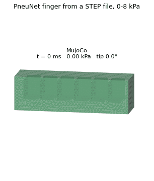

# softsim

Simulation of soft materials and soft robots, **validated against real data**, with the same YAML running on
several physics engines:

| Backend | What it is | Use it for |
|---|---|---|
| `mujoco` | MuJoCo flex (linear tetrahedra) | speed: control, sweeps, interactive viewing |
| `sofa` | SOFA v26.06 through SofaPython3 | more material laws, SOFA's contact |
| `fem` | softsim's own locking-free 3D finite elements (quadratic tetrahedra) | the truth the others are checked against |
| `rod` | slender bodies reduced to beams (SOFA BeamAdapter) | cables, arms and columns, in seconds |

Every backend declares what it can simulate and refuses what it can't, so a scene never quietly runs
different physics. A fast backend's error against the reference is measured (`softsim transfer`) and stated.
The [benchmark table](benchmarks.md) lists every validated case on every backend.



## Install

```bash
python3 -m venv .venv
.venv/bin/pip install -e ".[dev]"            # MuJoCo, gmsh, scipy, pytest
.venv/bin/pip install -e ".[fem,fast]"       # optional: the reference FEM (JAX) and PARDISO
```

On ROS 2 Humble, create the venv with `--system-site-packages` ([ROS 2](ros2.md)). For SOFA, unzip the
SOFA v26.06 Linux release and set `SOFA_ROOT` ([SOFA backend](backends/sofa.md)).

## Five lines

```python
from softsim import Simulation

sim = Simulation("scenarios/actuation/cable_cantilever.yaml", ["body.mesh.size=2.5mm"], backend="mujoco")
result = sim.run()
print(result.summary["final_bend_angle"])   # rad; Euler-Bernoulli says 0.270
```

## Where to go next

- **Tutorials:** [a first drop simulation](tutorials/first_drop.md), [changing a material](tutorials/change_a_material.md),
  [an actuated finger and its transfer to MuJoCo](tutorials/actuated_finger.md).
- **Materials:** [cards and parameters](materials.md), and the [material library](material_library.md) (25 silicone cards
  fitted to public test data).
- **Robots:** [actuation](actuation.md) (pressure, cables, forces, mounts), [gripper](gripper.md),
  [magnetic soft materials](magnetic.md).
- **Validation:** [benchmarks](benchmarks.md), [drop-test experiments](experiments.md), [predictions on unseen data](validation.md).
- **Extending:** add a [material](adding_a_material.md), [body](adding_a_body.md), [scenario](adding_a_scenario.md),
  [backend](adding_a_backend.md) or [dataset](adding_a_dataset.md).
