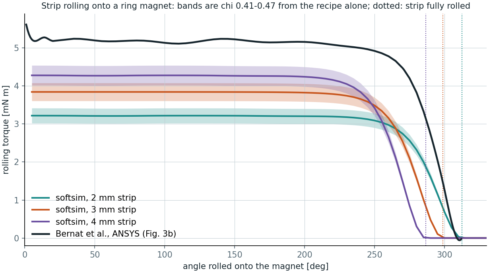
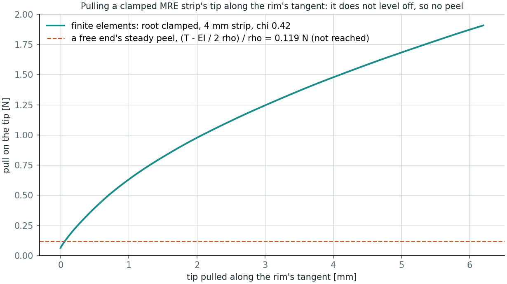

# Magnetic soft materials (MRE)

softsim models a **soft-magnetic elastomer**: silicone filled with iron powder, as in magnetorheological elastomer (MRE)
grippers. The iron has no magnetisation of its own. The applied field magnetises it, a strip turns to lie along the field,
and in a field gradient it is pulled towards the stronger field. The reference solver (`backend: fem`) runs it; MuJoCo,
SOFA and the rod backend refuse it rather than simulate a passive body.

## Using it

A material card and a field, in any scenario config:

```yaml
body:
  material:
    density: 2000 kg/m^3
    elastic:
      model: magneto_active
      matrix: {model: neo_hookean, youngs_modulus: 810 kPa, poisson_ratio: 0.49}
      particle_volume_fraction: 0.123   # or susceptibility: 0.45
      along: [1, 0, 0]                  # the strip's length, body frame
      normal: [0, 0, 1]                 # its thickness
      # demagnetization: block          # default; or [N_along, N_normal, N_across]

magnetic_field:
  uniform: [[0 s, [0, 0, 0]], [0.5 s, [20 kA/m, 0, 0]]]   # H, linear between waypoints; or a constant [Hx, Hy, Hz]
  magnets:
    - name: ring
      remanence: 1.23 T
      diameter: 20 mm
      hole: 4.2 mm
      thickness: 5 mm
      position: [0, 0, -12 mm]
      axis: [0, 1, 0]
      path: [[0 s, [0, 0, 0]], [0.2 s, [0, 0, 12 mm]]]    # optional, minimum jerk
      solid: true                                          # optional: the body can touch it
      edge: 0.2 mm                                         # optional: its chamfer (the default)
```

A `solid` magnet is also a rigid cylinder of the reference (its outer one), fixed or moving along its path, that the body
touches with its own friction. `edge` is the magnet's chamfer: it rounds the contact surface and softens the field at the
rims of the end faces (below).

`scenarios/magnetic/mre_strip_buckling.yaml` is a complete example (`softsim run scenarios/magnetic/mre_strip_buckling.yaml`,
12 s).

## The model

Energy per unit reference volume (`softsim/fem/magnetic.py`):

```text
w = -mu0 / 2 (chi_a (a.H)^2 + chi_n (n.H)^2 + chi_b (H.H - (a.H)^2 - (n.H)^2))
```

- **Axes follow the deformation.** The strip's axis is `a = F a0` and its normal is `n = F^-T n0`, both normalised, so the
  energy turns with the material. A shear shows the difference between F and F^-T.
- **Composite susceptibility.** `chi` is given, or comes from the iron's volume fraction by Maxwell Garnett's rule,
  `3 phi / (1 - phi)`.
- **Per-axis susceptibility.** Each axis takes `chi / (1 + N chi)`, where `N` is the demagnetising factor of the
  rectangular block bounding the body at rest. The factor is exact for a block (Aharoni 1998).
- **Field.** `H` is the applied field at the deformed position: a uniform part plus permanent magnets.
  - Each magnet is an axially magnetised cylinder, magnetised uniformly at `Br / mu0`.
  - Its field is exact outside it (Derby and Olbert's closed form, with Bulirsch's elliptic integral run for a fixed
    number of steps so JAX can differentiate it).
  - A ring is a disc minus its hole.
  - Inside a magnet, H is `B / mu0 - M`. Nothing should be there, but contact holds nodes out, not quadrature points.
    Taking `B / mu0` there made a false well just inside the rim, twice as deep as the real field, and it pulled a
    strip through the magnet's skin.
  - **Edges.** A sharp-edged magnet's field is infinite on the rims of its end faces (logarithmically). A strip drawn
    onto the magnet slid into that corner, and Newton failed. Real magnets are chamfered, and `edge` (0.2 mm, the small
    end of a chamfer) gives the field one: the elliptic modulus `kc`, which is zero only on those rims, becomes
    `sqrt(kc^2 + (edge / 2a)^2)`. The field is then finite there, 1.7% off 1 mm away and 0.6% at 2 mm. On Bernat's
    rolling strip it lowers the torque by 3.3% (by 1.0% for 0.1 mm). The torque table below uses the exact, sharp field.
- **Derivatives.** Newton's gradient and Hessian come from JAX. At each quadrature point they use the field's
  second-order expansion about where the point is now. Its value and first two derivatives there are the field's, so
  both are exact. Differentiating the magnets' elliptic integrals twice in reverse instead took 4 MB an element: 41 GB
  for a 10 800-element finger. The expansion takes 1.0 s a Hessian, at 1.2 GB.

**What it leaves out:**

- **The field is applied, not solved for.** The strip's own field is not computed: the model is first order in `chi`,
  with only the demagnetising factors correcting for shape. The factors stay at their rest values as the body bends.
- **Interactions.** Bodies do not magnetise one another, and magnets feel no force back.
- **Hard-magnetic particles** (NdFeB, magnetised before use): the card's `remanent_magnetization` M_r [A/m, body
  frame] adds `w_r = -mu0 (F M_r) . H` per unit reference volume (Zhao, Kim, Yuk and Zhao, J. Mech. Phys. Solids 124,
  2019), the magnetised material carried by the deformation; with `susceptibility: 0` the composite is purely hard.
  Checks: a turned body's energy `-mu0 V M_r H cos t`, a stretched one's `-mu0 V s M_r H` (the deformation gradient,
  not its rotation), and a cantilever magnetised along its length in a field across it, whose tip deflects by
  Euler-Bernoulli's `c L^3 / (3 E I)`, `c = mu0 M_r H A` (+1.1% at a 1 mm mesh, converging at second order).
- **Saturation is a tanh law, not a measured curve.** With the card's `saturation_magnetization` M_s set (0 keeps the linear
  law), the energy is `-mu0 M_s^2 / chi_r ln cosh(sqrt(2 chi_r q) / M_s)`, with `-mu0 q` the linear energy and `chi_r` the
  largest axis susceptibility. Along the easiest axis that is exactly `M = M_s tanh(chi H / M_s)`; the other axes saturate
  with it, an approximation. Checks (`tests/test_magnetic.py`): the tanh along the easy axis, the linear law at small
  fields, `|M| <= M_s` in any direction, a bar's energy from below to well above saturation, and a saturated piece pulled
  up a dipole's gradient by `mu0 V M dH/dz` (3.0 times weaker than the linear law at `chi H / M_s` = 3). A measured B-H
  curve would replace the tanh.

## Checks

Every check is against something that does not share the code it checks.

| Check | Against | Result | Test |
| --- | --- | --- | --- |
| Elliptic integral | Quadrature (scipy), including next to a rim | 1e-9 | `test_magnet_field.py` |
| Cylinder magnet's field | 400 current loops, Biot-Savart with scipy's elliptic integrals; 0.1 mm past the rim among the points | 1e-7 | `test_magnet_field.py` |
| On its axis; far away | Closed form; a dipole of moment `M V` | 1e-12; (a/r)^2 | `test_magnet_field.py` |
| Outside the magnet | div H = 0, curl H = 0 (JAX Jacobian), tilted ring | 1e-9 | `test_magnet_field.py` |
| Demagnetising factors | Cube 1/3; the three sum to 1; plate to 1, bar to 1/2 and 0 | 1e-12 | `test_magnet_field.py` |
| Turned and sheared body | `E(theta)` and `E(gamma)` by hand | 1e-9 | `test_magnetic.py` |
| Pull up a dipole's gradient | `-3 mu0 chi V m^2 / 4 pi^2 r^7` by hand | 1e-3 | `test_magnetic.py` |
| Newton's gradient and Hessian, in a dipole's field and 0.57 mm from a ring magnet | Central differences of the energy and of the gradient | 1e-6, 1e-5 | `test_magnetic.py` |
| Elements in chunks | All at once | 1e-12 | `test_magnetic.py` |
| Through the magnet's skin | Maxwell's jump conditions: H along the rim and B across both faces continuous, H across a face jumps by M | 1e-5 | `test_magnet_field.py` |
| Softened edge | Finite on the rim; within 2% of the sharp field 1 mm away, 0.2% at 5 mm | | `test_magnet_field.py` |
| Bar across a field, to 70% of buckling | Closed form of `E I t'' + K (t + e) = 0` | 2.2% at 1 mm (11% at 2 mm) | `test_magnetic.py`, `test_scenario_magnetic.py` |
| Strip rolled onto a ring magnet | Energy per radian of its cross-section (the field is axisymmetric), by quadrature | 0.09% at 0.5 mm | `test_magnet_field.py` |
| Config to solver | The card's per-axis `chi`; a turned body in a turned field keeps its energy; the field at each step's end; a solid magnet's cylinder, turn and path | 1e-12 | `test_scenario_magnetic.py` |
| Solid magnet | A strip pulled onto its rim lies on it, not in it, with a contact force | microns | `test_scenario_magnetic.py` |

**Mutations.** `python tools/mutate_magnetic.py` (about 25 min) breaks the model in 32 plausible ways, one at a time, on
a copy, and checks that a test fails each time. Before any mutation, it checks that the copy is what gets imported and
that the unmutated copy passes. The slips it tries include:

- a wrong tensor, a dropped factor or a wrong sign;
- an elliptic integral cut short, or a ring's hole not reversed;
- the field read at rest or at the step's start;
- the Hessian lost, or the field's expansion wrong;
- a solid magnet's size, turn or path wrong.

## Against Bernat et al.'s MRE gripper

Bernat, Czopek, Superczynska, Gajewski and Marcinkowska (arXiv:2407.13477) built a gripper from 60 x 15 mm MRE strips
(iron powder, 1 : 1 by weight) that roll onto axially magnetised ring magnets (20/4.2 x 5 mm, Br 1.21-1.25 T).

**Their data.** They computed the rolling torque in ANSYS (Fig. 3b) and measured the finger's force (0.70 ± 0.02 N,
Fig. 11). `tools/digitise_svg_plot.py` reads both figures out of the paper's vector files exactly: marker positions,
with axes calibrated on the plots' own ticks, so no reading by eye. The result is in
`datasets/bernat2024_mre_gripper.yaml`.

**What we compute.** `tools/mre_rolling_torque.py` wraps a meshed strip round the magnet by a prescribed map and takes
the torque as the slope of the solver's own magnetic energy. The susceptibility is not in the paper. Ours comes from the
recipe alone: 12-14% iron by volume gives `chi` = 0.41-0.47.



*Bands: `chi` 0.41-0.47 from the recipe. Dotted: the angle at which a strip of that thickness is fully rolled.
`python tools/mre_rolling_torque.py --plot docs/media/mre_rolling_torque.png`, about 1 min on a GPU.*

| Strip | Torque, chi 0.41 | Torque, chi 0.47 | Ratio to ANSYS (5.15 mN m) | chi matching ANSYS | Fully rolled |
| --- | --- | --- | --- | --- | --- |
| 2 mm | 3.01 mN m | 3.41 mN m | 0.58-0.66 | 0.79 | 313° |
| 3 mm | 3.59 mN m | 4.06 mN m | 0.70-0.79 | 0.63 | 299° |
| 4 mm | 3.98 mN m | 4.50 mN m | 0.77-0.87 | 0.56 | 286° |

At half the element size the torques move by 0.3% (`--size 0.5e-3`).

- **Shape.** The torque is flat while the strip rolls on, as in ANSYS. It falls to zero once the whole strip is on the
  rim.
- **Thickness.** The ANSYS curve reaches zero at 308.9°. A 60 mm strip is fully rolled at that angle if its mid-surface
  radius is 11.1 mm, which means a strip about 2.3 mm thick. The paper's text does not say which thickness its
  simulation used (it gives 2-4 mm). Our 2 mm curve also falls the way ANSYS's does. This is an inference from geometry,
  not a measurement.
- **Size.** For a 2 mm strip, the recipe's `chi` gives 58-66% of the ANSYS torque. ANSYS's own material matches a
  `chi` of 0.79, a relative permeability of 1.8. That is above the dilute Maxwell Garnett estimate, and below the
  "about 2-5" the paper quotes for MRE in general. Two things could explain part of the gap: the strip's own field
  beyond its demagnetising factors (which ANSYS solves for and we do not), and whatever B-H curve ANSYS used. Neither is
  known, so the gap is reported, not fitted away.

**The force is not checked yet.** The 0.7 N was read with the finger pressed on a gauge, at a contact point the paper
does not give.

- **A free end peeled along the rim's tangent.** Energy balance gives `F = (T - E I / 2 rho) / rho`, with
  `rho = R + t / 2`: the pull does `F rho` per angle unrolled, the strip gives back the rolling torque `T` and
  releases its bending energy `E I / 2 rho` (0.37 mN m here). For the 15 x 2 mm strip that is 0.24-0.28 N on our
  torque and 0.44 N on ANSYS's.
- **Measured.** The plateau is higher: 0.66 N for RTV, 0.76-0.83 N for DS and MS. So the gauge must act at a shorter
  lever, about 7 mm from the magnet's axis on ANSYS's torque ((5.15 - 0.37) mN m / 0.70 N).
- **The clamped finger cannot peel this way.** `tools/mre_tangent_pull.py` wraps a strip clamped at its root half-way
  round the magnet and pulls its tip along the rim's tangent. It has to be 4 mm wide, narrower than the magnet; see
  below.
  - The pull does not level off at the 0.119 N energy balance gives that strip. It rises from 0.064 N held to
    0.63 N at 1 mm and 1.9 N at 6.2 mm.
  - With the root clamped, the wrap lies between two tangent points that this pull leaves in place, so nothing
    unrolls.
  - A clamped finger peels only when the push lets its free end swing round. Its force is therefore set by where and
    which way it is pushed: the missing contact point again.



*`python tools/mre_tangent_pull.py` (about 25 min on a GPU), then
`python tools/mre_tangent_pull.py --plot runs/mre/peel_4mm_clamped.csv docs/media/mre_tangent_pull.png`.*

**What did not run.**

- **Bernat's 15 mm strip.** It overhangs the 5 mm magnet by 5 mm a side, and the magnet's poles pull those flaps in at
  metres per second. A plate estimate gives about 2 mm of flap deflection under that pull. Each step took minutes,
  and Newton failed at 1.4 ms.
- **A free, frictionless strip held only by its tip.** The magnet slid it sideways towards a rim edge, and Newton
  failed.
- **A strip released from a gap.** It hits the magnet at metres per second within half a millisecond (about
  1e4 m/s²), and Newton fails at the impact even with 0.125 ms steps. The real finger does not snap shut from a gap:
  it already lies on its magnet and rolls on or off as the magnet moves.

**Simulating the closed finger against a gauge needs:**

- the gauge's contact point and direction;
- the strip's thickness profile;
- the magnets' position in the closed state;
- if possible, a B-H curve of the composite (saturation would also tame the flaps).

## Limits

- **Reduced.** The strip's own field is not solved; demagnetising factors from the body's rest block. Saturation is an
  isotropic tanh law, off by default (`saturation_magnetization: 0`); no card has a measured value yet.
- **Hard-magnetic particles: checked, not yet validated.** `remanent_magnetization` [A/m, body frame] adds Zhao et al.'s
  (2019) energy `-mu0 (F M_r) . H`; checked against a turned and a stretched body's energy and a cantilever's tip
  deflection (`tests/test_magnetic.py`), not yet against a measured hard-magnetic robot.
- **One magnetic body.** No magnetic zones, and no field on a moving or rotating mount: move the magnets along their
  `path` instead.
- **Solid magnets are full cylinders.** A ring's contact solid is its outer disc, so nothing enters the hole; the
  contact rounds its edges by the magnet's `edge`, as its field does.
