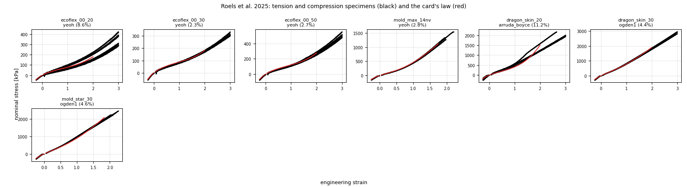
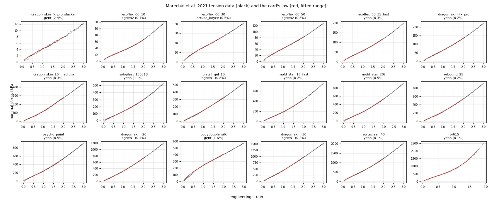

# Material library (generated)

Physical material cards fitted to public test data by `tools/make_material_library.py`; do not edit by
hand. Use a card by name, e.g. `material: ecoflex_00_30_roels2025`. Every card carries its data's
strain range (`validity`), fit uncertainty and references; `softsim material show <card>` prints them.

## Roels et al. 2025 (preferred)

Tension and compression, several specimens each, and a 3-hour compression relaxation per material
(doi:10.1002/aisy.202500699, data doi:10.5281/zenodo.14983287, CC-BY-4.0).

- **Fit:** the law is fitted to tension and compression together, so these cards hold in
  compression too.
- **Prony series:** from the relaxation hold, 1 s to 3 h. These silicones relax only 2–6% there.
- **Fast relaxation (impacts):** measured for Ecoflex 00-30 and 00-50 by Croquette et al. 2026
  (guided elastic waves, checked against a rheometer; arXiv:2604.27722), and added as Prony branches
  over 1 Hz–2 kHz without changing the response at the test rate. "Impact stiffening" is the
  small-strain shear storage modulus at 1 kHz over that at the test rate (0.06 Hz).
- **The other cards have no fast-rate data.** Impacts on them will be too soft and too bouncy.
  For comparison, the Ecoflex 00-10 drop card ([experiments.md](experiments.md)) relaxes about 70%
  within milliseconds.
- μ0 is the initial shear modulus at the test rate.
- The first second of each relaxation recording is a strain overshoot seen through a lagging load
  signal, and is left out.

| Card | Product | Law (fit error) | μ0 [kPa] | NH E [kPa] (error) | Strain range | Relaxation 1 s–3 h | Impact stiffening | Density |
| --- | --- | --- | --- | --- | --- | --- | --- | --- |
| `ecoflex_00_20_roels2025` | Smooth-On Ecoflex 00-20 | yeoh (8.6%) | 44.8 | 143.1 (11.0%) | -25–200% | 4.9% | – | typical (not in dataset) |
| `ecoflex_00_30_roels2025` | Smooth-On Ecoflex 00-30 | yeoh (2.3%) | 55.2 | 164.8 (3.7%) | -25–200% | 2.2% | 2.16× at 1 kHz | Smooth-On datasheet (specific gravity 1.07) |
| `ecoflex_00_50_roels2025` | Smooth-On Ecoflex 00-50 | yeoh (2.7%) | 71.8 | 225.7 (6.7%) | -25–200% | 5.4% | 2.42× at 1 kHz | typical (not in dataset) |
| `mold_max_14nv_roels2025` | Smooth-On Mold Max 14NV | yeoh (2.8%) | 131.8 | 501.1 (19.3%) | -25–175% | 3.2% | – | typical (not in dataset) |
| `dragon_skin_20_roels2025` | Smooth-On Dragon Skin 20 | arruda_boyce (11.2%) | 175.6 | 640.0 (20.8%) | -25–200% | 5.0% | – | typical (not in dataset) |
| `dragon_skin_30_roels2025` | Smooth-On Dragon Skin 30 | ogden1 (4.4%) | 277.2 | 972.0 (18.9%) | -25–200% | 3.0% | – | typical (not in dataset) |
| `mold_star_30_roels2025` | Smooth-On Mold Star 30 | ogden1 (4.6%) | 283.3 | 992.2 (22.6%) | -25–183% | 2.2% | – | typical (not in dataset) |

## Marechal et al. 2021

One tension curve per material, 18 silicones (doi:10.1089/soro.2019.0115, data
doi:10.5281/zenodo.3931808, ODbL).

- **Moduli are probably about 3× too low.** Strain was measured at the crosshead. For Ecoflex 00-30
  at 100% strain these data give 30 kPa, against 93 kPa from Roels et al. and 69 kPa from the datasheet.
- **Tension only:** compression is extrapolated.
- **No rate data.**
- **Prefer the Roels card** where a material has both.

| Card | Product | Law (fit error) | μ0 [kPa] | NH E [kPa] (error) | Strain range | Relaxation 1 s–3 h | Impact stiffening | Density |
| --- | --- | --- | --- | --- | --- | --- | --- | --- |
| `dragon_skin_fx_pro_slacker_marechal2021` | Smooth-On Dragon Skin FX-Pro with Slacker | gent (2.4%) | 2.2 | 7.7 (4.8%) | 0–200% | – | – | typical (not in dataset) |
| `ecoflex_00_10_marechal2021` | Smooth-On Ecoflex 00-10 | ogden2 (0.7%) | 12.9 | 31.2 (4.2%) | 0–200% | – | – | Smooth-On datasheet (specific gravity 1.04) |
| `ecoflex_00_30_marechal2021` | Smooth-On Ecoflex 00-30 | arruda_boyce (0.5%) | 16.9 | 54.4 (2.3%) | 0–200% | – | – | Smooth-On datasheet (specific gravity 1.07) |
| `ecoflex_00_50_marechal2021` | Smooth-On Ecoflex 00-50 | ogden2 (0.3%) | 28.1 | 81.2 (3.2%) | 0–200% | – | – | typical (not in dataset) |
| `ecoflex_00_35_fast_marechal2021` | Smooth-On Ecoflex 00-35 FAST | yeoh (0.3%) | 28.8 | 110.1 (5.8%) | 0–200% | – | – | typical (not in dataset) |
| `dragon_skin_fx_pro_marechal2021` | Smooth-On Dragon Skin FX-Pro | yeoh (0.2%) | 32.1 | 126.2 (5.8%) | 0–200% | – | – | typical (not in dataset) |
| `dragon_skin_10_medium_marechal2021` | Smooth-On Dragon Skin 10 MEDIUM | yeoh (0.3%) | 46.1 | 244.0 (9.1%) | 0–200% | – | – | Smooth-On datasheet (specific gravity 1.07) |
| `soloplast_150318_marechal2021` | Soloplast silicone 150318 | yeoh (1.1%) | 57.1 | 268.9 (7.7%) | 0–200% | – | – | typical (not in dataset) |
| `platsil_gel_10_marechal2021` | Polytek PlatSil Gel-10 | ogden1 (0.8%) | 58.0 | 294.2 (7.8%) | 0–200% | – | – | typical (not in dataset) |
| `mold_star_16_fast_marechal2021` | Smooth-On Mold Star 16 FAST | yeoh (0.2%) | 84.6 | 386.6 (7.9%) | 0–200% | – | – | typical (not in dataset) |
| `mold_star_20t_marechal2021` | Smooth-On Mold Star 20T | yeoh (0.5%) | 97.4 | 472.9 (8.3%) | 0–200% | – | – | typical (not in dataset) |
| `rebound_25_marechal2021` | Smooth-On Rebound 25 | yeoh (0.2%) | 99.1 | 483.0 (8.2%) | 0–200% | – | – | typical (not in dataset) |
| `psycho_paint_marechal2021` | Smooth-On Psycho Paint | yeoh (0.5%) | 107.9 | 489.5 (7.5%) | 0–200% | – | – | typical (not in dataset) |
| `dragon_skin_20_marechal2021` | Smooth-On Dragon Skin 20 | ogden1 (0.4%) | 123.4 | 651.6 (8.2%) | 0–200% | – | – | typical (not in dataset) |
| `bodydouble_silk_marechal2021` | Smooth-On Body Double SILK | gent (1.6%) | 136.9 | 426.1 (2.0%) | 0–200% | – | – | typical (not in dataset) |
| `dragon_skin_30_marechal2021` | Smooth-On Dragon Skin 30 | ogden1 (0.2%) | 176.3 | 879.1 (7.6%) | 0–200% | – | – | typical (not in dataset) |
| `sortaclear_40_marechal2021` | Smooth-On Sorta-Clear 40 | yeoh (0.1%) | 277.8 | 1111.6 (6.3%) | 0–200% | – | – | typical (not in dataset) |
| `rtv615_marechal2021` | Momentive RTV615 | yeoh (0.1%) | 342.3 | 1708.2 (10.6%) | 0–174% | – | – | typical (not in dataset) |

Errors are RMS over the fitted range, relative to each curve's largest stress. "NH E" is the
Young's modulus of a Neo-Hookean fit over the same range: a rough single-number stiffness, and
the only law MuJoCo has. For other ranges or laws, use `softsim fit-material` or
`softsim material project`.
